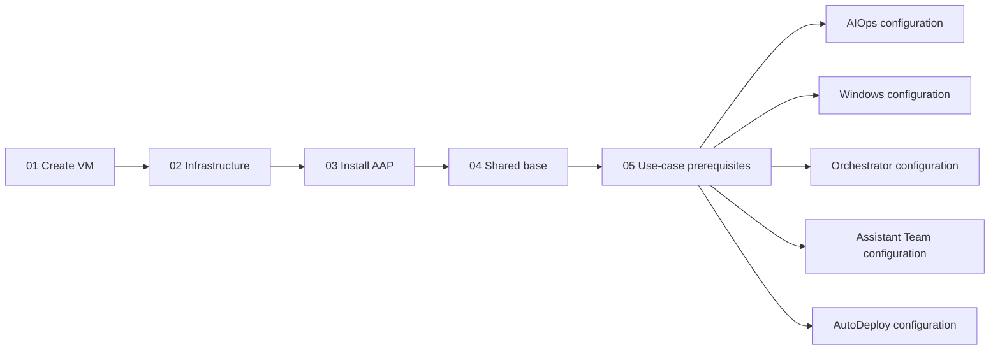

# AAP AutoDeploy and Configuration as Code

Recreate Ansible Automation Platform from configuration as code so that a new
instance can take over the production platform's tasks, including deploying and
configuring further AAP instances. An existing trusted AAP acts as the initial
seed. Demo-specific deployments remain supported through separate use-case
configurations.

A production replacement needs the platform and use-case definitions, secret
inputs, deployment automation, PAH content, execution environments and functional
verification required for those tasks. The existing fresh-instance pipeline and
selected use-case imports are parts of that goal. Fresh-target bootstrap
credential provisioning and persistent MCP access have been verified. Complete
production coverage, live rerun preservation, recursive deployment and takeover
verification remain pending.

The project provides reusable automation and CaC templates for other operators.
Populated shared and demo configuration is maintained in a separate private
repository as Vault-encrypted files.

Stage 03 allows the containerized installer up to two hours. Its existing-job
observer waits for the same ceiling without starting another installer. Set the
installation Job Template timeout to three hours to leave room for host
preparation and final health checks.

DNS creation and removal keep their API requests and responses protected with
`no_log`, including when diagnostic logging is enabled for other tasks.

Base means platform setup only. Use-case Git projects, inventories, hosts,
credentials, execution environments, templates, workflows, and EDA integrations
belong to their separate use-case configurations. Each use case has its own
deployment Job Template and encrypted configuration file.
Base also owns PAH's certified, validated, and community repository setup and
the Controller content-source credentials and organization attachments that use
those repositories. Base does not synchronize collection content. Each use case
declares which collections its own PAH preparation needs.

[PLAN.md](PLAN.md#todo) is the single project TODO list. Each open area explains
its context, purpose and completion goal; completed work is collected at
[Done:](PLAN.md#done). It includes the step-by-step operator guide and review
against Red Hat's CaC guidance. Older plans and completion notes are preserved
in Git and the decision history rather than duplicated as open work.
Current drift review uses CaC comparisons. Incremental catch-up using AAP audit
logs is planned: identify changed objects, retrieve their current configuration
and dependencies, and review differences before updating encrypted captures.
Audit checkpoints, component coverage and retention gaps still need validation.
Base implements persistent MCP token creation with a protected target-side copy.
The TODO tracks Vault-encrypted per-instance connection values in the private
base repository, separate Git write access, client configuration and CA trust.

## Current implementation

The repository contains the deployment stages and separate use-case imports:

| Stage | Playbook | Purpose |
|---|---|---|
| 01 | `01-linux-vm-setup.yml` | Clone a prepared golden image and discover the VM address. |
| 02 | `02-infra-config.yml` | Configure DNS, certificates, and the reverse proxy. |
| 03 | `03-aap-install.yml` | Prepare the VM and run the pre-staged AAP installer. |
| 04 | `04-aap-config.yml` | Apply the subscription, PAH sources and local download credentials, then shared CaC through `infra.aap_configuration.dispatch`. |
| 05 | `05-prepare-use-cases.yml` | Prepare the exact declared PAH collection versions and existing execution image before parallel imports. |

Post-install configuration uses the `dispatch` role from the
[Red Hat Communities of Practice AAP Configuration Collection](https://github.com/redhat-cop/infra.aap_configuration#readme).
It reads our CaC definitions and calls AAP APIs to create or update those objects.

Stage 04 downloads the private configuration repository's `main` branch into a
temporary directory, decrypts `cac/base_CaC_vault.yml`, and loads it before dispatch.
It also decrypts `cac/manifest.zip.vault` into a temporary ZIP and applies the AAP
subscription through `ansible.controller.license` before dispatch. The module's
`force: false` preserves an existing non-trial license on reruns. A failed import
stops configuration. A per-run Gateway token authenticates the subscription
import and dispatch. It is revoked afterward, and the temporary checkout, ZIP,
and authentication helper are removed after successful runs and ordinary task
failures. Ansible role-loading errors or interruptions can prevent cleanup.
The complete workflow described below provides automatic job handoff. On
20 October 2026 a fresh replacement completed stages 01-04, PAH prerequisite
preparation and all five captured use-case imports as individually launched jobs.
Base job 2233 verified administrator-password setup, bootstrap credential
provisioning, persistent MCP access and PAH configuration. Independent CoP/API
comparison confirmed the imported scope and identified remaining production gaps.
This establishes stage/import success; a complete workflow launch, recursive
creation of another AAP and functional demo tests remain open in the
[project TODO](PLAN.md#todo).

The separate `deploy-windows-demo.yml` imports the encrypted disconnected Windows
configuration from its private repository. `restore-windows-config.yml` remains a
local-file import utility. `deploy-orchestrator-demo.yml` imports only Automation
Orchestrator AAP definitions through a separate Job Template.
`deploy-assistant-team.yml` independently imports seven ordinary Assistant
Team deployment, lifecycle and recovery templates and their supporting AAP objects.
Its first successful live import restored all 21 owned objects; functional
deployment and recovery tests remain separate.
`destroy-test-aap.yml` handles guarded test-instance teardown.

The Windows importer creates inventory groups before linking their memberships.
The CoP group role starts requests asynchronously, so a parent group can otherwise
refer to children that do not yet exist on a clean target. A successful import
does not establish runtime collection compatibility or functional demo readiness.
The refreshed encrypted Windows capture includes patch-level assessment and
WSUS patch-ceiling templates and the managed Windows update template. Its 21
templates and 17 workflow nodes retain the existing owned dependencies; target
templates receive the Windows label without changing the source templates.
Configuration import 2270 verified the latest capture; runtime compatibility and
functional testing remain separate.

## Setup and secrets

### Complete deployment workflow and the AutoDeploy use case

The `Deploy Complete AAP` workflow runs the deployment stages on success only,
then imports AIOps Self-Healing, Disconnected Windows, Automation Orchestrator,
Assistant Team, and AutoDeploy itself in parallel. Teardown and imported demo
jobs are not workflow nodes.



Stage 01 consumes the hypervisor's next counter and publishes only `vm_name`,
`vm_ip`, and `aap_hostname` through `set_stats` workflow artifacts. The API URL
uses the discovered internal address. Stage 03 separately uses
`aap_installer_hostname` for its installer FQDN, keeping the workflow's HTTPS API
URL intact. No credentials, passwords or tokens are put in workflow artifacts.
The workflow's only survey question is `debug_logging`; saved repository URLs
are supplied on each appropriate node, and each existing Job Template keeps its
own credentials. Concurrent runs of this workflow are disabled.
Failure stops downstream success nodes. Recover manually by rerunning the failed
Job Templates with the same instance inputs, then launching the remaining stages.
Relaunching the entire workflow creates a new instance and consumes another
counter value. Installer observation remains available through Stage 03's existing
async-job identifier.

AutoDeploy is a separate use case rather than platform base. Its whole-file
Vault-encrypted `cac/autodeploy.yml` lives beside `cac/base_CaC_vault.yml` in the
existing private companion repository. It contains the workflow repository
mapping, exact deployment/use-case PAH requirements, deployment source project,
execution environment, two dedicated inventories, provisioning and environment
Vault credentials, and the deployment/import/teardown templates and surveys.
It has a dedicated `deploy-autodeploy.yml` importer and Job Template. The
importer restores the workflow on the target too, allowing that target to repeat
the same deployment sequence. The empty public structure is
[`cac/autodeploy.yml.example`](cac/autodeploy.yml.example). Populate it outside
Git, verify provisioning access, and encrypt it with the same `cac` Vault
credential before committing it privately. Provisioning keys must be dedicated
to the intended environment; do not copy an agent's GitHub SSH identity.

Stage 05 reads the separate AutoDeploy capture and shared base authentication
inputs through the base repository's existing Git credential. It synchronizes
only exact declared collection versions and their explicit dependency closure
through PAH, with upstream TLS validation enabled and automatic dependency
expansion disabled. Additional versions of one collection use separate batches,
so an older required pin is not silently displaced by another pin. Repository
requirements are restored to the complete declared set even after a failed
batch, and asynchronous PAH policy changes finish before synchronization starts.
Repository content is added rather than deliberately pruned. It then copies the execution
image already supplied by the installer bundle into Controller's runtime store
if absent; it does not pull a new image or install Python dependencies. Base
itself continues to configure empty PAH sources without synchronization.

`configure-deployment-workflow.yml` can create or reconcile the seed's workflow
without launching it. Supply `cac_workflow_vars_file` as a fully Vault-encrypted
configuration file and provide normal Controller authentication separately.
The AutoDeploy importer uses that same workflow task on replacement instances.
Existing external hypervisor, image, network, DNS and certificate services remain
environment prerequisites. Complete production coverage, runtime collection and
Python compatibility, and a fresh recursive deployment remain separate live
verification tasks. Applying the existing AIOps capture can start enabled EDA
activations; the workflow preserves that importer's existing activation policy.
The current source execution image reports Ansible Core 2.16.19 and includes
`dnspython`. The captured Windows requirement `chocolatey.chocolatey` 1.6.0
declares Core 2.18 or newer, so Windows runtime compatibility still needs a
reviewed image or requirement change and functional verification. Importing its
configuration alone does not resolve that mismatch.

### Execution environment and external prerequisites

Use an execution environment with Ansible and the required collections, including
`infra.aap_configuration`, `ansible.controller`, `redhat.rhel_system_roles`, and
`community.general`. Verify the dispatch role's dependencies in that environment.
Stage 02 uses `community.general.dig` to wait for the expected public A record.
The execution environment must include its Python dependency, `dnspython`;
project collection downloads do not install Python packages into the image.
`collections/requirements.yml` pins `infra.aap_configuration` to `4.10.0` and
`community.general` to `11.4.0`, which supports Ansible Core 2.16 or newer. Sync
both collections into the appropriate PAH repositories before project sync.
With collection downloads enabled, AAP installs it and its declared dependencies
during project synchronization. The requirements file defines which collections
are needed; Galaxy credentials attached to the project's organization define
where AAP downloads them. To use private Automation Hub's `validated` repository,
attach a Galaxy credential for that repository to the organization. Configured
sources must also provide the certified
`ansible.platform`, `ansible.hub`, `ansible.controller`, and `ansible.eda`
dependencies. This does not install Python or system packages into the execution
environment.

The target infrastructure needs the prepared golden image, installer bundle,
virtualization tools, and the DNS/certificate/proxy prerequisites described in
[documentation.md](documentation.md) and [PLAN.md](PLAN.md).

Environment access values remain encrypted in `myvars`. Platform definitions
are encrypted in the private configuration repository's `cac/base_CaC_vault.yml`;
use-case objects and credential inputs belong in their own encrypted files.
Supply the appropriate Ansible Vault password through a
local password file or an AAP Vault credential.
Each operator must prepare configuration for their own environment.

The private base contains the platform organization and setting, plus certified,
validated, and community PAH remotes, repositories, distributions, and ordered
Controller source attachments. Historical use-case objects remain separate.
Stage 04 creates a target-local, read-scope Gateway token for each missing PAH
download credential and stores it in Controller. It preserves existing matching
credentials on reruns. Base configuration never starts a collection sync.
The protected rollout completed successfully in 104 seconds. Independent API
checks verified all three remotes, repositories, distributions, and ordered
local source credentials. Public Galaxy is no longer attached to the organization.
Collection repository versions stayed unchanged and no collection sync task was
created. Existing read tokens were preserved across reruns; management and
verification tokens and the temporary configuration workspace were removed.

### Collection source policy

Project collection downloads must use private Automation Hub (PAH). Direct
public Ansible Galaxy access is not recommended; do not attach it to the
project's organization as a download source or fallback. Sync every required
certified, validated, and community collection, including its dependencies,
into PAH before synchronizing the project. Community content follows the same
policy: public Galaxy may be an upstream source for a PAH sync, while projects
download the curated content from PAH.

Attach credentials for the required PAH repositories to the project's
organization, preserving the intended source order. Protect bootstrap tokens and
provide those sources before project synchronization; job 04 cannot configure
the sources it needs to download its own dependencies. A platform-managed
public Galaxy credential may remain as an unattached object if AAP prevents
its deletion. Verify that it is absent from the organization's active sources.

Project-update execution environments also need the platform CA used by local
PAH. With a remote Podman engine, volume source paths refer to the host. Add the
installer's host-side `aap/tls/extracted` directory as a read-only mount at
`/etc/pki/ca-trust/extracted` through base
`controller_settings_base.settings.AWX_ISOLATION_SHOW_PATHS`, preserving the
existing mounts. The service container's internal path can resolve to a different
host trust store. The [base example](cac/base_CaC_vault.yml.example) shows the
generic mapping. Apply base before synchronizing the projects and keep
`GALAXY_IGNORE_CERTS` false. The live base rerun applied this setting, and both
Assistant Team project-update collection downloads then succeeded with certificate
verification.

The base PAH component configures `rh-certified`, `validated`, and `community`
repository endpoints and their upstream remotes. Public Galaxy is permitted as
the community remote's upstream; Controller projects download exclusively from
PAH. Configuring these endpoints and synchronizing their content are separate
operations. Set `sync: false` on base `hub_collection_repositories` entries and
exclude `hub_collection_repository_sync` from Stage 04 dispatch: the CoP role
otherwise defaults to synchronizing every defined repository. Creating a
distribution makes a repository available at its PAH download endpoint.

Every use-case configuration must include a `pah_requirements_demo` component,
replacing `demo` with its identifier. List required collection names and versions
under `certified`, `validated`, and `community`; include dependencies and keep
the list aligned with the use-case repository's `collections/requirements.yml`
and execution-environment requirements. Empty lists explicitly mean that a
category is not needed. This component is not a CoP dispatch variable. Stage 05
prepares and verifies the consolidated encrypted `cac_workflow_pah` catalog
before importing Controller projects; keep that catalog aligned with each
use case's source requirements. Its exact batches preserve separately required
older versions. Do not overwrite other use cases' requirements when extending a
shared PAH remote's collection list.

Encrypted base declares `pah_collection_policy`. Stage 04 sets and verifies
`sync_highest_versions: 1` on all three remotes and `retain_repo_versions: 1` on
their repositories, without synchronizing content or deleting collection
releases. This API extension is needed because the installed collection remote
module does not expose `sync_highest_versions`. The public base example contains
the generic policy template; actual environment configuration remains encrypted.

Collection release curation is a separate, preview-first operation in
`pah-collection-retention.yml`. It keeps the newest installed version of each
collection within each managed repository, then preserves versions justified
by reviewed project, playbook or execution-environment requirements and their
dependency closure. The same collection may occur in multiple repositories;
another repository's newer release does not remove this repository's latest,
and its older latest does not preserve obsolete copies in this repository.
The curator does not discover the newest upstream release. Stage 05
owns the separately declared synchronization requirements and preserves explicit
older pins when preparing content.

Pruning needs `pah_collection_requirements_audit` from encrypted configuration
or protected external input. The [audit example](cac/pah_requirements_audit.yml.example)
shows the schema. Review every current project at its deployed Git revision,
including nested playbook requirements and referenced execution-environment
requirements; record source paths, file SHA-256 digests and actual requirements.
Declare absence of requirements explicitly. Match every live execution
environment to its reviewed source or an inventory of an image pinned by digest.
Project revision and image-string checks detect declared configuration changes;
they do not prove that a mutable image tag still resolves to the same image or
that an image was built from its declared project source. Resolve that uncertainty
before marking the audit complete. Existing captured versions are not evidence
that a project requires those versions.

Use an external client or a different seed AAP against an idle target. The
curator refuses active target jobs and project updates, including its own job if
launched on the target itself; no target-side curation JT is provisioned. PAH
tasks, unknown or changed requirements, missing dependencies, unsupported
version constraints and nonstable releases also block pruning. Preview does
not change the target. Before apply, establish a maintenance window that prevents
new target job/workflow launches, project updates and other PAH writes until
verification finishes. The idle preflight and repository baseline comparisons
are checks, not a continuous lock on Controller or PAH. An optional
`pah_retention_plan_file` saves the protected
preview under `/tmp` with mode `0600`, outside Git. To apply, set
`pah_retention_operation: apply` and supply the reviewed
`pah_retention_approved_plan`; an exact plan and repository-baseline comparison
prevents applying a stale preview. Apply removes only obsolete associations
from the managed repositories and verifies the retained content. It performs no
global content deletion or orphan cleanup. A complete current production audit
and recurring execution remain [TODOs](PLAN.md#todo); base deployment does not
silently enable deletion or schedule curation.

A one-time cleanup on 2026-10-20 reduced the deployed repositories from 263 to
16 collection releases across 15 collections: certified retains 10, community
retains five, and validated retains one. It kept the newest release already
present for each collection plus `redhat.rhel_system_roles` 1.120.5, which two
projects explicitly pin, alongside 2.4.2. The three collection remotes now have
exact requirements, explicit dependency closure, and `sync_highest_versions: 1`.
Repository snapshot retention remains one. That maintenance preceded the
declarative base policy above; recurring cleanup remains a TODO. Content
was removed from repository snapshots without a global orphan cleanup, so these
counts do not establish reclaimed storage.

Use the collection remote's `sync_highest_versions: 1` to limit version selection
on a future sync. `retain_repo_versions: 1` only retains one repository snapshot;
it does not remove older collection releases from that snapshot. Pin the required
versions in remote requirements and include their complete dependency closure.
When that closure is explicit, set `sync_dependencies: false` so broad dependency
constraints do not download additional releases. Preserve older exact pins that
projects still require alongside the newest retained release. A remote selection
limit does not remove collection versions already present: pruning is a separate,
audited repository operation. See the [Pulp Ansible changelog](https://pulpproject.org/pulp_ansible/changes/)
for `sync_highest_versions` and the [repository retention guide](https://pulpproject.org/pulpcore/docs/user/guides/update-repo-retention/)
for snapshot retention.

The installed `ansible.hub.collection_remote` module does not expose
`sync_highest_versions`. Stage 04 now applies that setting through the dedicated
`pah_collection_retention` API extension after CoP dispatch creates the sources.
Keep the encrypted base configuration aligned with the live remote requirements;
do not replace it from an older plaintext export.

PAH has separate authentication purposes: upstream Red Hat tokens authorize
future certified/validated synchronization; local PAH credentials authorize
repository management and downloads. Base configures upstream URLs without
requiring an upstream token or downloading content. Supply encrypted upstream
tokens before a later use-case synchronization. Omit `auth_url` during URL-only
setup: Hub requires `token` whenever `auth_url` is specified, even without a sync.
Stage 04 validates this pair before changing the target.

The encrypted base's `pah_base` defines the organization and three ordered
`download_credentials` entries, each with `name` and `repository`. Stage 04 builds
their local URLs from the explicit target `aap_hostname`, creates target-only
read tokens, and saves them in Controller's Galaxy credentials. These persistent
download tokens are distinct from the temporary write token used for management,
which also supplies `hub_token` to the CoP Hub roles and is revoked afterward.
The unsupported AAP 2.7 `ansible.hub.ah_token` creation module is not used.

On reruns, an existing credential must have the expected organization, Galaxy
type, local URL, no external authentication URL, and a stored token. Type checks
use the name returned by the API's summary, which omits the kind. A mismatch
stops for review; the importer never silently repoints a credential or rotates a
hidden token. Token presence does not establish validity; expiry or revocation
requires credential repair. A new token is revoked after a failed save only if
a follow-up lookup proves the credential absent. An uncertain save retains the
token for inspection. Target tokens stay in the target's encrypted credential
store rather than being copied into a base intended for future instances.

The final organization association replaces its Galaxy source list with the
three PAH credentials in certified, validated, community order. An installed
public Galaxy credential can remain unattached. No imported use-case jobs,
workflows, activations, project synchronizations, or collection syncs are launched
by this base extension. Sensitive tasks stay protected even with ordinary
`debug_logging` diagnostics enabled.

### Stage 04 inputs

Supply `aap_hostname` as the full HTTPS URL of the target AAP. Use an internal
hostname that resolves to the internal IP, or the internal IP itself, to keep
configuration traffic on the internal network. The execution environment must
be able to reach that address. Stage 04 requires this explicit URL and has no
fallback based on `vm_name` or `vault_domain`; it does not require `vm_name`
or `vm_ip`.

Supply `aap_config_repo_url` as the HTTPS Git URL of the private configuration
repository. Stage 04 always uses `main`; it requires these Vault-encrypted files:

- `cac/base_CaC_vault.yml`: the shared YAML configuration.
- `cac/manifest.zip.vault`: the complete subscription manifest ZIP, encrypted as
  a whole file. Keep the original archive intact before encrypting it.

Use a read-only token with access to that repository.
Do not put the token in the URL or extra variables.

Private-repository read tokens are bootstrap credentials: the job needs one
before it can download and decrypt the configuration. Store the runtime copy in
an AAP custom credential that injects `CAC_GIT_TOKEN`, and attach the credential
for the selected repository to that use case's deployment template. Keep a
recovery copy in a separately encrypted bootstrap vault outside the configuration
checkout. A token stored only inside the repository it unlocks cannot bootstrap
its own download. Different tokens can use the same custom credential type;
changing one use case's token must not replace another use case's credential.

The encrypted base can also hold bootstrap credential inputs for a trusted
replacement AAP: its base-repository Git token, CaC Vault credential, and
use-case repository tokens. The seed must already have the initial Git token and
Vault password independently. Storing the Vault password inside the encrypted
base supports provisioning another trusted instance; it cannot unlock the first
seed or recover a lost decryption key by itself. Keep the initial recovery copy
separately. Every instance receiving these credentials gains their configuration
access and belongs to the same trust boundary. Step 04 now creates the four
separate Git-token credentials and the Vault credential with identifier `cac`
from these inputs, after applying shared base configuration. It creates or reuses
the compatible `CAC_GIT_TOKEN` credential type. An existing name with another
organization, credential type, Vault identifier, or Git injection schema stops
the run for review. Existing hidden secret values are preserved on reruns;
credential rotation remains a separate operation. Both bootstrap input mappings
may be omitted for a base that does not provision replacement access; supplying
only part of the set is rejected.

This step provisions configuration access, not the deployment project's own
inventories, environment credentials, projects, Job Templates or workflow. Those
objects belong to the separate AutoDeploy use case.

These tokens serve a different purpose from Source Control credentials created
on the target AAP. Those credentials allow imported projects to synchronize
their private playbook repositories and belong in their use case's encrypted
configuration.

Attach these credentials to the Stage 04 job template:

- A custom Git credential that injects the token as `CAC_GIT_TOKEN` in the job
  environment. Git reads it through a temporary askpass helper; it is not embedded
  in command arguments or written into the checkout's Git configuration.
- A Vault credential with identifier `cac` and the private configuration's password.
- The existing Vault credential that decrypts `myvars`, using its original/default
  identifier. `myvars` still supplies environment settings and installer SSH access.

AAP supplies the attached Vault passwords to Ansible at launch. `include_vars`
decrypts the shared YAML and `copy` with `decrypt: true` restores the manifest ZIP
with mode `0600` inside the job's private temporary directory. Both use the same
`cac` Vault credential; the playbook does not retrieve its password through AAP's
API or require it in extra variables. The license module uploads the restored ZIP
to the target AAP before the dispatch role applies object configuration.

The encrypted base may define `aap_password` and an `aap_user_accounts_base`
entry whose username is `{{ aap_username }}` and whose password is
`{{ aap_password }}`. This declares the desired administrator password. Step 04
tries that login first. If it is not active yet (HTTP 401), or no password was
configured, the playbook reads the current `gateway_admin_password` from the
deployed installer inventory over SSH using `vault_ansible_user` and
`vault_ansible_password` from `myvars`, with sudo access. The bundle path uses
`installer_extract_dir` and `aap_version`. Other authentication or connection
errors stop the run; they do not trigger a bootstrap attempt.

The successful login password is retained only in a protected, noncached fact
for pre-rotation PAH download-token creation. On a fresh instance this is the
installer password; on a configured-password rerun it is the configured password.
The desired `aap_password` remains unchanged. This lets Stage 04 issue the local
PAH credentials before the administrator's desired password has been applied.
No password is passed in workflow statistics or artifacts.

The CoP `gateway_users` role applies the declared administrator account using
the temporary configuration token. Step 04 then verifies the configured password
with a fresh login. After using installer bootstrap, it also updates that
deployed inventory's Gateway password, so subsequent use-case importers can
still read the current login there. Password operations remain protected even
with diagnostic logging enabled. A rerun with the configured password already
active does not require reading the installer inventory. Existing targets can supply their
current encrypted `aap_password` without a managed administrator entry.
`aap_username` defaults to the administrator account and may be overridden.

Live job 2125 applied the password through the CoP Gateway user role, verified
that login, and synchronized the deployed installer inventory with mode `0600`.
Job 2128 successfully reran using the configured password, skipping installer
reads, bootstrap-token creation and inventory changes. Independent verification
used trusted TLS and confirmed both logins, matching installer configuration,
no remaining run tokens, and unchanged use-case object counts. Both jobs removed
their temporary checkout and revoked their run token.

Step 04 creates a write-scope token through `/api/gateway/v1/tokens/` using the
current Gateway login. The Controller license module and dispatch then use
Bearer-token authentication. Dispatch runs inside the cleanup block so the
token remains valid until configuration ends. Cleanup revokes the token after
success or an ordinary task failure and removes the workspace even if revocation
fails. Fatal role-loading errors or interruptions can skip Ansible's cleanup;
such runs require checking for a leftover token.

### Persistent MCP access from base

After applying base and verifying the final administrator login, Step 04 creates
an `MCP admin token` owned by the administrator account with API scope `write`,
which allows both reads and writes within that account's permissions. This token
belongs to the target installation and survives temporary run-token cleanup.

The token value is returned only once by the API. Step 04 saves a recoverable JSON
copy at `/var/lib/aap-autodeploy/mcp-token.json` on the target through the existing
guest SSH/sudo credentials. The directory is root-owned with mode `0700`; the
file is root-owned with mode `0600` and saved atomically. Its fields are `target`,
`username`, `scope`, `id`, `token` and `expires`. An authorized operator can read
this protected file on the target when configuring an external MCP client.
The value is never printed or written to the checkout. Secret tasks stay protected
even when `debug_logging` is enabled. Base reruns therefore require guest SSH/sudo
access for this file even when installer-password bootstrap is unnecessary.

Reruns check the saved target, owner, scope and token ID, then authenticate with
the saved bearer to verify that it remains valid. Missing or mismatched API
metadata, expired/revoked access, duplicate tokens or unsafe storage permissions
stop for review without automatic rotation. If a manually created matching token
exists without a saved copy, it is preserved and a non-secret notice explains
that the API cannot recover its value. Its expiry metadata is checked, but the
hidden bearer cannot be tested without a copy. Retain the operator's existing copy or
plan explicit rotation. The playbook does not issue a duplicate token to replace it.

If saving a newly generated token fails, cleanup revokes it only when inspection
proves that its recoverable copy was not saved. An inconclusive storage check
preserves the token for operator inspection; a saved persistent token is never
revoked by ordinary run cleanup. Process termination or a lost token-creation
response can still require manual inspection. Run this provisioning serially for
each target; concurrent base jobs are not a token-rotation mechanism.

This implements target-side token creation and recovery storage. Fresh base
job 2233 and independent target checks verified live provisioning and MCP access;
live rerun preservation remains in the [TODO](PLAN.md#todo). Vault-encrypted
per-instance Git write-back, external client configuration and certificate trust,
and controlled rotation are also pending. Current target-side storage needs no
additional repository write credential.

For AAP 2.7, dispatch excludes the legacy `controller_applications` role because
`ansible.controller` 4.8.11 does not contain its application module. Dispatch's
`gateway_applications` role applies `aap_applications` through `ansible.platform`.
Other Controller configuration roles remain enabled.

The execution environment must provide `ansible.controller.license` and Git,
and trust the repository server's TLS certificate. HTTPS redirects and stored
Git credential helpers are disabled for this download. Submodules are not
fetched. Git servers must accept token authentication using the `x-access-token`
username, as GitHub does.

### Step 04 debug logging

`debug_logging` defaults to `false` in both the playbook and its Job Template.
An optional true/false survey can override that default for a launch. Boolean
values and the survey strings `true` and `false` are accepted; other inputs fail
playbook validation. With the multiple-choice survey enabled, API launches must
send `debug_logging` as the quoted string `"true"` or `"false"`, matching the
survey choices; the playbook converts it to a Boolean. `false` enables ordinary
role `no_log`, while `true` enables their troubleshooting output through the
dispatch collection's inverse `aap_configuration_secure_logging` setting.
Step 04 authentication, decryption, variable combination, credential operations,
and remote-token handling always remain protected. Keep the saved default at
`false`. The separate AIOps importer also uses the `debug_logging` name.

Stage 03 still uses `vm_name` and `vault_domain` to form the installer's fully
qualified hostname. That hostname can resolve internally; Stage 04's explicit
API URL determines how the configuration job connects.

### Recover interrupted Stage 03 monitoring

The Job Template's overall timeout must allow for host preparation as well as
the installer's own 7,200-second async limit. A 3,600-second template timeout
stopped an earlier live run while its remote installer was still running; the
installation template now allows 10,800 seconds. A timeout does not establish an installer
failure or justify starting another installer.

To inspect that existing installation, launch Stage 03 with the same `vm_name`
and `vm_ip`, plus `aap_installer_resume_job_id` from the original job's async
events. For example, use a placeholder such as `j123456789012.34567`, replacing
it with the actual identifier. This mode skips host preparation, installer
inventory edits, and installer launch. It waits for the existing async result
under the installer account, then runs the Controller health check only if the
installer reports exit code zero. Installer output remains protected.

Resume mode cannot extend the original remote async limit. Missing results,
timeouts, and unsuccessful installer exits require inspecting protected installer
logs before any installation retry. A listening HTTPS port alone is insufficient
to establish successful installation.

Live resume job 2008 verified the original installer's successful exit and an
HTTP 200 Controller ping; the installer-launch task was skipped.

Administrator password management comes from the encrypted base configuration.
Removing the remaining `myvars` dependency is separate pending work. Automatic
job handoff and the five parallel configuration imports are implemented in the
complete workflow; full-workflow execution and functional remediation tests
remain open.

### AIOps configuration deployment

Run `deploy-aiops-demo.yml` through its own Job Template only after Step 04 has
finished on the chosen target. This job loads `cac/aiops_demo.yml` from the
private repository's `main` branch. It does not load base or the subscription
manifest, and it does not launch any of the imported demo Job Templates.
Applying enabled EDA activation definitions can start those activations.

The template uses the same execution environment, project, and three credentials
as Step 04. Supply the target's explicit `aap_hostname` and
`aap_config_repo_url`. `debug_logging` defaults to `false`; the optional survey
accepts the quoted strings `"true"` and `"false"` for API launches. Authentication
uses the current encrypted `aap_password`, or the installer SSH fallback described
above. A temporary Gateway token is revoked after configuration.

The encrypted AIOps file must declare `aiops_configuration_ready: true` after
review, a list named `aiops_required_secret_variables` (empty is allowed), and
`aiops_eda_controller_credential_name` / `aiops_eda_organization_name`. Required
secret variables must be supplied, nonempty, and contain actual secret values.
These checks stop incomplete captures before target API changes.

Deployment applies Controller resources and EDA credentials, projects, and
decision environments first. It then creates Event Streams with
`ansible.eda.event_stream`, and finally applies the rulebook activations through
the CoP role. After initial dispatch, a supplemental project task preserves
`update_revision_on_launch` and its cache timeout when declared in the vault;
CoP 4.10.0 does not forward those settings. It waits for the project without
triggering a second sync. Initial dispatch excludes both `eda_event_streams`
and `eda_rulebook_activations`. CoP 4.10.0 includes an Event Stream role, but
its data items expect `organization`; our dedicated module definitions use
`organization_name`. Excluding that role keeps stream creation in the explicit
step, after prerequisites and before activations. The vault must contain
nonempty `eda_event_streams_aiops_demo` and
`eda_rulebook_activations_aiops_demo` lists, with every activation mapping
referencing an Event Stream defined in the vault. References use names and
rulebook source names or indexes; target IDs and stream UUIDs are generated on
the new instance. External event publishers are outside this deployment's scope.

The EDA Controller credential in `eda_credentials_aiops_demo` uses the CoP
item keys `organization` and `credential_type`. It must use the target URL plus
`/api/controller` for `inputs.host`, and
`aiops_controller_access_token` for its
`inputs.oauth_token`. On first deployment the playbook generates a persistent
target-specific Gateway token and immediately stores it in that EDA credential.
It never copies the source instance's token. On reruns it preserves the existing
credential and token, checking organization, credential type, target URL, and
other declared settings. A mismatch requires review rather than automatic token
replacement. This check cannot verify the hidden token's validity or expiry.

The persistent EDA token remains available after the job. If deployment fails,
cleanup revokes a newly created token only when a successful API lookup proves
that its EDA credential was not saved. An inconclusive lookup preserves the token
for inspection, avoiding revocation of a token already needed by EDA. Ordinary
cleanup still revokes the temporary configuration token and removes the checkout.
Fatal role-loading errors and interruptions have the same cleanup limitations as
Step 04. This job deploys AAP configuration; external environment setup and
functional remediation verification are separate work.

Never commit plaintext secrets or sensitive environment-specific data, including
account names, hostnames, addresses, tokens, or keys. Vault-encrypted files/values
are allowed. Keep `vpf` and other Vault password files outside Git. Ignore rules
are a convenience; inspect staged files before committing.

### Disconnected Windows configuration deployment

Run `deploy-windows-demo.yml` through its own Job Template after shared base has
been applied. Supply `aap_hostname` as the explicit target HTTPS URL and
`aap_config_repo_url` as the private Windows configuration repository's HTTPS Git
URL. It reads only the fully Vault-encrypted `cac/windows_disconnected.yml` from
`main`. The attached Git token must have read access to this repository; access
to another demo's private repository does not imply access here. For a fine-grained
token, include the chosen configuration repository in its selected repositories
and grant repository contents read access. The Git credential remains separate
from the Vault credential needed to decrypt the downloaded configuration.

Git failures report only a fixed category: repository access/not found, DNS,
TLS/certificate, redirect, connection/timeout, or an unclassified failure. Raw Git
errors and credential data stay hidden, including with diagnostics enabled.

Attach the same three credential types used by Step 04: the custom Git token
injecting `CAC_GIT_TOKEN`, the `cac` Vault credential, and the existing Vault
credential for `myvars`. Administrator authentication comes from an explicitly
supplied protected `aap_password`, or the installer password retrieved over SSH
using the existing environment settings. A temporary Gateway token authenticates
the import and is revoked afterward; the checkout and askpass helper are removed
on success and ordinary task failures.

The vault must set `windows_disconnected_configuration_ready: true` and list its
required secret variables in `windows_disconnected_required_secret_variables`.
Every listed value must be present and nonempty. The importer restores inventory,
credentials, projects, execution environments, Job Templates, and workflow
definitions through CoP dispatch. It rejects job-launch and schedule definitions
and excludes dispatch's launch roles. It does not apply the subscription or shared
base, run the imported automation, or change Windows machines.

When the encrypted capture declares `windows_disconnected_ad_target_enabled`,
the importer also prepares the AD extension's encrypted target credential for
this platform. It reads public SSH host keys and the host and installed-platform
CA bundles over the
existing installer SSH connection and verifies the target HTTPS chain and
hostname before saving the credential. Runtime AD configuration uses this
platform's credentials and trust, rather than a previous validation instance.
The imported Windows workflow contains the AD provisioning branch; importing
its definitions still launches no jobs and enables no LDAP authenticator.
The installed-platform bundle uses the existing containerized-installer trust
path; a protected `windows_disconnected_ad_target_ca_path` can select another
verified layout. Certificate and hostname validation remain required.
Diagnostic logging can show this public-trust read command's error; passwords,
decryption and credential updates remain protected.
TLS verification reads the certificate files directly so Unicode comments in
the public trust bundles are accepted.

`debug_logging` defaults to `false`, with the same optional `"false"`/`"true"`
survey choice as other import templates. Authentication, decryption, wildcard
variable combination, and credential updates remain protected even when enabling
diagnostics. Ordinary object operations follow the diagnostic choice. Syntax and
seven focused readiness, secret-input, and execution guards have passed. Fresh
configuration import 2248 succeeded, and follow-up 2270 imported the latest
earlier 21-template capture. Independent API checks verified the added template and
supporting configuration. Imported patching/deployment jobs were not run by those
checks; runtime testing remains in the project TODO.
The AD extension's refreshed encrypted capture contains 32 templates and a
29-node workflow. Its Vault, reference and actual CoP rendering checks passed;
live import and AD provisioning are separate validation.

### Automation Orchestrator configuration deployment

Use `deploy-orchestrator-demo.yml` after shared base to import the Orchestrator's
AAP objects. Supply `aap_hostname` as the explicit target HTTPS URL and
`aap_config_repo_url` as its private configuration repository's HTTPS Git URL.
The importer downloads `main` and loads only the whole-file Vault-encrypted
`cac/orchestrator.yml`. Attach the custom Git credential with read access to
that repository (`CAC_GIT_TOKEN`), the `cac` Vault credential, and the existing
Vault credential for the environment settings in `myvars`. A protected
`aap_password` may be supplied; otherwise it retrieves the current installer
password over SSH. Git failures disclose only a fixed diagnostic category.

The capture's `orchestrator_capture_readiness` mapping must set
`aap_object_definitions_complete`, `static_secrets_recovered`, and
`portable_to_new_aap` to Boolean `true`, with an empty `remaining_review` list.
Its registry username and password must be populated inside the encrypted file.
A pending functional OpenShift test does not prevent importing reviewed AAP
objects. Job-launch, workflow-launch, and schedule definitions are rejected.

The current capture defines eight objects: two Job Templates, one project,
one inventory and its localhost host, one execution environment, one registry
credential, and one label. The import preserves the deploy and cleanup surveys.
Use `Orchestrator EE` consistently for the execution environment definition,
the project's default environment, and both Job Templates. These references
must resolve within the imported configuration on a clean target.
Their AAP/OpenShift inputs are supplied when those imported templates are run;
they are separate from the importer's own target URL and administrator login.
The encrypted localhost definition preserves job-time Python selection:

```yaml
ansible_python_interpreter: !unsafe "{{ ansible_playbook_python }}"
```

The `!unsafe` YAML tag prevents the importer's Jinja evaluation from replacing
the expression with its own Python path. AAP stores the expression as ordinary
host-variable text, and each imported job evaluates it in its own execution
environment. Use the tag for this deferred value inside the encrypted capture.
Live configuration import 2273 succeeded; a separate verified HTTPS read confirmed
the inventory retains the literal expression. The application templates were not
launched for this verification.
The importer does not apply base or the subscription, launch either imported
template, deploy OpenShift resources, or perform cleanup operations.

`debug_logging` defaults to `false`, with the same optional `"false"`/`"true"`
survey as the other import templates. Git authentication, Vault loading,
registry credentials, wildcard combination, and temporary Gateway-token tasks
remain protected during diagnostics. Ordinary object operations follow the
logging choice. Each run revokes its own temporary Gateway token and removes
its checkout on success or ordinary failure; checkout cleanup also runs if token
revocation fails. Interruptions and fatal role-loading errors can prevent cleanup.

Focused offline validation exercises actual Vault loading and eleven import
preflight cases, including plaintext rejection, missing secrets, incomplete
review, and attempts to execute automation. Three failure scenarios verify token
revocation and workspace cleanup. The first live definition import completed
successfully; the imported deployment and cleanup templates were not launched.

### Assistant Team configuration deployment

The private companion repository stores the encrypted capture at
`vaults/cac/assistant_team_vault.yml`. Its editable working copy and export
inventory stay outside Git. The code repository is public, so its projects no
longer require an SCM credential for private code. Access to the private companion
repository remains a separate bootstrap requirement.

Use `deploy-assistant-team.yml` after shared base. Supply `aap_hostname` as the
explicit target AAP HTTPS URL and `aap_config_repo_url` in the form
`https://GIT_HOST/OWNER/REPOSITORY.git`. The importer downloads `main` and loads
only `vaults/cac/assistant_team_vault.yml`. Use the existing custom CaC Git-token
credential type, which injects `CAC_GIT_TOKEN`, with read access to this private
repository. Attach that credential, the `cac` Vault credential, and the existing
Vault credential for `myvars`. Reusing the type does not grant repository access;
the attached token must authorize this repository. A separate credential of the
same type can hold a different token without changing other use cases' access.
Git uses a temporary askpass helper with HTTPS certificate verification enabled;
the token stays out of URLs, command arguments and the helper's stored contents.
For public code projects, omit the source-control credential field. An empty
credential name can make the Controller module match every credential and fail.

The target administrator input follows the other importers: supply a protected
`aap_password`, or let the importer retrieve the current installer password over
SSH using the encrypted environment settings. It creates its own temporary
Gateway token, revokes that token, and removes the private checkout after success
or ordinary failure. Checkout cleanup still runs if token revocation fails.
Interrupted jobs and fatal role-loading failures retain the existing cleanup
limitation. `debug_logging` defaults to `false`; authentication, credential
updates, Vault loading and wildcard combination remain protected during debugging.

Capture the current project revisions, deployment and recovery templates, and
external configuration credential definitions together. The injected inputs are
encrypted file snapshots from the private companion; do not restore obsolete
Vault paths inside the code repository or assume that a historical release still
includes environment configuration. Preserve the existing encrypted authentication
snapshots without refreshing provider credentials during a configuration export.

The capture also declares its collection requirements for PAH and its execution
environment image and pull policy. Prepare the required content through PAH
before project synchronization; validated object definitions do not establish
that collections or container images are available on the target.

Seven ordinary deployment, lifecycle and recovery templates are captured in the
standard Controller variable lists. Authentication maintenance is captured separately under
`assistant_team_authentication_maintenance`, outside default CoP dispatch.
Activate that optional section explicitly with repository write access, controller
authorization and CA trust for the target AAP. A maintenance token or certificate
bundle from the source AAP must not be treated as valid for another instance.
Keep unresolved optional inputs in the protected readiness report. The ordinary
import requires Boolean readiness for ordinary objects, deployment configuration,
static secrets and embedded encrypted configuration, with empty unresolved and
required secret lists. It verifies all six embedded snapshots are whole-file
Vault ciphertext and rejects launches and schedules. Overall capture readiness
can remain false while optional maintenance or functional testing is outstanding;
this does not authorize importing maintenance or executing runtime automation.

The current lifecycle capture includes the Shutdown template and controlled VM
name surveys for fresh deployment and retirement. Retirement defaults to a
preview and requires an explicit confirmation to delete. Arbitrary launch extra
variables are disabled on these three lifecycle templates. The deployment-test
project pins the reviewed application release and explicitly selects the owned
execution environment.

The encrypted configuration also defines a nonadministrator inventory service
account, a long password, and its administrator grant on the dedicated Assistant
Team inventory. CoP imports these prerequisites before the templates. The importer
reuses the captured lifecycle credential schema, then issues a token on the new
target using that service account. Source-instance tokens and inventory IDs are
never copied. New target deployments register their guests; existing source guest
registrations stay outside this dedicated capture's owned scope.

The service token is stored on its target at
`/var/lib/aap-autodeploy/assistant-team-inventory-token.json`, in a root-owned
directory with mode `0700` and a regular file with mode `0600`. The resolved
credential contains that target's URL, inventory ID, CA and token. Reruns preserve
the password and token and verify the stored binding and credential checksum.
An existing service account must authenticate with its encrypted password before
any definition updates. Its password is then omitted from user updates, so other
metadata changes cannot reset it.
Duplicate or expired tokens, unexpected privileges, incompatible credential
schemas, changed CA/URL/inventory bindings, and existing access without a
recoverable token copy require review. Only a newly issued token proved not to
have been saved is revoked after a failed first setup.

Lifecycle clients require verified HTTPS. The importer reads the installed CA
from the target over the existing trusted SSH connection, and verifies the URL
before creating lifecycle resources. By default the CA is below the installer
user's `aap/tls/extracted/pem/directory-hash/ca-bundle.crt`; an encrypted lifecycle
`ca_path` can select another installed trust file. The supplied `aap_hostname`
must match a certificate DNS or IP SAN and be reachable from the execution
environment. Trusting a CA alone does not make an unmatched IP address valid.
This check does not disable certificate verification or replace certificates.

Verify the declared PAH collections and existing service-side execution
environment image before launching the import Job Template. The importer restores
definitions only; it does not launch VM lifecycle, recovery, provider requests or
authentication-maintenance operations. Offline validation exercises actual Vault
loading, core completeness, encrypted snapshots, repository URL guards and token
cleanup. A successful import is separate from testing the imported automation.

Live import job 2139 succeeded with protected logging after the declared certified
collection was synchronized through PAH and the existing execution image verified
in the Controller runtime's image store. Independent, TLS-verified API comparison
passed 396 checks across all 21 owned objects, including both synchronized public
code projects, six templates, credential attachments and protected snapshot inputs.
The temporary Gateway token and checkout were removed. Optional authentication
maintenance and the imported VM lifecycle, recovery and provider operations were
not run.

## Start a CaC configuration

The checkout includes two plaintext examples with empty resource lists:

- [cac/base_CaC_vault.yml.example](cac/base_CaC_vault.yml.example): shared objects.
- [cac/project.yml.example](cac/project.yml.example): per-demo objects.

Copy them into an operator-owned working directory outside Git before filling in
actual values. The commented entries use generic placeholders; replace the empty
lists with your resource definitions. Give every per-demo variable the same
unique suffix, such as `controller_projects_DEMO_PLACEHOLDER`, and reference
dependencies by object name. Keep configuration authentication separate from the
credentials that demo jobs will use inside AAP.

Keep editable files such as `base.yml` and `DEMO_PLACEHOLDER.yml` in that
working directory. When a configuration is ready:

1. Create a separate Vault-encrypted copy using the local Vault password file.
2. Place that encrypted copy in the private configuration repository's `cac/`.
   Use `base_CaC_vault.yml` or `DEMO_PLACEHOLDER_CaC_vault.yml` as its name.
3. Verify the Vault header, successful decryption with the intended password,
   and equality with the working copy without displaying decrypted content.
4. Review staged files, then commit and push only the encrypted configuration.

The AIOps-specific filename is `aiops_demo.yml`; its contents are still whole-file
Vault encrypted in the private repository. Its editable copy and extraction
inventory stay outside Git. Only the current working demo is selected; older
test objects are listed separately. Shared source inventory, SSH credentials,
and runtime environments are copied under AIOps-specific names for independent
ownership. Source objects remain untouched.

Keep the editable working files and Vault password file outside Git. This public
repository's `cac/` retains the empty examples. Stage 04 loads the private shared
base automatically. The separate AIOps entry point loads `cac/aiops_demo.yml`;
adding other encrypted demo files does not apply them automatically.

See [Configuration_as_Code.md](Configuration_as_Code.md) for variable naming,
resource types, and restore dependencies. Empty templates do not provision
resources and have not been tested as populated demo configurations against AAP.

## Version maintenance

`VERSION` tracks this project's source version independently of `aap_version`
in `vars/main.yml`, which selects the AAP installer.

The initial source baseline is `0.0.1`. After that baseline, increment the version
once for every commit, including documentation and decision-history commits:

```bash
# Fixes, documentation, history, and other non-feature changes:
python3 src/bump-version.py

# Features: increment minor and reset patch:
python3 src/bump-version.py --feature
```

The helper locates `VERSION` relative to its own project directory. It preserves
the major version and refuses invalid version text. It and its tests need only
Python 3's standard library; no dependency installation or build step is required.
Follow standard Python formatting with four-space indentation.

Update [RELEASE_NOTES.md](RELEASE_NOTES.md) for each version. Commit implementation
and relevant README changes together. Add the implementation commit ID to
[design_decisions_history.md](design_decisions_history.md) in a following
documentation commit when necessary; that commit also increments patch.
Use "Document" in documentation-only commit subjects and summaries.

For a requested release, push an annotated `v<VERSION>` tag on the commit whose
`VERSION` matches, then publish the matching GitHub release. A branch version
increment alone is not a published release. Release notes must state what was
verified and whether deployment was performed. Later documentation commits can
advance the branch beyond the released version.

## Validation

Run the local tests and whitespace check:

```bash
python3 -m unittest discover -s tests -v
git diff --check
```

The version-tool tests need only Python's standard library. The dispatch
regression additionally needs Ansible, PyYAML, and the declared runtime
collections installed in the selected Python environment. It explicitly skips
when these dependencies are unavailable. Set `ANSIBLE_COLLECTIONS_PATH` to their
installation directory when needed. It runs the real CoP dispatcher in check
mode against synthetic definitions, without contacting AAP, and verifies that
streams and activations stay out of initial dispatch. The Orchestrator regression
uses synthetic encrypted captures for its actual preflight tasks and a local HTTP
fixture for token cleanup; it does not contact AAP or run imported automation.
It also exercises the installed CoP wildcard combination and host-parameter
rendering with different import/job Python paths, checking that a literal
interpreter expression survives storage and resolves at job runtime.
The Assistant Team regression additionally checks ordinary core completeness,
preserved encrypted snapshots and separation from optional maintenance, plus HTTPS
repository URL rejection, required token injection and cleanup after failed imports.
The inventory-service regression covers first setup, protected storage, token
reuse, masked credential checksums, privilege/schema/binding collisions, expiry,
and both confirmed and uncertain save failures using synthetic secrets.
The Gateway login regression checks initial password bootstrap, reruns without
installer access, legacy installer-only configuration, rejected passwords and
server/access failures, while verifying that secrets stay out of output.
The MCP regression exercises creation, protected recovery storage, rerun reuse,
manual-token preservation, rejected saved access, and failed-save cleanup using
a local HTTP fixture and a local substitute for the target-side filesystem.

These checks do not run AAP jobs. Ansible syntax checks alone do not verify
Vault-file loading, authentication, dependency readiness, or successful deployment.
No standalone formatter or linter dependency is required for the version helper.

## Repository layout

- Root playbooks: deployment, configuration, and guarded teardown.
- `cac/`: empty plaintext examples; populated CaC lives in the private repository.
- `vars/`: generic defaults; `templates/`: reverse-proxy templates.
- `utils/`: existing controller-label utility.
- `src/`: version-maintenance helper; `tests/`: version-tool and dispatch regressions.
- `VERSION`, `RELEASE_NOTES.md`, and `AGENTS.md`: version and working rules.
- `documentation.md`: deployment overview; `Configuration_as_Code.md`: CaC reference.
- `PLAN.md`: the single current TODO list, with context/goals and completed work
  under `Done:`. Git and decision history preserve earlier plans.
- `design_decisions_history.md`: documented decisions and implementation references.
