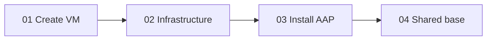

# AAP AutoDeploy and Configuration as Code

Initial organization failures retain a Vault-encrypted diagnostic in the native
AAP job artifacts, using the existing CaC Vault credential. The base job stops
at that failure; credentials remain protected in its normal logs.

Base configuration and project imports keep CoP asynchronous results in an
absolute, private directory inside that job's temporary workspace. Launch,
polling and cleanup therefore use the same location even when the execution environment's home
directory differs between those operations. The existing workspace cleanup
removes the directory after configuration finishes.

Deploy a fresh AAP, import selected use cases, run their demonstrations, and clean
up the disposable resources so the demonstration can be repeated. A rebuild can
be driven by an external AAP; it must not depend on the hypervisor being rebuilt.
Start with [RESTART_HERE.md](RESTART_HERE.md) when resuming existing work.

## Run the demonstration

1. Prepare the selected test hypervisor through Hactar configuration. Confirm its
   pinned identity, images, available memory/disk, DNS access, nginx and existing
   ACME account. Keep the original production hypervisor excluded.
2. Run the four existing AAP deployment stages in order: create the VM, configure
   infrastructure, install AAP and apply shared base CaC. Use the VM name returned
   by Stage 01 as `aap_instance_key` in Stages 02–04.
3. Run the existing selected-use-case selector for the chosen AAP inventory
   entry. It prepares each use case's PAH prerequisites, then imports its CaC.
   For a standalone import, run the existing Stage 05 preparation first, then
   supply `aap_instance_key` to the use case's CaC deployment template. Each
   template calls `deploy-cac-project.yml` with its saved `aap_cac_project_id`
   and repository-specific Git/Vault credentials. The inventory FQDN and
   instance token select the receiving HTTPS API.
4. Run the imported use-case jobs. Importing CaC installs definitions; it does
   not deploy the application's infrastructure or prove the demo works. Run
   memory-intensive use cases sequentially.
5. Verify the visible result, then run that use case's normal cleanup jobs for
   its disposable resources. Preserve AAP, reusable templates, source images and
   other use cases. Fix a failed automation step and rerun it before calling the
   demonstration complete.
6. Use the verified AAP to install its successor environment. This is the
   version-to-version acceptance test; a successful CaC import alone is
   insufficient. Follow the agreed capacity and retirement order before any
   later bare-metal rebuild.

The [functional sequence and target boundaries](docs/recovery-and-use-case-targets.md)
explain the expected results, resource lifecycle and deferred OpenShift test.
Use-case repositories provide their runtime instructions. Current task states and
live results are in [TODO.md](TODO.md) and its encrypted full records, rather
than a second checklist here.

Controller project imports allow 180 one-second async status polls. A normal
successor import exhausted CoP's default 50 polls after 60.280 seconds while its
project synchronization continued and then succeeded in 67.684 seconds. The
longer project-specific bound stays below the role's existing 1000-second async
execution allowance; other resources and secure failure reporting are unchanged.
Native variable-routing checks cover the pinned role/collector. A normal
successor self-CaC import subsequently passed in 174.539 seconds on that fix.

Command Center is a separate AAP project with its own explicitly launched
installer Job Template. It is outside the base stages01–04 and is not a base
installation or acceptance requirement. The owner has deferred its installation
and testing; prepared infrastructure and application work remains preserved.
When resumed, fresh Command Center deployment uses the application's maintained default
installation directory and a separate `~/ccng-wd` agent workspace. The owner
selected the newest application source at deployment and a fresh Beads tracker
on first setup; updates must preserve existing trackers and authentication.
The focused Ansible prerequisite/workspace patch is prepared and locally
checked, but has not yet completed its successor deployment.
AIOps deployment release 1.4.1 prepares RHEL repository prerequisites and builds
its MCP images on the selected TRA instead of staging image/RPM bundles through
the hypervisor. Registration, repositories and packages passed on the selected
runtime guest; its container build failed and protected log diagnosis remains
unfinished. Authenticated queries and repair still need acceptance. AutoDeploy's
existing pre-import step seeds the selected encrypted runtime namespace with the
same vaulted RHSM inputs used for AAP and the existing private Hactar source
reader. Repeated imports preserve matching values and refuse conflicts. Native
source retrieval passed in a normal monitoring job; live firewall reconciliation
and the complete monitoring/EDA loop remain unfinished.

Newly verified monitoring-VM details must be saved inside that instance's existing
Zabbix VM definition, with its configuration nested there. The owner approved
reusing the existing CaC importer after VM creation, then continuing configuration
from CaC. This fresh-instance producer is being implemented; no separate metadata
store, ownership file or additional saved template is approved.

The source AAP has completed an AAP-only successor deployment through these four
stages, with trusted HTTPS/API authentication, a valid license and ready
Controller. Original guests and source images were preserved. Stage 01 needed
the published SSH correction and a native start-at-task continuation; fresh
unattended provisioning and complete successor acceptance remain unverified.

Remote and self-targeted AutoDeploy CaC imports have also passed. The selected
successor now has its AIOps definitions, with new EDA activations disabled;
application services and fresh runtime tests remain separate. AIOps retains the
approved saved-image Zabbix authentication baseline, without adding a token
producer or encryption mechanism.
Windows, Assistant, Automation Orchestrator and RHEL configuration setup passed
through their existing prerequisite and import jobs. RHEL's independent EE-only
prerequisite path was also verified live. These imports do not test OpenShift or
external RHEL workloads. The staged Windows test passed AD login/RBAC, both
exact April OS baselines, application baseline/upgrades and combined verification.
Normal Windows-only cleanup then passed and preserved the original core guests
and golden images. The owner subsequently directed removing only the predecessor
AAP VM and its runtime clone; that one-off operation passed survivor checks.
Its DNS, proxy and credential records remain for later scoped cleanup. Other
predecessor guests remain preserved, and remaining testing uses the successor.
The original workflow failed, so fresh unattended execution is not yet proved.
The private Windows companion now adds the selected instance's already trusted
registered issuer when missing from its API credential bundle. Existing and
legacy bundles remain unchanged, avoiding another per-counter CA repair.
Assistant's complete model-free software test and normal owned retirement passed,
preserving all five original guests and golden images. This verifies deployed
CLI/project isolation without provider-authentication transfer or model inference.
Its existing minimal Linux provisioning template has now deployed the successor's
testserver and TRA, with native identity and source/canonical publication verified.
The public caller pins the corrected Linux SSH-field publisher. The successor
website passes normal DNS and trusted HTTPS checks. Zabbix deployment and the
testserver agent have also passed, with monitoring and event forwarding configured.
The normal retry reused the owned clone and passed with AIOps 1.1.7, whose
bounded DNS wait covers the observed negative cache.
The frontend's trusted HTTPS Basic-authentication gate passed independently.
The live outage test found that the website probe times out before generating
an event. The proved cause is a missing guest-to-hypervisor HTTPS permission.
The owner chose AIOps-owned permissions: deployment adds its required access
and decommission removes it. The earlier AutoDeploy exception is superseded.
The owner requires CaC to remain the single source of truth. Each instance's
application permissions, resource validation and target hypervisor belong in
its own encrypted AIOps section. Applying CaC must reconcile additions, changes
and removals; an observed rule or saved host file does not authorize retention.
The public common callers now replace the isolation-helper/deployed-JSON path
with readable Ansible and native firewall configuration. Protected CaC migration,
coordinated caller pins, the initial host apply and live demonstration verification
remain separate rollout steps. Do not mix old and new policy writers on one host.
The website was restored, its button is disarmed and both EDA activations are off.
Website recovery is not yet accepted.
AIOps 1.1.8 now requires a fresh successful website sample before forwarding,
with standard retry-exhaustion handling. Fifteen focused tests and strict lint
passed; live acceptance of that correction waits for the firewall integration.
Private MCP setup and the complete AI-driven outage/repair test remain open;
the existing non-AI website recovery route is a separate functional check.

## Keep the demo boundaries clear

- Base configures AAP and its shared content sources. Each selected use case owns
  its application jobs, runtime settings and disposable infrastructure. AIOps
  service settings belong in its private companion, not the AAP-only registry.
- All seven reviewed CaC import templates use one playbook, fixed project IDs and separate
  repository reader/Vault credentials. API calls require verified HTTPS and the
  selected instance's token. There is no SSH or installer-password API fallback.
  Optional private MCP metadata follows that same selected record into existing
  AIOps runtime settings; its CA applies only to the application, not global
  trust. Publish the installer's issuing CA rather than its full system-root
  bundle. See the [ordinary backfill sequence](docs/instance-token-store.md).
- An inventory entry selects the AAP API destination; a pinned hypervisor and
  verified VM identity select infrastructure targets. These are separate choices.
- Rebuild isolation prevents restored guests from contacting production using
  inherited settings. Successful guest configuration releases only the verified
  guest; production blocks and private MCP boundaries remain in place.
- Preserve required-input, intended-resource and successful-operation checks.
  Use bounded waits for installation and other asynchronous operations. Add
  focused checks for observed failures; avoid parallel rebuild frameworks and
  repeated proof collection that do not help the demo run.

See [project imports](docs/cac-project-import.md),
[base portability](docs/autodeploy-portability.md),
[upstream TLS](docs/aap-upstream-tls.md),
[instance tokens](docs/instance-token-store.md),
[shared allocation](docs/shared-instance-allocation.md), and
[decommissioning](docs/decommission.md) for the relevant operator details.
The existing [guest release](roles/recovery_guest_release/README.md) and
[guest retirement](roles/recovery_guest_retire/README.md) roles own the shared
isolation/ownership transitions; use-case jobs call them at their lifecycle
boundaries. Windows reset reuses the retirement role's existing source-ownership
plan before selecting configured-guest or unconfigured-clone cleanup; missing
ownership grants no deletion permission. The Windows infrastructure job also
owns its optional additional
AAP NIC and persistent RHEL connection; the CaC importer remains API-only.
Final AAP isolation release selects only its primary interface. A Windows-owned
second interface remains verified and recorded without gaining that release.

For Linux guests, the existing release publisher carries the verified SSH user
and port into their source inventory fields as well as their resource record,
so AIOps can consume a newly created guest without inventory defaults or manual
patching. Missing values are not invented, conflicting existing values refuse
publication, and Windows keeps its WinRM fields.

## Native firewall transactions

The firewall callers use readable Ansible and native configuration. They check
actual hypervisor and guest identity with the existing resource validators,
apply ordinary rich rules through certified `redhat.rhel_system_roles.firewall`
`1.120.5`, and consume Hactar's reviewed native nft validate/readback/apply tasks.
The Python validators no longer read or write a deployed JSON policy or change
firewall rules. Exact DHCP cleanup remains in the existing retirement verifier
pending the separately tracked helper cleanup.

Supply `aap_hactar_source_revision` as the reviewed full Git commit and
`hactar_source_public_ip` from the existing encrypted Hactar source identity.
Hactar source is private: supply `hactar_source_git_token` through the existing
encrypted project settings and attached Vault credential. AutoDeploy loads it
from its encrypted `myvars`; other callers retain their own encrypted runtime
transport. Never put the token in ordinary saved or launch-time Extra Variables.
The source-only reader is separate from the allocation writer's `CAC_GIT_TOKEN`.
Git receives a process-local authentication header scoped to the fixed Hactar
repository, with credential helpers disabled, redirects refused and TLS verified.
No credential is written into the checkout configuration.
Normal AIOps preparation also seeds this reader into the selected instance's
existing encrypted runtime file, using the same protected pre-import path as
subscription settings. Other instances are preserved, an identical retry makes
no change, and conflicting existing authentication stops for explicit review.
The job retrieves that exact task revision over verified HTTPS into a
private temporary controller directory and binds `hactar_firewall_source_root`
there. It does not borrow another AAP project's workspace. Prepare the declared
certified collection through the existing PAH process before synchronization;
ordinary jobs do not install missing collection or EE dependencies.

Every previous/desired policy candidate is a complete CaC document. The native
nft file/table is read only to verify that it matches a candidate, never imported
as desired configuration. The identity/provisioning preflight stays read-only
and rejects drift with an instruction to run explicit CaC reconciliation first.
Mutating lifecycle callers reconcile the complete current CaC, including removals,
instead of demanding that a deleted grant remain in a saved host snapshot. Policy
application writes only Hactar's native `/etc/nftables/hactar-recovery.nft` and
owned nft table. Existing source publication and unpublished-change rollback
remain at the caller's lifecycle boundary.

Application grants are read from their own private AIOps CaC through the existing
central bootstrap reader/Vault fields. No extra credential is attached. The
native tag-aware loader preserves existing `!unsafe` and embedded `!vault`
values without using unrelated secret leaves. Both files use the existing global
`include_vars` pattern, so YAML reads only the required credential or instance
branches. Ownership actions consume the AIOps loader's raw registered facts.
Wrapping a whole file in a namespace previously evaluated unrelated `pah_base`
or `aiops_eda_organization_name` references before selecting those branches. Whole-file decryption uses the
bootstrap key only through protected stdin; its 0600 temporary variables file is
outside the Git checkout and removed by normal `always` cleanup. Source or key
failure stops the operation rather than becoming an empty permission list.

The native application identity assertion reports only `uuid_matches`,
`bridge_matches` and `address_matches` booleans when it fails. All
three original checks must still pass. Recorded identities, native command
readback and credential material remain hidden; other tasks retain protected
logging. These messages identify a failed check and do not authorize accepting
drift or changing a reservation.

Address proof matches the clone producer's native DHCP allocation. A unique exact
static DHCP reservation remains sufficient for a stopped guest. Without any
static record for its saved MAC or address, the job requires one unexpired native
IPv4 lease for that exact pair and refuses duplicates or crossed ownership. The
read uses `LC_ALL=C` and `TZ=UTC`; source and hypervisor clocks must be correct.
Finite native expiry timestamps are supported; malformed, absent or expired
leases stop the job. No saved address is adopted or rewritten. DNS host records
are separate from DHCP ownership and are not counted as reservations.

Each declared Zabbix record must have explicit
`aiops_instances[instance].zabbix.configuration.firewall.guest_host_clients`, including an empty list
when access is removed. A never-created/retired instance without Zabbix has no
grant. Only records on the actual pinned hypervisor contribute, after native
UUID, current/persistent disk and MAC/network, bridge and static-address checks.
Base publication stays base-only: native old/new/rollback candidates add current
application CaC in job memory. Removing one app entry therefore removes it from
the effective nft policy while other declared instances survive. No application
grant is copied into AutoDeploy's canonical captures.

Fresh Zabbix deployment publishes its authenticated VM row in the existing
native source inventory, then invokes the existing AIOps importer. That importer
keeps the VM's firewall and importer settings inside its own `configuration`
mapping, seals the existing Vault files and renders the updated consumer inputs.
The pending API-only appliance changes require schema 2 native VM/API ownership
and a disabled metadata-only source row. They reject appliance SSH connection
fields while retaining the UUID, disk, MAC, address and physical-owner checks
used for guarded retirement. Linux guest management remains unchanged. These
source changes still require live verification. The owner selected booting
under verified hypervisor network isolation and configuring through the internal
API, while keeping appliance Internet access blocked; no separate baseline
image is required.
See [native monitoring record publication](docs/aiops-instance-preparation.md#native-monitoring-record-publication).

Decommission keeps the selected AIOps CaC owner/tuples until exact native rich
rules are disabled in runtime and permanent configuration. Its explicit native
reduction removes only that instance's app grants and preserves other instances.
After successful cleanup, the normal operator update removes the selected AIOps
records before another apply; the base retire publisher does not edit that repo.
Deleting the source tuple/owner first can leave an unattributable ordinary rule:
stop for manual reconciliation, not a broad purge. Plain omission still removes
effective nft access, but does not prove physical ordinary-rule cleanup. See
[decommission ordering](docs/decommission.md#retire-only-the-selected-guests-permissions).

Separate AAP jobs serialize their native checks, firewall changes and rollback
using atomic `mkdir` of `/run/hactar-recovery-policy.lock`, with five one-second
retries by default. A caller whose concurrent jobs share a longer transaction
can set `aap_isolation_lock_retries` to an integer from zero to 1800, with the
same one-second retry delay. Windows setup must allow for the other queued VM
transactions, including guarded network preparation and clone creation.
The retry budget does not establish progress or authorize removing another
job's lock. `always` releases it with `rmdir` only after this invocation acquired
it. Check-mode observations use the same temporary lock without applying policy.
A killed controller may leave the directory behind: later jobs fail closed.
Confirm that no policy-writing job is active before manually removing an abandoned
empty directory; never break a lock based only on its age or recursively delete it.

This lock does not coordinate with historical directory-`flock` callers. The
switch on the selected hypervisor therefore requires a quiescent window, the
matching Hactar native base, and coordinated AutoDeploy/Assistant/Windows caller
pins. Do not run old policy-writing revisions on that host concurrently with the
new callers. Unrelated production deployments retain their existing tested pins. Local fixture tests
do not establish live migration or complete end-to-end acceptance.

## AAP Configuration as Code visualization

Both repository windows keep one complete, scrollable presentation file. The
private file includes readable configuration labels, quoted Jinja variables for
VM inputs and synthetic encrypted secret examples; the public file combines
source-pinned playbook excerpts. RHEL setup shows the certificate task and firewall
role with matching private inputs; a later certificate update highlights only its
section. Travelling blocks use the same light fills as their configuration objects.
Each step scrolls both panes to the matching section and colours only
the active definitions/code, while all other sections remain available.
The blue AAP-settings arrow reads “Push AAP config”; the following base-content
arrow reads “Push AAP content”.
Arrows show only their action captions
above the line; destination subtitles and ACTIVE text underneath are deleted.
Purple change arrows read “Push OS changes”, “Push AAP config changes”, and
“Push AAP content changes”, in that order.
The purple content-push arrow aligns with the original AAP’s top edge, entering
the receiving content area; its position follows the rendered card on resize.

The [decision history](design_decisions_history.md) records the original
component-width and project-import choices separately from later layout fixes
and their verification limits.

[Open the interactive story](https://kvegh.github.io/aap_autodeploy_configascode/)
to follow an original AAP, its first destination and another AAP rebuilt from
Git, keeping private encrypted YAML separate from public execution playbooks.
Seven chapters contain thirteen stops. RHEL configuration is applied during OS
preparation. The base push then has two steps: AAP configuration and AAP content. Each highlights
only its definitions; settings appear before shared automation objects. Project
imports, platform/infrastructure changes, manual additions, capture and complete
replay follow. The original `#base` link still opens completed base content.
Certificate and Firewall use one consistent RHEL stack throughout, with Certificate
above Firewall; early OS preparation does not switch their placement or styles.
Navigation stays in a stable sidebar footer, outside changing step content. The
redundant bottom object/profile status summary is deleted. Deployment stops use the main chapter and Next/Previous
navigation; the redundant AAP Deployment sidebar section is removed.
Regional servers and Regional automation arrive during Apply objects with
Satellite Inventory and Application automation playbooks. The later AAP settings
update changes Logging to v2 without adding automation objects.

Blue base configuration includes AAP Logging Config v1, AAP EDA Config v1, Certificate config v1 and
Firewall v1. Git updates AAP Logging Config and Certificate config to violet v2 while EDA
and Firewall stay at v1. The whole Infrastructure
configuration group sits inside RHEL. Only the RHEL label, preparation indicators and configuration
bars are shown; redundant infrastructure/networking captions are omitted. Bars stack on the
right beside the RHEL label and preparation indicators to save vertical space. The page performs no host configuration
or live AAP operation.
Captured manual-origin definitions remain amber when replayed to the next AAP. During the manual-change stop, a
seated Linux sysadmin in permanently reserved space above the small original AAP wears a plain hoodie and glasses,
leaning toward a laptop with hands on the keyboard. A small amber outage alert
and one coffee mug establish the incident-response scene. The original AAP stays
in its lower position from the beginning; showing the figure does not move it. The illustration is a
locally stored generated PNG; its prompt is documented in the demo guide. An amber arrow shows their
configuration entering the first receiving AAP directly; the figure disappears
when the scan brings those definitions into Git.

The three-column diagram uses matching code/receiving rows across the available
page height, with five percent of that height reserved for balanced outer spacing
and the original AAP centred between them. Each receiving AAP uses
two independently packed, unboxed object columns: Inventories/Credentials on the
left and Projects/Job Templates on the right. AAP configuration is a separate
full-width category below them, divided by one light inset horizontal line; RHEL
remains underneath. The settings category stays anchored at the bottom as
objects fill the space above. Automation, AAP-setting and RHEL configuration
bars follow the Deploy application screenshot proportions, scaling with each
AAP rather than using a fixed width. The two stacks start just inside their
respective halves, with small vertical gaps between blocks. Names and object
counts do not resize the bars. Repeated object badges are deleted; a single
colour legend below the original middle AAP explains blue base configuration,
purple Git-defined changes and yellow manual configuration captured back to Git. Text inside
the coloured bars is two sizes larger; headings, sidebar and code text retain
their existing sizes. Compact bars
keep all definitions visible without internal receiving-card scrolling. The first destination aligns with the upper code window;
the lower AAP rectangle is hidden throughout the main story. “Room for another AAP”
appears only in a brief preparation stop immediately before the final deployment,
which fills that destination with the complete saved configuration. All installed cards share prominent AAP branding. Larger sidebar text,
a fixed current-step heading and completed/current chapter states make progress
easier to follow. Examples are synthetic. The named examples include VMWare Inventory, Satellite Inventory,
Server access key, Application auth token and the AAP Config-as-Code Git project;
see the demo guide for the complete naming table.

A RHEL foundation holds the infrastructure group at the bottom of each AAP card. It shows
VM creation, OS prerequisite preparation and AAP installation, plus the host
firewall/nginx/TLS setup. These host services are not shown as guest services,
and a general OS upgrade is not claimed. Stage 02 delivers blue firewall and
Certificate configuration bars into this RHEL rectangle. A later CaC run visibly
replaces Certificate config v1 with purple v2 there, retaining blue Firewall v1; the final
rebuilt instance receives the resulting configuration. Dark 3px card borders and
larger Git text make the diagram easier to read.

Purple Git-defined changes follow the same layer order as the blue setup:
OS/RHEL Certificate configuration, AAP Logging configuration, then additional
AAP objects. Earlier changes remain applied as the story advances.

The new VM appears in Stage 01, receiving AAP in Stage 03 and base definitions
in Stage 04. Trigger choices and detailed scan/review mechanics are abstracted.
Implementation links, repeatable interaction checks and local preview instructions
are in [demo/README.md](demo/README.md). Existing-tool checks cover story behaviour
and source mapping; rendered browser and phone layout remain separately unverified.

The retained [GitHub Pages workflow](.github/workflows/deploy-demo.yml) checks
source after checkout, runs syntax and interaction tests and deploys the six
allowlisted public assets after matching main pushes. Pages uses GitHub Actions;
pull requests only check. No frontend dependency installation or build is needed.

## Tasks and decisions

The [Project Decision/Action Path Flowchart](docs/project-decision-action-path-flowchart.md)
provides a frozen seven-day retrospective: short Mermaid summaries with expandable
decisions, failures, fixes, outcomes and timing. The 20 longest evidenced episodes
show ranks and durations directly in their coloured boxes. Elapsed spans are
separate from actual job runtime; overlapping work is not added into a fake total.
It explains delivery delays without exposing raw action logs or environment identifiers.
The additional [interactive HTML version](docs/project-decision-action-path-flowchart.html)
lets you click a diagram node to toggle its matching explanation. GitHub displays
HTML source: download the file and open it locally in a modern browser. No server
is needed; diagram rendering needs internet access to the pinned Mermaid runtime.
The HTML uses compact phase diagrams and derives its node controls from the
current graph/detail IDs. Its status distinguishes runtime import, rendering and
controls; a control error keeps rendered diagrams visible. If scripts do not
start, download/open locally rather than rely on a preview that blocks JavaScript.

The [development speed recommendations](docs/development-speed-improvement-review.md)
provide a short review from the actual v16 start through the fixed 11 November
2026 checkpoint. The [detailed evidence](docs/development-speed-improvement-evidence.md)
ranks 30 long episodes and separates repeated short operations from actual job
runs. Fourteen named actions each specify a concrete change and completion
criterion; coverage tables map all 30 ranked episodes, 18 additional findings
and the 64 earlier report blocks to those actions. It identifies continuation gaps, timeout design, avoidable prerequisites
and producer/consumer failures; owner-required checks are distinguished from
waste. These reports propose improvements without changing runtime settings.

Queued cleanup `bead-wd-72f.34` replaces unnecessary standalone helpers, custom
plugins/modules, embedded scripts and custom server-side state files across the
related demos. The bounded source inventory `bead-wd-72f.34.1` is complete;
the firewall portion is already in progress separately. Use readable Ansible and certified collections
or vendor roles. Keep desired configuration, ownership and validation in existing
encrypted project CaC, separated by instance, and migrate consumers before
removing their old helpers or files. Preserve application-native authentication,
data and necessary native service configuration. Any remaining capability gap
needs a concrete explanation and owner consultation. This is planned cleanup,
not a completed migration or authority for blanket live deletion.

Beads is authoritative. `scripts/sync_todo.py` generates the public task overview
and encrypts complete scoped records in the existing Hactar repository; run its
`--check` mode before publishing a checkpoint. Keep private task details and
populated configuration encrypted. [Restart instructions](RESTART_HERE.md)
explain recovery without the current tracker. Lasting decisions and implementation
commits remain in `design_decisions_history.md`; older run evidence belongs there
or in the protected task records, rather than the README's opening instructions.
Completed visualization and performance handoffs are omitted from this overview;
their history remains in Beads and the encrypted recovery export. Their owning
chats track subsequent implementation.

The generated overview and protected export reflect the current Beads records.
The source Core 2.20 runtime passed an authenticated forced image pull, normal
preflight and zero-error CaC preview. The approved physical reinstall then passed
provider host-key matching and strict authenticated OS, machine-ID and hardware
checks. Encrypted trust and existing deployment source pins contain that verified
identity. Conversion, host setup and all seventeen post-reboot host checks passed
under Core 2.20. Removing an approval definition during the active run caused
AAP to mark its parent workflow failed despite successful child jobs; that result
is retained. Current workflow definitions contain no manual approval nodes.
Stage 01 verifies the native firewall policy against protected CaC and checks
the persistent isolation service before allocating a new guest.
Fresh-target EE acquisition and complete versioned AAP acceptance remain separate.
The initial base and application migration selected official Core 2.20. Its
reference and preservation audit passed; focused stock-image tests passed for
AIOps, Assistant, Windows and RHEL. The derived EE-v1 selection below supersedes
that initial image selection. OpenShift functional execution remains deferred.

The owner subsequently selected a derived **AAP AutoDeploy EE-v1** as the next
shared default. Its [build instructions and package inventory](execution-environment/README.md)
use the exact Red Hat Core 2.20 base and add Kubernetes, jsonpatch and their
hash-locked dependencies. The initial local build preserves all original Python
packages and native startup settings. Hub publication, native AAP execution and
the default/CaC change must pass separately before this replaces the current EE.
The first publication failed native AAP integrity verification because Hub stored
a truncated layer; its cached local pull did not verify all remote bytes. A
content-preserving `1.0.1` replacement passed an uncached download of every blob
and decompressed layer. A normal read-only AAP job subsequently passed with an
actual Core 2.20.10 runtime header. Source AAP now uses EE-v1 as its global
default; all 62 managed templates and the Hactar project default select it.
The deployment persists the approved 200-second Hub worker and 600-second
registry route timeouts through the existing installer and native Platform CaC
module. The subsequent **ee-proj-aap-cac** design replaces Source-Hub dependence:
each receiver builds the exact official base plus the two direct Python
requirements from Red Hat Trusted Libraries, then publishes to its own Hub.
The [automated build playbook](docs/execution-environment-build.md) verifies
all remote bytes and the offline runtime before returning an immutable image.
Stage 04 runs it before creating the receiver default and its dedicated native
registry credential. The existing [Orchestrator CaC deployment](docs/orchestrator-execution-environment.md)
also invokes the builder before importing project definitions. Other reviewed
project image references resolve that receiver's native shared EE; unrelated
custom images are preserved. Encrypted target credentials and normal pinned SSH
access remain prerequisites. No Source-Hub firewall exception is required. Delegated builds resolve the job-local pinned SSH options from the original orchestration host.

The normal use-case selector preserves Orchestrator's already saved Machine
credential only when its ID, name, type and organization match the independently
resolved registered hypervisor. This permits the approved receiver-local image
build while retaining the reviewed repository and shared token-store bindings.
Other generic project imports remain API-only and refuse Machine credentials.

The shared project image passed a real build, publication, uncached download
and a repeat run that skipped rebuilding and publishing. Source AAP's default
and 62 managed templates select **ee-proj-aap-cac**. A fresh receiver's normal
base configuration passed, and its existing local-only Demo Job Template ran
successfully from its own Hub image with an actual Core 2.20.10 runtime header.
The normal Orchestrator import/build path and application acceptance remain
separate checks; an image build alone does not establish deployment completion.

Keep AAP-owned integration tasks labeled `aap-autodeploy` alongside their
conversation association and original parent so the existing export includes
them. Moving a task preserves its actual state; an unanswered credential-source
question remains blocked until the user supplies or identifies the answer.

External CloudCLI remains future work in the existing deferred task
`bead-wd-9ezo`, for an independent CaC project. Its full handoff stays in the
encrypted task snapshot; the public overview retains only task metadata.

## Current implementation

Windows lifecycle checks follow each libvirt network's DNS setting: exact DHCP
ownership is required, while DNS records are required only when DNS is enabled.
An explicitly disabled DNS service stays disabled during deployment and cleanup.

RHEL source 0.5.7 passed one complete RHSA/cutoff/full-update cycle on the
workshop controller, including verified already-current full updates. Its CaC
import and read-only runtime passed on the receiving AAP; client SSH from that
AAP remains unverified. See the RHEL project for the repeat/reset instructions.

All seven reviewed project import Job Templates use [one API-only configuration
playbook](docs/cac-project-import.md), `deploy-cac-project.yml`, with fixed project
IDs and separate repository Git/Vault credentials. Choose the inventory instance
at launch; the saved shared token store supplies its API token automatically. The playbook derives the
private repository and canonical capture filename, verifies TLS, and applies
reviewed CoP data without SSH authentication fallback or workload execution.
The [consolidation analysis](docs/deployment-consolidation-analysis.md) remains
historical reasoning; its former credential and importer design questions are
superseded by this implementation. Live import/function tests remain separate.

The repository contains the deployment stages and separate use-case imports:

| Stage | Playbook | Purpose |
|---|---|---|
| 01 | `01-linux-vm-setup.yml` | Clone a prepared golden image and discover the VM address. |
| 02 | `02-infra-config.yml` | Configure DNS, certificates, and the reverse proxy. |
| 03 | `03-aap-install.yml` | Prepare the VM and run the pre-staged AAP installer. |
| 04 | `04-aap-config.yml` | Apply the subscription, PAH and shared CaC, verify MCP/API publication, then release only the completed AAP guest after cleanup. |
| Separate | `05-prepare-use-cases.yml` | Prepare exact PAH requirements for explicitly selected use cases; outside base deployment. |
| Separate | `deploy-selected-use-cases.yml` | Install only chosen umbrella Projects and saved CaC through the seed's scoped configuration importers. |

Post-install configuration uses the `dispatch` role from the
[Red Hat Communities of Practice AAP Configuration Collection](https://github.com/redhat-cop/infra.aap_configuration#readme).
It reads our CaC definitions and calls AAP APIs to create or update those objects.

Stage 04 downloads the private configuration repository's `main` branch into a
temporary directory, decrypts `cac/base_CaC_vault.yml`, and loads it before dispatch.
It also decrypts `cac/manifest.zip.vault` into a temporary ZIP and applies the AAP
subscription through `ansible.controller.license` before dispatch. The module's
`force: false` preserves an existing non-trial license on reruns. A failed import
stops configuration. A per-run Gateway token authenticates the subscription
import and dispatch. It is revoked afterward, and the temporary checkout, ZIP,
and authentication helper are removed after successful runs and ordinary task
failures. Ansible role-loading errors or interruptions can prevent cleanup.
The obsolete per-project wrapper playbooks have been removed. Every deployment
Job Template selects the common importer and fixes its project ID in extra variables.
`restore-windows-config.yml` remains a local-file utility.
`destroy-test-aap.yml` backs **Decommission AAP Test Instance**. It requires
explicit instance confirmation, pinned hypervisor identity and verified ownership
before removing the selected VM, related same-version guests, disks, DNS,
certificates, nginx and isolation permissions. Source images, other guests,
shared credentials and the monotonic allocation counter are preserved. The
existing writer retains the selected reservation while policy and source API
cleanup run, then removes that reservation after verified completion. Other
instances and shared settings remain unchanged; consumed numbers are never
reused. Application ownership stays outside the AAP-only allocation record. See
[decommission details](docs/decommission.md) for the exact scope and retry rules.
Code validation and a successful live decommission remain distinct results in
the task records.

### CaC-owned related-resource retirement

Related VM ownership comes from the selected instance's existing encrypted
AIOps VM definitions, loaded by the existing native policy preparation. No
additional repository credential, source controller copy or target API read is
needed. AutoDeploy's reservation remains authoritative for the primary AAP VM,
hypervisor and consumed counter. Any present source inventory row must agree
with the durable application identity; a missing row does not erase that
identity. Registered primaries and CaC-owned auxiliary guests from surviving
instances on that same hypervisor remain visible to permission validation even
without source inventory rows; deletion stays limited to the selected instance.
Runtime settings and secrets are excluded from the ownership proof.

The existing Python validator/action integration checks this project-specific
cross-repository identity contract, which Controller collection inventory modules
do not validate. Native Ansible still loads the private capture and performs
hypervisor, domain, disk, snapshot, network and firewall operations. A failed job
can reconstruct the same related records from unchanged private CaC on retry;
retain those private records until normal cleanup has succeeded. Missing or
conflicting CaC never authorizes deletion by name alone. See the focused
retirement tests and [decommission procedure](docs/decommission.md).

The Windows importer creates groups before linking their memberships, so
asynchronous group creation cannot leave references to missing children.
Its capture includes the infrastructure, patch assessment, bounded WSUS update
and cleanup jobs. Import success still requires separate runtime demonstration
and reset acceptance.

## Setup and secrets

### Base deployment and explicitly selected use cases

The `Deploy Complete AAP` workflow runs stages 01–04 on success only and stops
after shared base configuration. It creates no use-case projects or imports.
The separate [use-case selector](docs/selected-use-cases.md) installs only the
operator's selected umbrella submodules and their reviewed saved CaC. Application,
deployment and demo jobs are not launched by configuration selection.
Reviewed EE-only cases may declare no PAH collection prerequisites. Preparation
skips those empty collection loops while retaining execution-image readiness;
other declared collections still require exact versions.
The selector uses the attached source API bearer and, when required, its
existing CA credential. Its temporary trust bundle also retains the receiving
AAP's installed authority; global trust is unchanged. Selected imports have run
successfully, but application jobs still require their own functional test.
The shared inventory has per-hypervisor VM groups with `hypervisor_host`, and
AAP hosts carry explicit `ansible_fqdn`. Configuration import selects the exact inventory host through `aap_instance_key`.
The saved **AAP API/MCP Auth Token Store** selects its bearer and binds its URL to
`ansible_fqdn`; TLS verification is required. There is no SSH or installer-password
fallback. Manual native API credentials remain usable separately and must set a
Request Timeout; the generic importer sets its own numeric request timeout.
An import authentication failure reports only its HTTP status and a fixed
TLS, DNS, network, timeout or authorization category. The request, bearer and
response stay protected; this diagnostic changes no authentication or trust.

Future deployments use `<role>.vNN.<zone>` public names, with the same allocated
number for AAP and its demo website. Existing allocation/libvirt/inventory keys
are preserved. See [shared allocation](docs/shared-instance-allocation.md) and
[decommissioning](docs/decommission.md).



Stage 01 consumes the shared encrypted counter and publishes `vm_name`, `vm_ip`,
`aap_hostname` and the public-key-only `aap_instance_route` through `set_stats`
workflow artifacts. The API URL uses this reserved VM's unique public hostname.
Stages 02–04 reread the completed registry entry, reject conflicting inputs and
route private guest SSH through its exact hypervisor with both host keys checked.
Attach the existing AutoDeploy secrets repository read token and CaC Vault to those
stages; guest stages also need the pinned hypervisor's Machine credential.
The Git/YAML instance registry is temporary. A real CMDB is required; see
Beads `bead-wd-sc8` and [the work plan](PLAN.md#todo). Product selection and
migration remain subject to an agreed design.
Stage 02 refuses a conflicting existing A record and requires either an existing
certificate for this hostname or a separately approved ACME registration; it
never accepts new certificate terms. No credentials, passwords or tokens are put
in workflow artifacts.
The workflow's only survey question is `debug_logging`; saved repository URLs
are supplied on each appropriate node, and each existing Job Template keeps its
own credentials. Concurrent runs of this workflow are disabled.
Failure stops downstream success nodes. Stages 02–04 can be rerun with the same
registered instance input. If Stage 01 has already created its guest, preserve
that guest and consumed reservation: rerunning Stage 01 allocates another name.
Inspect the failure before a bounded manual continuation of its remaining tasks;
a repaired partial run does not prove fresh unattended provisioning.

If VM creation completed but its final installation-access plan failed, use the
existing Stage 04 template with only the `aap_installation_access` tag and the
same registered instance. This repair exits before ordinary base configuration;
then continue Stages 02, 03 and full Stage 04. On a freshly rebuilt host with no
guest grants, the planner derives explicit production protection from the
existing canonical source address. Publication preserves the exact previous
policy for comparison, while native verification materializes that same
protection already enforced by the host's base firewall. Other clients and
production exclusions remain unchanged; missing or conflicting identity stops
the operation. Never repeat VM creation to repair this final access step.
If a protected access task fails, the rescue reports only fixed Boolean error
categories before rollback. Module arguments, raw error text and credentials
remain protected; a category alone does not prove a root cause or successful
rollback. Verify the actual native state before a bounded continuation.
The categories distinguish general package detection, DNF version detection
and a missing DNF module; the job also reports its actual Ansible version.
Access transactions use ordinary delegation to the hypervisor's unique existing
inventory identity. Core 2.20 fixes the unsafe delegated package-fact lookup
reported in [upstream issue #82598](https://github.com/ansible/ansible/issues/82598).
The old delegation-clearing, role-specific Python override and manual package
fact workaround are removed from both primary and rollback role calls. The
certified firewall role selects its package manager normally; protected values,
strict SSH trust, target Python selection and native transaction guards remain.
The earlier Core 2.16 repair and its live result remain historical evidence in
Git; they do not establish acceptance of this new engine or a rebuilt instance.

The Stage 01 readiness probe temporarily binds the new guest's SSH connection
facts, checks its pinned route, then restores the hypervisor's original connection
facts even on failure. This prevents the earlier hypervisor port and user facts
from overriding the delegated guest connection. Both SSH server keys remain
verified. Installer observation remains available through Stage 03's existing
async-job identifier.

AutoDeploy is a separate use case rather than platform base. Its whole-file
Vault-encrypted `vaults/cac/aap_autodeploy_configascode-cac-vault.yml` lives beside `cac/base_CaC_vault.yml` in the
existing private companion repository. It contains the workflow repository
mapping, exact deployment/use-case PAH requirements, deployment source project,
execution environment, two dedicated inventories, provisioning and environment
Vault credentials, and the deployment/import/teardown templates and surveys.
It has a dedicated Job Template fixing `aap_autodeploy_configascode` for the
common importer. The importer restores the workflow on the target too, allowing that target to repeat
the same deployment sequence. The empty public structure is
[`cac/autodeploy.yml.example`](cac/autodeploy.yml.example). Populate it outside
Git, verify provisioning access, and encrypt it with the same `cac` Vault
credential before committing it privately. Provisioning keys must be dedicated
to the intended environment; do not copy an agent's GitHub SSH identity.

Stage 05 is separate from base. It reads the AutoDeploy capture and shared base
authentication through the base repository's existing Git credential. It requires
an explicit supported selection and synchronizes only its exact reviewed pins
through PAH, with upstream TLS validation enabled and automatic dependency
expansion disabled. Additional versions of one collection use separate batches,
so an older required pin is not silently displaced by another pin. Repository
requirements are restored to the complete declared set even after a failed
batch, and asynchronous PAH policy changes finish before synchronization starts.
Repository content is added rather than deliberately pruned. It then copies the execution
image already supplied by the installer bundle into Controller's runtime store
if absent; it does not pull a new image or install Python dependencies. Base
itself continues to configure empty PAH sources without synchronization.

`configure-deployment-workflow.yml` can create or reconcile the seed's workflow
without launching it. Supply `cac_workflow_vars_file` as a fully Vault-encrypted
configuration file and provide normal Controller authentication separately.
The AutoDeploy importer uses that same workflow task on replacement instances.
Existing external hypervisor, image, network, DNS and certificate services remain
environment prerequisites. Complete production coverage, runtime collection and
Python compatibility, and a fresh recursive deployment remain separate live
verification tasks. AIOps configuration now restores rulebooks disabled; enabling
them is a separate explicit operation. Every importer requires its project label
on every Job Template and matching-organization definitions for every label.
Multiselect survey defaults must be strings, including `''` for no default;
the API rejects a YAML/JSON empty list before creating a survey.
The earlier source image used Core 2.16.19. The selected official job runtime
now uses the Core 2.20 stream described below. Selected Windows prerequisites
retain their exact requirements, including the Chocolatey pin and Microsoft
collections. Runtime compatibility and fresh-target setup remain separate
validation; metadata import is not proof.

### Execution environment and external prerequisites

Use the unmodified official AAP 2.7 image
`registry.redhat.io/ansible-automation-platform-27/ee-minimal-rhel9:2.20`
with pull policy `missing`. The actual Controller job runtime was inspected as
Core 2.20.10. Collections come from project requirements, including
`infra.aap_configuration`, `ansible.controller`, `redhat.rhel_system_roles`, and
`community.general`; installing collections does not change the image.
The platform's own control-plane/project-update EE remains independent.

The owner chose to keep this image unmodified, with no added `dnspython`.
Stage 02 runs RHEL's `dig` through `ansible.builtin.command` on the pinned
hypervisor, retaining the explicit public resolver, exact-address comparison and
bounded propagation retry. Hactar base owns its `bind-utils` prerequisite.
Before API authentication, `ansible.builtin.getent` queries the EE's DNS service,
without `/etc/hosts`; the IPv4-only route rejects alternate addresses and any
returned IPv6 address before the existing trusted HTTPS check. GNU `getent hosts`
tries IPv6 first, then IPv4; it does not expose individual DNS response codes.
These tasks no longer use `community.general.dig` or require its Python library.

Base CaC declares `controller_execution_environments_base` and
`aap_default_execution_environment`. Stage 04 resolves that name to this
controller's current EE ID before setting `DEFAULT_EXECUTION_ENVIRONMENT`;
source-controller IDs are never copied into rebuilt environments. The AutoDeploy
capture and Hactar controller rebuild capture use the same named runtime.
The Hactar provider reinstall, conversion, setup, reboot and verification jobs
all select that EE. Preserved legacy jobs retain their existing engine choices.

Base CaC creates a built-in Container Registry credential with verified TLS and
links it to the execution environment. Controller uses that credential to pull
the declared official image before starting a job. The installer bundle contains
the older default stream; a fresh controller acquires Core 2.20 through this
native mechanism. Stage 05 prepares collection content and does not copy or pull
its own EE image: those tasks cannot run before their runtime is available.
Real registry inputs stay in encrypted shared base CaC. Fresh-target download
and job-runtime verification remain part of the normal deployment acceptance.

Core 2.20 plugins preserve repository configuration trust through Ansible's
public template API. Literal template-bearing data remains explicitly `!unsafe`
when encrypted configuration is rewritten; ordinary repository references still
evaluate. Native tagged YAML integers are accepted while booleans remain invalid
for counters, IDs and ports. There is no fallback to the older engine.

`collections/requirements.yml` pins `infra.aap_configuration` to `4.10.0` and
`community.general` to `11.4.0`, which supports Ansible Core 2.16 or newer. Sync
both collections into the appropriate PAH repositories before project sync.
With collection downloads enabled, AAP installs it and its declared dependencies
during project synchronization. The requirements file defines which collections
are needed; Galaxy credentials attached to the project's organization define
where AAP downloads them. To use private Automation Hub's `validated` repository,
attach a Galaxy credential for that repository to the organization. Configured
sources must also provide the certified
`ansible.platform`, `ansible.hub`, `ansible.controller`, and `ansible.eda`
dependencies. This does not install Python or system packages into the execution
environment.

The target infrastructure needs the prepared golden image, installer bundle,
virtualization tools, and the DNS/certificate/proxy prerequisites described in
[documentation.md](documentation.md) and [PLAN.md](PLAN.md).

Environment access values remain encrypted in `myvars`. Platform definitions
are encrypted in the private configuration repository's `cac/base_CaC_vault.yml`;
use-case objects and credential inputs belong in their own encrypted files.
Supply the appropriate Ansible Vault password through a
local password file or an AAP Vault credential.
Each operator must prepare configuration for their own environment.

The private base contains the platform organization and setting, plus certified,
validated, and community PAH remotes, repositories, distributions, and ordered
Controller source attachments. Historical use-case objects remain separate.
Stage 04 creates a target-local, read-scope Gateway token for each missing PAH
download credential and stores it in Controller. It preserves existing matching
credentials on reruns. Base configuration never starts a collection sync.
The protected rollout completed successfully in 104 seconds. Independent API
checks verified all three remotes, repositories, distributions, and ordered
local source credentials. Public Galaxy is no longer attached to the organization.
Collection repository versions stayed unchanged and no collection sync task was
created. Existing read tokens were preserved across reruns; management and
verification tokens and the temporary configuration workspace were removed.

### Collection source policy

Project collection downloads must use private Automation Hub (PAH). Direct
public Ansible Galaxy access is not recommended; do not attach it to the
project's organization as a download source or fallback. Sync every required
certified, validated, and community collection, including its dependencies,
into PAH before synchronizing the project. Community content follows the same
policy: public Galaxy may be an upstream source for a PAH sync, while projects
download the curated content from PAH.

Attach credentials for the required PAH repositories to the project's
organization, preserving the intended source order. Protect bootstrap tokens and
provide those sources before project synchronization; job 04 cannot configure
the sources it needs to download its own dependencies. A platform-managed
public Galaxy credential may remain as an unattached object if AAP prevents
its deletion. Verify that it is absent from the organization's active sources.

Project-update execution environments also need the platform CA used by local
PAH. With a remote Podman engine, volume source paths refer to the host. Add the
installer's host-side `aap/tls/extracted` directory as a read-only mount at
`/etc/pki/ca-trust/extracted` through base
`controller_settings_base.settings.AWX_ISOLATION_SHOW_PATHS`, preserving the
existing mounts. The service container's internal path can resolve to a different
host trust store. The [base example](cac/base_CaC_vault.yml.example) shows the
generic mapping. Apply base before synchronizing the projects and keep
`GALAXY_IGNORE_CERTS` false. The live base rerun applied this setting, and both
Assistant Team project-update collection downloads then succeeded with certificate
verification.

The base PAH component configures `rh-certified`, `validated`, and `community`
repository endpoints and their upstream remotes. Public Galaxy is permitted as
the community remote's upstream; Controller projects download exclusively from
PAH. Configuring these endpoints and synchronizing their content are separate
operations. Set `sync: false` on base `hub_collection_repositories` entries and
exclude `hub_collection_repository_sync` from Stage 04 dispatch: the CoP role
otherwise defaults to synchronizing every defined repository. Creating a
distribution makes a repository available at its PAH download endpoint.

Every use-case configuration must include a `pah_requirements_demo` component,
replacing `demo` with its identifier. List required collection names and versions
under `certified`, `validated`, and `community`; include dependencies and keep
the list aligned with the use-case repository's `collections/requirements.yml`
and execution-environment requirements. Empty lists explicitly mean that a
category is not needed. This component is not a CoP dispatch variable. Stage 05
prepares and verifies the consolidated encrypted `cac_workflow_pah` catalog
before importing Controller projects; keep that catalog aligned with each
use case's source requirements. Its exact batches preserve separately required
older versions. Do not overwrite other use cases' requirements when extending a
shared PAH remote's collection list.

Encrypted base declares `pah_collection_policy`. Stage 04 sets and verifies
`sync_highest_versions: 1` on all three remotes and `retain_repo_versions: 1` on
their repositories, without synchronizing content or deleting collection
releases. This API extension is needed because the installed collection remote
module does not expose `sync_highest_versions`. The public base example contains
the generic policy template; actual environment configuration remains encrypted.

Collection release curation is a separate, preview-first operation in
`pah-collection-retention.yml`. It keeps the newest installed version of each
collection within each managed repository, then preserves versions justified
by reviewed project, playbook or execution-environment requirements and their
dependency closure. The same collection may occur in multiple repositories;
another repository's newer release does not remove this repository's latest,
and its older latest does not preserve obsolete copies in this repository.
The curator does not discover the newest upstream release. Stage 05
owns the separately declared synchronization requirements and preserves explicit
older pins when preparing content.

Pruning needs `pah_collection_requirements_audit` from encrypted configuration
or protected external input. The [audit example](cac/pah_requirements_audit.yml.example)
shows the schema. Review every current project at its deployed Git revision,
including nested playbook requirements and referenced execution-environment
requirements; record source paths, file SHA-256 digests and actual requirements.
Declare absence of requirements explicitly. Match every live execution
environment to its reviewed source or an inventory of an image pinned by digest.
Project revision and image-string checks detect declared configuration changes;
they do not prove that a mutable image tag still resolves to the same image or
that an image was built from its declared project source. Resolve that uncertainty
before marking the audit complete. Existing captured versions are not evidence
that a project requires those versions.

Use an external client or a different seed AAP against an idle target. The
curator refuses active target jobs and project updates, including its own job if
launched on the target itself; no target-side curation JT is provisioned. PAH
tasks, unknown or changed requirements, missing dependencies, unsupported
version constraints and nonstable releases also block pruning. Preview does
not change the target. Before apply, establish a maintenance window that prevents
new target job/workflow launches, project updates and other PAH writes until
verification finishes. The idle preflight and repository baseline comparisons
are checks, not a continuous lock on Controller or PAH. An optional
`pah_retention_plan_file` saves the protected
preview under `/tmp` with mode `0600`, outside Git. To apply, set
`pah_retention_operation: apply` and supply the reviewed
`pah_retention_approved_plan`; an exact plan and repository-baseline comparison
prevents applying a stale preview. Apply removes only obsolete associations
from the managed repositories and verifies the retained content. It performs no
global content deletion or orphan cleanup. A complete current production audit
and recurring execution remain [TODOs](PLAN.md#todo); base deployment does not
silently enable deletion or schedule curation.

A one-time cleanup on 2026-10-20 reduced the deployed repositories from 263 to
16 collection releases across 15 collections: certified retains 10, community
retains five, and validated retains one. It kept the newest release already
present for each collection plus `redhat.rhel_system_roles` 1.120.5, which two
projects explicitly pin, alongside 2.4.2. The three collection remotes now have
exact requirements, explicit dependency closure, and `sync_highest_versions: 1`.
Repository snapshot retention remains one. That maintenance preceded the
declarative base policy above; recurring cleanup remains a TODO. Content
was removed from repository snapshots without a global orphan cleanup, so these
counts do not establish reclaimed storage.

Use the collection remote's `sync_highest_versions: 1` to limit version selection
on a future sync. `retain_repo_versions: 1` only retains one repository snapshot;
it does not remove older collection releases from that snapshot. Pin the required
versions in remote requirements and include their complete dependency closure.
When that closure is explicit, set `sync_dependencies: false` so broad dependency
constraints do not download additional releases. Preserve older exact pins that
projects still require alongside the newest retained release. A remote selection
limit does not remove collection versions already present: pruning is a separate,
audited repository operation. See the [Pulp Ansible changelog](https://pulpproject.org/pulp_ansible/changes/)
for `sync_highest_versions` and the [repository retention guide](https://pulpproject.org/pulpcore/docs/user/guides/update-repo-retention/)
for snapshot retention.

The installed `ansible.hub.collection_remote` module does not expose
`sync_highest_versions`. Stage 04 now applies that setting through the dedicated
`pah_collection_retention` API extension after CoP dispatch creates the sources.
Keep the encrypted base configuration aligned with the live remote requirements;
do not replace it from an older plaintext export.

PAH has separate authentication purposes: upstream Red Hat tokens authorize
future certified/validated synchronization; local PAH credentials authorize
repository management and downloads. Base configures upstream URLs without
requiring an upstream token or downloading content. Supply encrypted upstream
tokens before a later use-case synchronization. Omit `auth_url` during URL-only
setup: Hub requires `token` whenever `auth_url` is specified, even without a sync.
Stage 04 validates this pair before changing the target.

The encrypted base's `pah_base` defines the organization and three ordered
`download_credentials` entries, each with `name` and `repository`. Stage 04 builds
their local URLs from the explicit target `aap_hostname`, creates target-only
read tokens, and saves them in Controller's Galaxy credentials. These persistent
download tokens are distinct from the temporary write token used for management,
which also supplies `hub_token` to the CoP Hub roles and is revoked afterward.
The unsupported AAP 2.7 `ansible.hub.ah_token` creation module is not used.

On reruns, an existing credential must have the expected organization, Galaxy
type, local URL, no external authentication URL, and a stored token. Type checks
use the name returned by the API's summary, which omits the kind. A mismatch
stops for review; the importer never silently repoints a credential or rotates a
hidden token. Token presence does not establish validity; expiry or revocation
requires credential repair. A new token is revoked after a failed save only if
a follow-up lookup proves the credential absent. An uncertain save retains the
token for inspection. Target tokens stay in the target's encrypted credential
store rather than being copied into a base intended for future instances.

The final organization association replaces its Galaxy source list with the
three PAH credentials in certified, validated, community order. An installed
public Galaxy credential can remain unattached. No imported use-case jobs,
workflows, activations, project synchronizations, or collection syncs are launched
by this base extension. Sensitive tasks stay protected even with ordinary
`debug_logging` diagnostics enabled.

### Stage 04 inputs

Supply `aap_instance_key` as the completed allocation's exact registered VM name,
or carry the matching Stage 01 workflow handoff. This stage uses the allocation
key, which is preserved when an inventory entry is renamed; CaC import templates
instead select the inventory entry. The registry derives the public HTTPS
API URL and private guest SSH jump route. Caller-supplied conflicting URLs or
addresses, bare private-API fallbacks, alternate AAAA routes and disabled TLS
validation are refused. Attach the AutoDeploy repository read token, CaC Vault,
environment Vault and the pinned hypervisor Machine credential.

Supply `aap_config_repo_url` as the HTTPS Git URL of the private configuration
repository. Stage 04 always uses `main`; it requires these Vault-encrypted files:

- `cac/base_CaC_vault.yml`: the shared YAML configuration.
- `cac/manifest.zip.vault`: the complete subscription manifest ZIP, encrypted as
  a whole file. Keep the original archive intact before encrypting it.

Use a repository-scoped read-only token for configuration downloads. The two
approved write exceptions are described below.
Do not put the token in the URL or extra variables.

Private-repository read tokens are bootstrap credentials: the job needs one
before it can download and decrypt the configuration. Store the runtime copy in
an AAP custom credential that injects `CAC_GIT_TOKEN`, and attach the credential
for the selected repository to that use case's deployment template. Keep a
recovery copy in a separately encrypted bootstrap vault outside the configuration
checkout. A token stored only inside the repository it unlocks cannot bootstrap
its own download. Different tokens can use the same custom credential type;
changing one use case's token must not replace another use case's credential.

The encrypted base supports five required repository credential pairs and
optional RHEL and Command Center pairs for a trusted replacement AAP. Each pair has a repository
read-token credential and a CaC Vault credential. The seed needs the initial base pair independently; a
password or token stored only inside the repository it unlocks cannot bootstrap
that download. Keep the initial recovery copy separately.

| Secrets repository | Read-token credential | CaC Vault credential |
| --- | --- | --- |
| `aap_autodeploy_configascode-secrets` | `aap_autodeploy_configascode-secrets CaC repo read token` | `aap_autodeploy_configascode-secrets CaC vault cred` |
| `assistant-team-secrets` | `assistant-team-secrets CaC repo read token` | `assistant-team-secrets CaC vault cred` |
| `disconnected-windows-patching-secrets` | `disconnected-windows-patching-secrets CaC repo read token` | `disconnected-windows-patching-secrets CaC vault cred` |
| `automation-orchestrator-secrets` | `automation-orchestrator-secrets CaC repo read token` | `automation-orchestrator-secrets CaC vault cred` |
| `aiops-selfhealing-demo-secrets` | `aiops-selfhealing-demo-secrets CaC repo read token` | `aiops-selfhealing-demo-secrets CaC vault cred` |
| `RHEL-sniperpatching-secrets` (optional) | `RHEL-sniperpatching-secrets CaC repo read token` | `RHEL-sniperpatching-secrets CaC vault cred` |
| `command-center-ng-secrets` (optional) | `command-center-ng-secrets CaC repo read token` | `command-center-ng-secrets CaC vault cred` |

Repository tokens are read-only by default, with two approved exceptions:

- The existing `VM allocation git Pseudo CMDB writer` has read/write access to
  the AutoDeploy/base CaC secrets repository. It saves encrypted allocations,
  instance access and verified inventory/isolation updates. Its separate
  configuration-download token remains read-only.
- The existing AIOps secrets token has repository-scoped **Contents: Read and
  write** permission, approved for saving encrypted settings and verified
  resource details for each new instance. Its credential retains the existing
  `CaC repo read token` display name; that name does not describe its current
  write permission. The importer now prepares those encrypted settings; fresh
  successor acceptance remains separate.

Both use the existing `Cac_git_token_type`; no additional credential type or
repository is introduced. Other companion repository tokens remain read-only.
Changing permissions on the same token does not require replacing its encrypted
value. Every saved secret remains Vault-encrypted, and writer permissions are
limited to the corresponding private repository.

Bootstrap inputs use the same keys (`base`, `assistant_team`,
`windows_disconnected`, `orchestrator`, `aiops`) in
`cac_bootstrap_git_credentials` and `cac_bootstrap_vault_credentials`.
Each Vault entry supplies its name, `vault_id: cac`, and protected password.
When bootstrap is configured, the original five pairs are required. RHEL uses
the exact additional key `RHEL-sniperpatching` in both mappings; supply both its
Git and Vault entries or omit both. Selecting RHEL also requires
`configuration_repositories.rhel_sniperpatching` in protected selector
configuration. Existing five-project bootstrap and selection remain valid
without the RHEL credential pair or configuration-repository entry. Existing hidden
secrets are preserved on reruns; rotation and rekeying are separate operations.
Command Center follows the same optional-pair rule with key `command_center_ng`
in both bootstrap mappings and `configuration_repositories.command_center_ng`
for selection. Its importer uses `aap_cac_project_id: command-center-ng`, the
same common playbook and no wrapper. Importing its CaC does not install the
application or sign an account into Codex; those remain separate prerequisites
and an explicit application job.
The approved application deployment reads protected runtime settings from the
private companion, prepares the expected SSH server key before connecting, and
downloads the public application source over verified HTTPS without a Git token.
Pin the AAP project and guest checkout to the same tested application commit.
Choose a published revision that supports the intended configuration format;
importing CaC does not upgrade a running application or restart active agents.
The owner clarified that existing setup creates a user-chosen password when
authentication is absent and preserves configured authentication on updates.
The earlier claim that an application password-setup feature was missing is
withdrawn. Published CCNG 0.37.0 documents this interactive setup; its Ansible
path requires protected input only when authentication is absent. Verify the
selected guest and the existing noninteractive setup path before requesting
anything further. Do not create a default password or copy production auth.
The successor application deployment and login checks remain unfinished;
working production proxy access is a separate completed task. No password
input is currently requested from the owner.
Both mappings may be omitted when replacement-access bootstrap is not wanted.
The production and existing fresh-instance credential names, grants and bindings
were verified after migration. Configuration templates keep their own repository
pair; runtime credentials and unrelated template settings stay unchanged. This
maintenance leaves current registry routing intact. Inventory-driven destination
lookup and automatic per-instance API token selection are implemented in the shared project importer.

`Cac_git_token_type` is the reusable custom schema, not a credential containing a
token. Its `CAC_GIT_TOKEN` injector supplies the separate per-repository access
tokens and the dedicated `VM allocation git Pseudo CMDB writer` token. The writer
uses this same type; it does not share the read token or change its permissions.
The encrypted shared base stores the writer under `controller_credentials_base`,
with `credential_type: Cac_git_token_type` and `inputs.token`. Allocation and
extraction derive its repository URL from encrypted project `myvars` and require
the existing environment Vault credential. The extractor saves this attachment
alongside its CaC Vault. The old allocation-writer type is no longer provisioned; migrate the existing
writer credential before using these updated jobs.
Normal Source Control credentials handle AAP's SCM checkout of playbook projects;
they are not automatically available for arbitrary playbook downloads. Public
playbook checkout, private CaC read/decrypt, and target AAP API authentication are
separate purposes. Runtime environment Vaults keep their own bindings. The
AutoDeploy repository's existing CaC Vault credential encrypts and decrypts the
shared instance registry; a separate registry Vault credential is not required.
Each child receives exactly its repository's CaC pair,
never several Vault credentials with the same `cac` identifier.

This step provisions configuration access, not the deployment project's own
inventories, environment credentials, projects, Job Templates or workflow. Those
objects belong to the separate AutoDeploy use case.

These tokens serve a different purpose from Source Control credentials created
on the target AAP. Those credentials allow imported projects to synchronize
their private playbook repositories and belong in their use case's encrypted
configuration.

Attach these credentials to the Stage 04 job template:

- A custom Git credential that injects the token as `CAC_GIT_TOKEN` in the job
  environment. Git reads it through a temporary askpass helper; it is not embedded
  in command arguments or written into the checkout's Git configuration.
- A Vault credential with identifier `cac` and the private configuration's password.
- The existing Vault credential that decrypts `myvars`, using its original/default
  identifier. `myvars` still supplies environment settings and installer SSH access.

AAP supplies the attached Vault passwords to Ansible at launch. `include_vars`
decrypts the shared YAML and `copy` with `decrypt: true` restores the manifest ZIP
with mode `0600` inside the job's private temporary directory. Both use the same
`cac` Vault credential; the playbook does not retrieve its password through AAP's
API or require it in extra variables. The license module uploads the restored ZIP
to the target AAP before the dispatch role applies object configuration.

The encrypted base may define `aap_password` and an `aap_user_accounts_base`
entry whose username is `{{ aap_username }}` and whose password is
`{{ aap_password }}`. This declares the desired administrator password. Step 04
tries that login first. If it is not active yet (HTTP 401), or no password was
configured, the playbook reads the current `gateway_admin_password` from the
deployed installer inventory over SSH using `vault_ansible_user` and
`vault_ansible_password` from `myvars`, with sudo access. The bundle path uses
`installer_extract_dir` and `aap_version`. Other authentication or connection
errors stop the run; they do not trigger a bootstrap attempt.

The successful login password is retained only in a protected, noncached fact
for pre-rotation PAH download-token creation. On a fresh instance this is the
installer password; on a configured-password rerun it is the configured password.
The desired `aap_password` remains unchanged. This lets Stage 04 issue the local
PAH credentials before the administrator's desired password has been applied.
No password is passed in workflow statistics or artifacts.

The CoP `gateway_users` role applies the declared administrator account using
the temporary configuration token. Step 04 then verifies the configured password
with a fresh login. After using installer bootstrap, it also updates that
deployed inventory's Gateway password, so subsequent use-case importers can
still read the current login there. Password operations remain protected even
with diagnostic logging enabled. A rerun with the configured password already
active does not require reading the installer inventory. Existing targets can supply their
current encrypted `aap_password` without a managed administrator entry.
`aap_username` defaults to the administrator account and may be overridden.

Live job 2125 applied the password through the CoP Gateway user role, verified
that login, and synchronized the deployed installer inventory with mode `0600`.
Job 2128 successfully reran using the configured password, skipping installer
reads, bootstrap-token creation and inventory changes. Independent verification
used trusted TLS and confirmed both logins, matching installer configuration,
no remaining run tokens, and unchanged use-case object counts. Both jobs removed
their temporary checkout and revoked their run token.

Step 04 creates a write-scope token through `/api/gateway/v1/tokens/` using the
current Gateway login. The Controller license module and dispatch then use
Bearer-token authentication. Dispatch runs inside the cleanup block so the
token remains valid until configuration ends. Cleanup revokes the token after
success or an ordinary task failure and removes the workspace even if revocation
fails. Fatal role-loading errors or interruptions can skip Ansible's cleanup;
such runs require checking for a leftover token.

### Persistent API and MCP access from base

After applying base and verifying the final administrator login, Step 04 creates
an `MCP admin token` owned by the administrator account with API scope `write`,
which allows both reads and writes within that account's permissions. This token
belongs to the target installation and survives temporary run-token cleanup.

The token value is returned only once by the API. Step 04 saves a recoverable JSON
copy at `/var/lib/aap-autodeploy/mcp-token.json` on the target through the existing
guest SSH/sudo credentials. The directory is root-owned with mode `0700`; the
file is root-owned with mode `0600` and saved atomically. Its fields are `target`,
`username`, `scope`, `id`, `token` and `expires`. An authorized operator can read
this protected file on the target when configuring an external MCP client.
The value is never printed or written to the checkout. Secret tasks stay protected
even when `debug_logging` is enabled. Base reruns therefore require guest SSH/sudo
access for this file even when installer-password bootstrap is unnecessary.

Reruns check the saved target, owner, scope and token ID, then authenticate with
the saved bearer to verify that it remains valid. Missing or mismatched API
metadata, expired/revoked access, duplicate tokens or unsafe storage permissions
stop for review without automatic rotation. If a manually created matching token
exists without a saved copy, it is preserved and a non-secret notice explains
that the API cannot recover its value. Its expiry metadata is checked, but the
hidden bearer cannot be tested without a copy. Retain the operator's existing copy or
plan explicit rotation. The playbook does not issue a duplicate token to replace it.

If saving a newly generated token fails, cleanup revokes it only when inspection
proves that its recoverable copy was not saved. An inconclusive storage check
preserves the token for operator inspection; a saved persistent token is never
revoked by ordinary run cleanup. Process termination or a lost token-creation
response can still require manual inspection. Run this provisioning serially for
each target; concurrent base jobs are not a token-rotation mechanism.

The same token also authenticates remote CaC deployment API calls. With
`aap_instance_key_store.publish: true`, base writes the selected instance record
into `aap_instance_api_credentials` in the canonical encrypted AutoDeploy capture,
then updates **AAP API/MCP Auth Token Store on the source AAP**. Publication uses
the existing Git writer, source API credential and source CA; no second token or
additional job is created. A failed publication keeps the saved target token so
reruns can repair synchronization. Other instance records and literal templates
are preserved. See [instance token storage](docs/instance-token-store.md) for
requirements, tests and the temporary store's access limitation.

For registered replacement instances, this same base step also configures and
verifies the AAP guest's management connection to its own hypervisor. The exact
source identity must already have an approved HTTPS permission; the destination
address and TCP port come from its registered hypervisor pin. Existing isolation,
production protection and unrelated clients are preserved. The existing
publication transaction saves and synchronizes the matching encrypted policy
aliases, with strict retry handling and no token rotation. See
[hypervisor management access](docs/hypervisor-management-access.md) for the
identity checks, atomic application, rollback and decommission behavior.

### Step 04 debug logging

`debug_logging` defaults to `false` in both the playbook and its Job Template.
An optional true/false survey can override that default for a launch. Boolean
values and the survey strings `true` and `false` are accepted; other inputs fail
playbook validation. With the multiple-choice survey enabled, API launches must
send `debug_logging` as the quoted string `"true"` or `"false"`, matching the
survey choices; the playbook converts it to a Boolean. `false` enables ordinary
role `no_log`, while `true` enables their troubleshooting output through the
dispatch collection's inverse `aap_configuration_secure_logging` setting.
Step 04 authentication, decryption, variable combination, credential operations,
and remote-token handling always remain protected. Keep the saved default at
`false`. The separate AIOps importer also uses the `debug_logging` name.

Stage 03 still uses `vm_name` and `vault_domain` to form the installer's fully
qualified hostname. That hostname can resolve internally; Stage 04's explicit
API URL determines how the configuration job connects.

### Recover interrupted Stage 03 monitoring

The Job Template's overall timeout must allow for host preparation as well as
the installer's own 7,200-second async limit. A 3,600-second template timeout
stopped an earlier live run while its remote installer was still running; the
installation template now allows 10,800 seconds. A timeout does not establish an installer
failure or justify starting another installer.

To inspect that existing installation, launch Stage 03 with the same `vm_name`
and `vm_ip`, plus `aap_installer_resume_job_id` from the original job's async
events. For example, use a placeholder such as `j123456789012.34567`, replacing
it with the actual identifier. This mode skips host preparation, installer
inventory edits, and installer launch. It waits for the existing async result
under the installer account, then runs the Controller health check only if the
installer reports exit code zero. Installer output remains protected.

Resume mode cannot extend the original remote async limit. Missing results,
timeouts, and unsuccessful installer exits require inspecting protected installer
logs before any installation retry. A listening HTTPS port alone is insufficient
to establish successful installation.

Live resume job 2008 verified the original installer's successful exit and an
HTTP 200 Controller ping; the installer-launch task was skipped.

Administrator password management comes from the encrypted base configuration.
Removing the remaining `myvars` dependency is separate pending work. Automatic
job handoff is implemented for the base-only workflow. Project/CaC selection is
separate; full workflow/selector execution and functional remediation tests remain
open.

### AIOps configuration deployment

Choose the AIOps configuration Job Template. It fixes
`aap_cac_project_id: aiops-selfhealing-demo`; the common importer loads
`vaults/cac/aiops-selfhealing-demo-cac-vault.yml` from its dedicated private
repository. Follow the [operator procedure](docs/cac-project-import.md), selecting
`aap_instance_key`; the saved shared token store selects its API token. The public
playbook repository needs no private read token.

The same importer now [prepares the selected AIOps instance's encrypted settings](docs/aiops-instance-preparation.md)
before resource creation and records native webhook/Event Stream data afterward.
It reuses the existing AIOps repository's approved write access and preserves
existing secrets on retries. Missing auxiliary VMs stay absent and disabled;
their actual ownership comes only from existing native deployment evidence.
Native inventory SSH ports may be decimal text; preparation normalizes that
representation before applying the same strict hypervisor pin validation.
Preparation marks its generated monitoring importer, firewall-owner and policy
projections as templates for Core 2.20. They render into native configuration
before AAP saves inventory variables; literal runtime and credential values
retain their data semantics.
The writer also detects changes between literal data and executable templates,
including when the underlying text is unchanged.
Application deployment and successor-environment acceptance remain separate.

Normal preparation job 3320 succeeded on published revision `5728dfe` (0.41.1)
for an existing target. Independent readback preserved all sixty-nine previous
template IDs, verified the added Claude installer and matched the selected
application VM identity. This proves that preparation/refresh path, without
creating a successor or establishing this version's final AAP release acceptance.

Before the first import on a fresh target, run the existing use-case prerequisite
preparation for that instance and the reviewed AIOps selection. It supplies the
exact PAH collection versions required by the imported SCM projects, including
`community.libvirt`; a successful Git clone alone does not satisfy those
dependencies. Existing PAH content is retained, and application jobs are not run.

The capture must be reviewed, contain its required encrypted inputs, and declare
valid Event Stream/source mappings. Common resource handlers apply complete EDA
project settings, normalize Event Stream organization aliases and create new
activation definitions disabled. Existing activation states and stored Controller
access tokens are preserved; mismatches require review. No imported demo Job
Template or explicit activation action is launched.

Activation extra variables retain their declared serialized string during Ansible
task rendering. This prevents an unchanged value such as an empty YAML mapping
from becoming a dictionary and producing an unnecessary API update during a
repeat import. Genuine definition changes still follow the native module's
update path and the API's restrictions; the importer never stops or restarts a
running activation to apply them.
Missing or null extra variables continue to use the native module's defaults.

The first configuration import was verified on a fresh recovery controller after
the reviewed prerequisite preparation. Independent API readback checked all
declared Controller and EDA objects, successful Controller project syncs and both
activation definitions remaining disabled. This verifies configuration deployment;
application execution and end-to-end remediation remain separate checks.

Subsequent normal deployment and live verification established the selected
website's restore/rearm loop and the testserver's Linux/ICMP monitoring. Copied
Apache checks are disabled in place on the minimal guest. The selected isolated
demo now also passed its controlled agent-service outage: a real monitoring
event reached EDA, one bounded agent invocation launched one successful saved
repair, and native service/fresh original-trigger recovery checks passed.
Acceptance task `bead-wd-72f.33` is closed. Its scoped agent activation remains
enabled alongside the website activation; configuration refresh preserves that
runtime and its existing ciphertext. Fresh definitions still require their
reviewed activation step. Package removal, production migration and complete
successor deployment are outside that service-outage proof. Full results remain
in the existing encrypted Hactar rebuild checkpoint.

The later physical test-host rebuild is tracked separately in Beads. Its retired
instance data is removed while the next AAP allocation remains 18. RHEL
conversion completed remotely after Controller timed out; the original failed
workflow has not been relabeled successful. Hardware preflight now passes with
the expected firmware identifiers stored in encrypted CaC. After the owner's
explicit continuation approval, the remaining host stages
completed through the existing templates: RHEL update, host setup, managed access
verification, managed reboot and post-reboot verification. All 17 host checks and
the firmware identity check passed after reboot. Temporary conversion credentials
were cleaned up before continuing. Image staging now copies and verifies the
selected existing images; creating the AAP VM remains the next separate stage.
The failed workflow remains historical evidence; these host results do not
establish a fresh AAP 18 deployment.

The owner’s follow-up `bead-wd-72f.31.2.6` starts only after v18 acceptance:
the AIOps project will own monitoring-server and demonstration-guest installation
and setup, triggered by its project configuration deployment. The main TRA
toolkit remains in the base. This is a planned ownership/trigger change; the
current run retains its existing behavior.

### Disconnected Windows configuration deployment

Choose the Windows configuration Job Template, which fixes
`aap_cac_project_id: disconnected-windows-patching` for the common importer.
It reads `vaults/cac/disconnected-windows-patching-cac-vault.yml` from its own
private repository using that repository's saved read token and Vault credential.
Choose the inventory destination; its API bearer is selected automatically; raw
repository/file inputs and installer-password SSH fallback are removed.
Prepared target public CA/known-host inputs are required for application trust.
See the [shared procedure and safeguards](docs/cac-project-import.md).

The vault must set `windows_disconnected_configuration_ready: true` and list its
required secret variables in `windows_disconnected_required_secret_variables`.
Every listed value must be present and nonempty. The importer restores inventory,
credentials, projects, execution environments, Job Templates, and workflow
definitions through CoP dispatch. It rejects job-launch and schedule definitions
and excludes dispatch's launch roles. It does not apply the subscription or shared
base, run the imported automation, or change Windows machines.

Launching the Windows infrastructure job is a separate operation. Following the
AIOps infrastructure pattern, that job owns both its required supplemental AAP
NIC and persistent guest connection, then the Windows guests. A pure CaC import
does not change VM hardware, configure the guest operating system or launch that
job. Generic AAP base setup does not add a Windows NIC, and no separate guest-OS
Job Template is required. Existing AAP guest preparation remains a partial
golden-image, storage, subscription and installer setup rather than a complete
RHEL operating-system baseline.

The AD extension's target public CA bundle and SSH-known-host data must be
prepared as encrypted project inputs before import. The generic importer does
not discover them using SSH. Runtime AD configuration uses the selected
platform's credential and trust; importing definitions launches no jobs and
enables no LDAP authenticator.

`debug_logging` defaults to `false`, with the same optional `"false"`/`"true"`
survey choice as other import templates. Authentication, decryption, wildcard
variable combination, and credential updates remain protected even when enabling
diagnostics. Ordinary object operations follow the diagnostic choice. Syntax and
seven focused readiness, secret-input, and execution guards have passed. Fresh
configuration import 2248 succeeded, and follow-up 2270 imported the latest
earlier 21-template capture. Independent API checks verified the added template and
supporting configuration. Imported patching/deployment jobs were not run by those
checks; runtime testing remains in the project TODO.
The AD extension's refreshed encrypted capture contains 32 templates and a
29-node workflow. Its dedicated test import passed after refreshing the existing
Windows source project. Independent reads verified the template and node counts,
target-specific credential binding and file injectors; the imported verifier
passed all 48 scoped grants. Subsequent Windows/AD runtime stages also passed
applicable Server patching, promotion and identity nesting, synchronized domain
time and LDAPS/gateway trust. All twelve AD users received the expected regional
teams on both services. The full live verifier passed 48 scoped grants, 192
regional access checks and twelve completed mock jobs. Complete fresh combined
infrastructure provisioning and live membership revocation remain separate
validation. See the Windows repository's
[presenter walkthrough](https://github.com/kvegh/disconnected-windows-patching/blob/main/docs/active-directory-demo-guide.md)
for VNC/browser steps, narration, role comparisons and the setup reference.
AD holds role groups and membership; Ansible configures their AAP team mappings
and object permissions. The LDAP integration does not import Windows ACLs.

The selected staged demonstration subsequently passed the OS/application patch
chain and final Windows-only reset using source 1.1.11. Final cleanup verified
the five disposable guests and owned records absent while preserving the core
VMs and golden images. That repaired staged run does not establish fresh,
unattended provisioning; the encrypted recovery records retain its limitations.

### Automation Orchestrator configuration deployment

Choose the Orchestrator configuration Job Template, which fixes
`aap_cac_project_id: automation-orchestrator` for the shared importer. Its
canonical capture is `vaults/cac/automation-orchestrator-cac-vault.yml`. Select the
inventory destination under the
[common procedure](docs/cac-project-import.md); its own Git/Vault pair stays saved.

The capture's `orchestrator_capture_readiness` mapping must set
`aap_object_definitions_complete`, `static_secrets_recovered`, and
`portable_to_new_aap` to Boolean `true`, with an empty `remaining_review` list.
Its registry username and password must be populated inside the encrypted file.
A pending functional OpenShift test does not prevent importing reviewed AAP
objects. Job-launch, workflow-launch, and schedule definitions are rejected.

The current capture defines eight objects: two Job Templates, one project,
one inventory and its localhost host, one execution environment, one registry
credential, and one label. The import preserves the deploy and cleanup surveys.
Use `Orchestrator EE` consistently for the execution environment definition,
the project's default environment, and both Job Templates. These references
must resolve within the imported configuration on a clean target.
Their AAP/OpenShift inputs are supplied when those imported templates are run;
they are separate from the importer's own target URL and administrator login.
The encrypted localhost definition preserves job-time Python selection:

```yaml
ansible_python_interpreter: !unsafe "{{ ansible_playbook_python }}"
```

The `!unsafe` YAML tag prevents the importer's Jinja evaluation from replacing
the expression with its own Python path. AAP stores the expression as ordinary
host-variable text, and each imported job evaluates it in its own execution
environment. Use the tag for this deferred value inside the encrypted capture.
Live configuration import 2273 succeeded; a separate verified HTTPS read confirmed
the inventory retains the literal expression. The application templates were not
launched for this verification.
The importer does not apply base or the subscription, launch either imported
template, deploy OpenShift resources, or perform cleanup operations.

Diagnostic logging does not reveal protected Git, Vault, registry or API
credentials. The common importer removes its private checkout on normal
completion and ordinary failure. Earlier live imports described above predate
the shared-driver migration; no new application job was launched for it.

### Assistant Team configuration deployment

The private companion stores the whole-file encrypted capture at
`vaults/cac/assistant-team-cac-vault.yml`. Its public automation repositories need
no private SCM credential. Choose the Assistant configuration Job Template; its
fixed `assistant-team` project ID selects this capture. Set the inventory host
and keep the saved shared API/MCP token-store credential. The saved repository
read token and Vault credential stay separate. Follow the
[common operator procedure](docs/cac-project-import.md).

Seven ordinary deployment, lifecycle and recovery templates and their supporting
objects are imported as reviewed CoP data. Optional authentication maintenance
remains outside default dispatch and is not enabled by this import. Ordinary
readiness flags must be true, unresolved/required secret lists empty, and all
six embedded deployment/authentication snapshots fully Vault encrypted. Preserve
`!unsafe` runtime expressions and snapshots without refreshing provider credentials.
Collection/image prerequisites and functional application tests remain separate.

The dedicated inventory service identity is checked entirely through target
APIs: one nonprivileged user, the exact inventory grant, no team membership and
the reviewed credential schema. Existing-user control is proved before changes;
its password is omitted from metadata updates. First setup stores a target-only
service token directly in its Controller credential. Reruns preserve masked
inputs and check API-visible bindings. Legacy or ambiguous access needs explicit
recovery; the common importer does not read target token files, scrape installer
passwords, rotate existing tokens or use SSH for API authentication.

Imported lifecycle templates retain their own preview/confirmation requirements.
Configuration import does not run VM creation/retirement, recovery, provider or
authentication-maintenance operations. Historical import2139 verified21objects
through396APIchecks before this generic migration; that is not a live functional
validation of the new driver.

## Start a CaC configuration

The checkout includes two plaintext examples with empty resource lists:

- [cac/base_CaC_vault.yml.example](cac/base_CaC_vault.yml.example): shared objects.
- [cac/project.yml.example](cac/project.yml.example): per-demo objects.

Copy them into an operator-owned working directory outside Git before filling in
actual values. The commented entries use generic placeholders; replace the empty
lists with your resource definitions. Give every per-demo variable the same
unique suffix, such as `controller_projects_DEMO_PLACEHOLDER`, and reference
dependencies by object name. Keep configuration authentication separate from the
credentials that demo jobs will use inside AAP.

Keep editable populated files and Vault password files outside Git. When a
configuration is ready:

1. Create a whole-file Vault-encrypted copy with the intended repository's Vault
   password.
2. Save shared bootstrap configuration as `cac/base_CaC_vault.yml` in its private
   repository. Save a use case as `vaults/cac/<project-id>-cac-vault.yml` in
   `<project-id>-secrets`, for example
   `vaults/cac/aiops-selfhealing-demo-cac-vault.yml`.
3. Verify the Vault header and successful decryption without displaying its
   contents. Review staged files and push only encrypted populated configuration.
4. Run the corresponding CaC import template for the selected AAP. Stage 04 loads
   shared base only; adding a use-case file does not import it automatically.

This public repository retains only empty configuration examples. Runtime
settings for a use case belong in its own private companion and are delivered
through its existing encrypted runtime inputs, separately from shared AAP base.

See [Configuration_as_Code.md](Configuration_as_Code.md) for variable naming,
resource types, and restore dependencies. Empty templates do not provision
resources and have not been tested as populated demo configurations against AAP.

[AAP configuration models and export coverage](docs/aap-configuration-model.md)
explains the component API schemas, CoP export capabilities and remaining scanner
integration work. Extend the scanner with the union of its existing capabilities
and useful CoP capabilities; compare overlapping fields and relationships before
selecting an implementation. CoP's export-all selection does not establish
complete AAP coverage; masked secrets and unreadable or unsupported configuration
need explicit handling before a comparison can be considered complete.

## Version maintenance

`VERSION` tracks this project's source version independently of `aap_version`
in `vars/main.yml`, which selects the AAP installer.

The initial source baseline is `0.0.1`. After that baseline, increment the version
once for every commit, including documentation and decision-history commits:

```bash
# Fixes, documentation, history, and other non-feature changes:
python3 src/bump-version.py

# Features: increment minor and reset patch:
python3 src/bump-version.py --feature
```

The helper locates `VERSION` relative to its own project directory. It preserves
the major version and refuses invalid version text. It and its tests need only
Python 3's standard library; no dependency installation or build step is required.
Follow standard Python formatting with four-space indentation.

Update [RELEASE_NOTES.md](RELEASE_NOTES.md) for each version. Commit implementation
and relevant README changes together. Add the implementation commit ID to
[design_decisions_history.md](design_decisions_history.md) in a following
documentation commit when necessary; that commit also increments patch.
Use "Document" in documentation-only commit subjects and summaries.

For a requested release, push an annotated `v<VERSION>` tag on the commit whose
`VERSION` matches, then publish the matching GitHub release. A branch version
increment alone is not a published release. Release notes must state what was
verified and whether deployment was performed. Later documentation commits can
advance the branch beyond the released version.

## Validation

Run the local tests and whitespace check:

```bash
python3 -m unittest discover -s tests -v
git diff --check
```

The version-tool tests need only Python's standard library. The dispatch
regression additionally needs Ansible, PyYAML, and the declared runtime
collections installed in the selected Python environment. It explicitly skips
when these dependencies are unavailable. Set `ANSIBLE_COLLECTIONS_PATH` to their
installation directory when needed. It runs the real CoP dispatcher in check
mode against synthetic definitions, without contacting AAP, and verifies that
streams and activations stay out of initial dispatch. The Orchestrator regression
uses synthetic encrypted captures for its actual preflight tasks and a local HTTP
fixture for token cleanup; it does not contact AAP or run imported automation.
It also exercises the installed CoP wildcard combination and host-parameter
rendering with different import/job Python paths, checking that a literal
interpreter expression survives storage and resolves at job runtime.
The Assistant Team regression additionally checks ordinary core completeness,
preserved encrypted snapshots and separation from optional maintenance, plus HTTPS
repository URL rejection, required token injection and cleanup after failed imports.
The inventory-service regression covers first setup, protected storage, token
reuse, masked credential checksums, privilege/schema/binding collisions, expiry,
and both confirmed and uncertain save failures using synthetic secrets.
The Gateway login regression checks initial password bootstrap, reruns without
installer access, legacy installer-only configuration, rejected passwords and
server/access failures, while verifying that secrets stay out of output.
The MCP regression exercises creation, protected recovery storage, rerun reuse,
manual-token preservation, rejected saved access, and failed-save cleanup using
a local HTTP fixture and a local substitute for the target-side filesystem.

These checks do not run AAP jobs. Ansible syntax checks alone do not verify
Vault-file loading, authentication, dependency readiness, or successful deployment.
No standalone formatter or linter dependency is required for the version helper.

## Repository layout

- Root playbooks: deployment, configuration, and guarded teardown.
- `cac/`: empty plaintext examples; populated CaC lives in the private repository.
- `vars/`: generic defaults; `templates/`: reverse-proxy templates.
- `utils/`: existing controller-label utility.
- `src/`: version-maintenance helper; `tests/`: version-tool and dispatch regressions.
- `VERSION`, `RELEASE_NOTES.md`, and `AGENTS.md`: version and working rules.
- `documentation.md`: deployment overview; `Configuration_as_Code.md`: CaC reference.
- Beads: authoritative current tasks; `TODO.md`: generated public overview.
  `PLAN.md` and Git history preserve the earlier implementation plans.
- `design_decisions_history.md`: documented decisions and implementation references.

### Private CA trust for project imports

For a receiver signed by the existing private CA, attach the existing **AAP CaC
source CA** credential to that repository's importer. The importer preserves the
execution environment's default PEM trust, appends the injected CA in its private
workspace, and applies it to authenticated requests and imported configuration
modules only for that job. TLS verification and hostname checks stay enabled;
the private workspace is removed on success or failure. This does not change the
EE image, system trust, credential type or receiver certificate.
