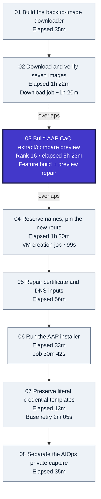
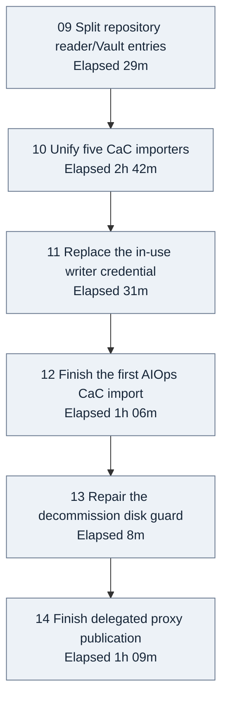
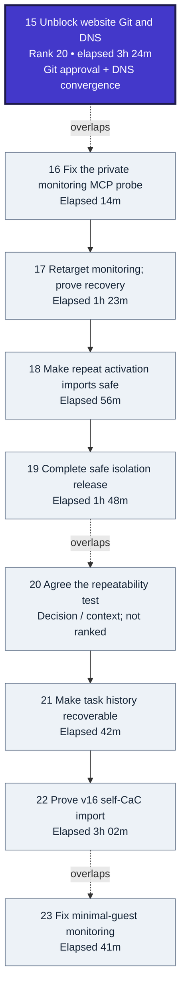
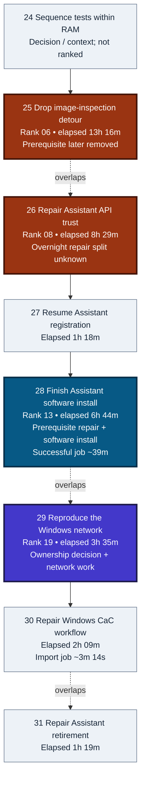
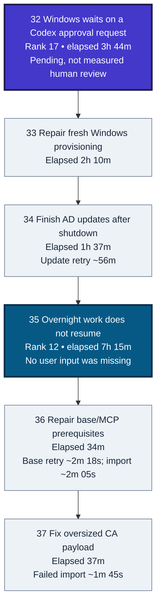
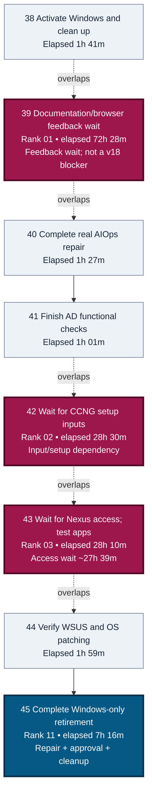
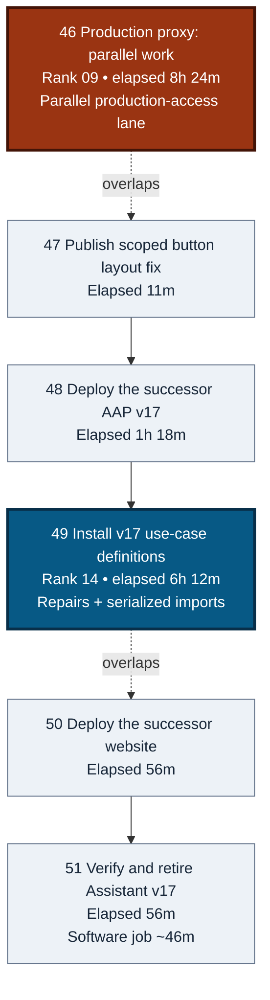
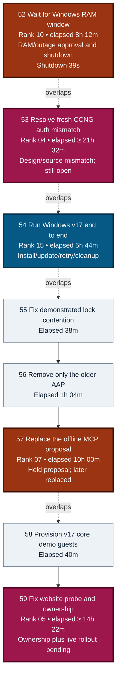
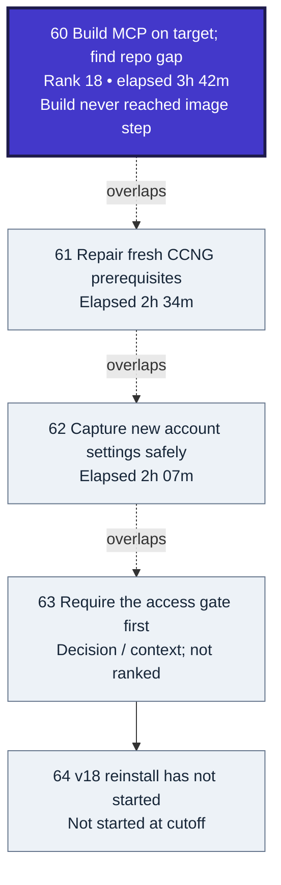

# Project Decision/Action Path Flowchart

**Frozen window:** 2 November 2026, 09:55:47 UTC → 9 November 2026, 09:55:47 UTC.

**Coverage:** 64 meaningful blocks across nine phases; top 20 elapsed episodes highlighted.

This replaces the one-day pilot with a frozen seven-day retrospective. It explains meaningful decisions, execution, failures, fixes and waits; it is **not a current deployment-status page**. Markdown is the primary report. The [compact HTML companion](project-decision-action-path-flowchart.html) contains the same blocks and lets a diagram node open its matching explanation.

The target was a repeatable chain: recover the test hypervisor, install AAP, import each use case, run its actual infrastructure/application jobs, demonstrate functionality, clean up owned resources, then let one AAP install its successor. **CaC import, software installation and functional acceptance are different results.** Production infrastructure remained outside the rebuild target.

At the cutoff, AAP v17 existed and many staged tests had passed. Website recovery/firewall rollout, live private-MCP builds and fresh CCNG acceptance still had gaps. **The complete test-hypervisor reinstall and v18 deployment had not started.**

## How to read the timings

Elapsed values below are rounded observations between recorded starts/failures/requests and the corresponding result, decision or cutoff. They are **not active working time**. A stated or measured job runtime is shown separately inside the block. Unknown runtime, active effort and wait attribution remain unknown.

The top 20 rank **concrete action episodes**, including explicit pending episodes—not umbrella goals such as “finish the project” or “wait for v18.” Scope decisions, milestones and a sub-repair already contained in a ranked episode are not ranked. Rank colours encode elapsed order only, **not success or failure**. Every coloured box also states its rank and duration.

**Do not add the rows.** Workstreams overlap and some waits allowed other progress. No cumulative implementation total or numerical critical path is claimed. In particular, the longest item is a documentation/browser-feedback wait, not 72 hours of coding and not a demonstrated v18 blocker. Production CCNG proxy work was a parallel lane, not evidence that successor work technically required it.

Solid arrows show observed sequence, not a proven dependency for every pair. Dotted arrows mark overlapping episode spans. Blocks are grouped by the work being explained, so a block can start in one phase and finish on a later date. Expand its explanation for the actual bounds.

## Why this took several days

| Contributor | What the evidence supports |
| --- | --- |
| Missing reproducibility | The original environment concealed prerequisites: network interfaces, issuer trust, usable repositories, tool setup and instance-specific settings. Fresh v16/v17 runs exposed them. |
| Repeated boundary defects | Numeric strings, templating/literal tags, workflow payloads, legacy ownership data, libvirt views, PowerShell depth and Python-version compatibility caused real stop/fix/retry cycles. |
| Documented waits and missed continuation | Narrow access/setup approvals, the RAM/outage decision, pending Codex approval operation and an explicitly acknowledged overnight hold created long calendar spans. Not every wait was a user delay, and reports did not continue jobs. |
| Real software time | The backup transfer was reported around 1h 20m; an AAP installer 30m 42s; Assistant software runs about 39m and 46m; one AD retry about 56m. These explain execution time without inflating it to whole-day effort. |
| Acceptance was broader than an import | Successful imports and configuration checks did not prove monitoring samples, model-driven repair, fresh unattended replay or safe teardown. Real tests found gaps that fixture checks had missed. |
| Scope and ownership changed during delivery | One importer replaced duplicate playbooks; credential naming/types were corrected; cloned services were retargeted; firewall ownership and offline MCP transport were later revised. Those were additional implementation episodes. |
| Side lanes are not the critical path | HTML feedback, production proxy work and small UI changes happened alongside factory tests. Their long recorded spans must not all be called time lost before v18. |

## The 20 longest evidenced episodes

**Magenta: ranks 1–5 · orange: 6–10 · cyan-blue: 11–15 · indigo: 16–20.** Other blocks are pale. The colours indicate elapsed ranking, not severity or completion.

| Rank | Step / concrete episode | Observed elapsed | Main interpretation |
| --- | --- | --- | --- |
| **01** | **39 — Publish the pilot report and wait for actual HTML feedback** | **72h 28m** | Documentation/browser-feedback wait; not a demonstrated v18 blocker |
| **02** | **42 — Prepare fresh CCNG prerequisites and its private reader** | **28h 30m** | Prerequisite approval/token wait, then target setup |
| **03** | **43 — Unblock the Nexus package pipeline with a narrow allowlist change** | **28h 10m** | Narrow access approval, then package tests |
| **04** | **53 — Resolve CCNG first-password assumptions without copying an existing login** | **≥ 21h 32m** | Fresh-auth design/source mismatch; unresolved at cutoff |
| **05** | **59 — Repair website monitoring and untangle firewall ownership** | **≥ 14h 22m** | Live website probe and firewall-ownership dependency |
| **06** | **25 — Remove the unnecessary Windows image-inspection prerequisite** | **13h 16m** | Avoidable image-inspection prerequisite |
| **07** | **57 — Resolve the held MCP artifact-key delivery proposal** | **10h 00m** | Held offline transport proposal; later replaced |
| **08** | **26 — Repair Assistant API trust before its first VM test** | **8h 29m** | Trust repair spanning overnight; active/wait split unknown |
| **09** | **46 — Make the existing production CCNG proxy work with trusted backend TLS** | **8h 24m** | Production proxy lane, parallel to successor acceptance |
| **10** | **52 — Free RAM through an approved source-AAP shutdown** | **8h 12m** | RAM capacity and explicit source-AAP outage decision |
| **11** | **45 — Finish Windows v16 cleanup through normal retirement jobs** | **7h 16m** | Cleanup repairs, partial removal and disk approval |
| **12** | **35 — Restart authorized work after an overnight continuation failure** | **7h 15m** | Explicit failure to continue already-authorized work |
| **13** | **28 — Fix the Assistant container bootstrap and complete software installation** | **6h 44m** | Container prerequisites plus a real software run |
| **14** | **49 — Install the testable v17 CaC catalog through the normal importer** | **6h 12m** | CaC repair, prerequisites and serialized imports |
| **15** | **54 — Exercise the v17 Windows lab and its owned cleanup** | **5h 44m** | Real Windows provisioning, configuration, updates and cleanup |
| **16** | **03 — Build AAP CaC extraction/comparison and verify the real preview** | **5h 23m** | New feature implementation and live-preview correction |
| **17** | **32 — Resume Windows after a pending Codex approval request** | **3h 44m** | Pending Codex approval operation; internal split unknown |
| **18** | **60 — Implement target-side MCP builds and attempt the first real run** | **3h 42m** | New target-build path; live attempt failed before building |
| **19** | **29 — Add the Windows-only second AAP network interface** | **3h 35m** | Windows-interface ownership decision and implementation |
| **20** | **15 — Unblock website deployment on missing Git and DNS convergence** | **3h 24m** | Missing Git approval plus DNS convergence |

## Decision/action flow

Every numbered node has the same numbered expandable explanation below. Job runtimes, where known, appear in the node and its explanation.

### 2 November — recover images and install the first AAP

### 3 November — simplify CaC imports and replace the trial instance

### 4 November — monitoring, isolation release and v16 self-import

### 4–5 November — prepare Assistant and the Windows network

### 5–6 November — repair first Windows execution and resume stalled work

### 6–7 November — prove repairs, finish Windows and handle waits

### 7–8 November — production HTTPS and the v17 successor

### 8 November — v17 runtime tests and new monitoring failure

### 9 November — factory gaps still open at the cutoff

## Expandable explanations

<strong>01 — Implement a reconnectable image downloader</strong> · 35m

**Context / issue:** Recovery lacked an rclone download playbook that survives controller disconnects.

**Decision, action and result:** Used native Ansible async with a saved job identifier, encrypted remote configuration, image hashes and safe publication checks; an initially discussed systemd service was not retained. Reported 59 distinct tests plus syntax/lint passing; encrypted inputs ready, live download not yet launched.

**Why the time passed:** Observed request-to-checkpoint span. Includes explanation/design discussion; no measured active-development duration.

**Timing:** 02 Nov 09:56:46 → 02 Nov 10:32:00 UTC; **35m observed**. State: **Completed episode**. Individual job runtime and active effort are unknown.

**Evidence:** Visible narrative at the stated bounds; later confirmations are not added to elapsed time.

<strong>02 — Download and verify the backup image set</strong> · 1h 22m

**Context / issue:** The replacement needed seven large disk images before recovery could proceed.

**Decision, action and result:** Launched the normal download job; monitored bytes, then checked all hashes before publication. All seven images verified and published; requested staging/obsolete-disk cleanup reported finished. A separately requested upstream image copy was size/hash-verified, and later confirmed in local and offhost storage; its upload completion time is unknown.

**Why the time passed:** Queue-to-success observation includes transfer and verification. Do not label this all implementation effort.

**Timing:** 02 Nov 11:42:45 → 02 Nov 13:04:45 UTC; **1h 22m observed**. State: **Completed episode**. About 1h 20m reported controller job runtime; observed queued-to-success span is separately calculated.

**Evidence:** Visible narrative at the stated bounds; later confirmations are not added to elapsed time.

<strong>03 — Build AAP CaC extraction/comparison and verify the real preview</strong> · Rank 16 · 5h 23m

**Context / issue:** No generic extraction/update path handled additions, changes, removals and concurrent repository edits.

**Decision, action and result:** Built comparison/update playbook and preview template. Live preview first failed; diagnosed missing private issuing CA, retained existing API credential type and supplied separate CA trust. Real preview passed with zero conflicts/validation errors; differences were reported without accepting a baseline or pushing configuration.

**Why the time passed:** Long observed feature span, NOT a continuous five-hour runtime. Significant implementation visibility gap between early comparison tests and publication; exact active/wait attribution is unknown.

**Timing:** 02 Nov 11:56:42 → 02 Nov 17:19:44 UTC; **5h 23m observed**. State: **Completed episode**. Individual job runtime and active effort are unknown.

**Evidence:** Visible narrative at the stated bounds; later confirmations are not added to elapsed time.

<strong>04 — Shared VM-name reservation and pinned replacement route</strong> · 1h 20m

**Context / issue:** The name counter and inherited private-network SSH route were unsuitable for creating uniquely named AAPs on another hypervisor.

**Decision, action and result:** Persisted reservations in encrypted Git before creation and bound each instance to its hypervisor identity and SSH route. New VM created, pinned guest host key checked through replacement, then login and administrator access and distinct machine identity verified.

**Why the time passed:** Observed design/build/verification span overlaps the image transfer. Never sum these as serial work.

**Timing:** 02 Nov 12:19:23 → 02 Nov 13:39:10 UTC; **1h 20m observed**. State: **Completed episode**. VM creation job itself reported about 99s.

**Evidence:** Visible narrative at the stated bounds; later confirmations are not added to elapsed time.

<strong>05 — Repair certificate, DNS and installation prerequisites</strong> · 56m

**Context / issue:** Certificate tooling absent, saved DNS credential returned HTTP 401, and first pre-install audit also rejected capacity/tools/connectivity expectations.

**Decision, action and result:** Approved Certbot packages installed through the existing base path; certificate account registered after legal/contact approval; refreshed stale DNS credential and retried after public DNS convergence; refined preparation checks. Infrastructure and prerequisite audit passed, leaving installer-owned preparation steps to the installer.

**Why the time passed:** Observed multi-prerequisite repair span. Includes approval, publication and DNS propagation; these cannot be apportioned precisely from visible messages.

**Timing:** 02 Nov 16:20:27 → 02 Nov 17:15:58 UTC; **56m observed**. State: **Completed episode**. Individual job runtime and active effort are unknown.

**Evidence:** Visible narrative at the stated bounds; later confirmations are not added to elapsed time.

<strong>06 — Run the AAP installer</strong> · 33m

**Context / issue:** Fresh guest still needed the actual AAP platform installed after prerequisites passed.

**Decision, action and result:** Launched bounded asynchronous preparation/installation and monitored progress and endpoint readiness until terminal success. Installer successful and intended Controller endpoint returned HTTP 200.

**Why the time passed:** Reported measured job duration is more useful than the launch/report observation span. Messages show CPU/disk progress during the wait.

**Timing:** 02 Nov 17:17:18 → 02 Nov 17:49:59 UTC; **33m observed**. State: **Completed episode**. 30m42s reported successful installer runtime.

**Evidence:** Visible narrative at the stated bounds; later confirmations are not added to elapsed time.

<strong>07 — Fix premature credential-template evaluation in base CaC</strong> · 13m

**Context / issue:** Installed platform base configuration failed while combining CaC variables: credential templates evaluated too early.

**Decision, action and result:** Reproduced against real configuration/collection version, preserved literal tags and retried only failed base stage. Base job succeeded; follow-up states44 affected template strings retained literal tags without changed values.

**Why the time passed:** Observed failure-report-to-success span includes focused code fix/publication and retry; successful installer was not rerun.

**Timing:** 02 Nov 17:52:45 → 02 Nov 18:05:17 UTC; **13m observed**. State: **Completed episode**. Successful base retry reported2m05s.

**Evidence:** Visible narrative at the stated bounds; later confirmations are not added to elapsed time.

<strong>08 — Separate the AIOps private capture and bootstrap access</strong> · 35m

**Context / issue:** AIOps shared a private capture and token with another project; existing token could not read the newly created companion.

**Decision, action and result:** Copied encrypted capture unchanged, added repository-scoped bootstrap reader and verified user-supplied PAT before switching importer bindings. Private capture, URL, credential binding and publication verified; separate runtime vault location remained explicitly unresolved. Earlier, the user selected base-only AutoDeploy with optional use-case imports. The label audit found incomplete API/UI coverage, so labels could not provide universal ownership.

**Why the time passed:** Contains a visible PAT-input wait: inability reported19:19:39.943; user supplied token19:37:32.577. Other bootstrap work continued meanwhile.

**Timing:** 02 Nov 19:14:51 → 02 Nov 19:49:32 UTC; **35m observed**. State: **Completed episode**. Individual job runtime and active effort are unknown.

**Evidence:** Visible narrative at the stated bounds; later confirmations are not added to elapsed time. Decision history: 3b6d48f separates AIOps bootstrap access; the Nov 2 label audit (1846f71) leaves universal ownership unresolved.

<strong>09 — Split and rename per-repository read/Vault credentials</strong> · 29m

**Context / issue:** Repository credential names/references were unclear and five secret repositories shared one Vault credential object.

**Decision, action and result:** After explicit split approval, created five named reader/Vault pairs, changed bootstrap/CaC references and reassigned14 templates. Independent source/receiving-controller readbacks and active-reference checks passed. Later status confirmation was not extra execution time.

**Why the time passed:** Implementation/verification span ends11:34; the later13:27 completion reply should not inflate this to over two hours.

**Timing:** 03 Nov 11:04:39 → 03 Nov 11:34:05 UTC; **29m observed**. State: **Completed episode**. Individual job runtime and active effort are unknown.

**Evidence:** Visible narrative at the stated bounds; later confirmations are not added to elapsed time. Decision history: 7e5f672 binds repository-specific reader/Vault pairs.

<strong>10 — Unify five importers, migrate capture names and remove wrappers</strong> · 2h 42m

**Context / issue:** Five import playbooks duplicated logic; some apparent special cases already existed in CoP. Implementation also retained wrappers contrary to the requested direct extra-variable design.

**Decision, action and result:** Analysed differences, agreed one importer with fixed project ID per JT, renamed five capture files, preserved activation state, then removed wrappers and corrected deployment names/naming collision. Five direct shared-playbook templates verified with IDs/credentials/links preserved; no use-case runtime launched. The user required API authentication exclusively and removed installer-password lookup over SSH as a fallback.

**Why the time passed:** Observed analysis-to-final-correction span includes a long alternative-design discussion, three coordinated agents and avoidable wrapper/name rework. Actual implementation approval begins14:47:16.359; earlier interval is analysis/decision time.

**Timing:** 03 Nov 13:42:51 → 03 Nov 16:24:53 UTC; **2h 42m observed**. State: **Completed episode**. Individual job runtime and active effort are unknown.

**Evidence:** Visible narrative at the stated bounds; later confirmations are not added to elapsed time. Decision history: b5fb34b removes wrappers and calls one playbook with saved project-ID extra variables.

<strong>11 — Replace the allocation writer without changing an in-use type</strong> · 31m

**Context / issue:** Desired writer credential type could not be changed on the source controller because its credential had job history.

**Decision, action and result:** Verified dedicated writer/read-only token permissions, updated code to the existing user-owned token type, then obtained replacement approval and switched assignments before deleting retired credential. Both controllers verified, retired credential removed and source/private configuration published. Earlier registry simplification reused the repository Vault and reader; extra registry credentials were unnecessary.

**Why the time passed:** Observed migration span includes real API limitation and approval wait; do not call it an unexplained stall.

**Timing:** 03 Nov 17:13:37 → 03 Nov 17:44:45 UTC; **31m observed**. State: **Completed episode**. Individual job runtime and active effort are unknown.

**Evidence:** Visible narrative at the stated bounds; later confirmations are not added to elapsed time. Decision history records reuse of the existing repository Vault and reader rather than extra registry credentials.

<strong>12 — Complete AIOps import through sequential rendering/input/content failures</strong> · 1h 06m

**Context / issue:** Importer failed on unresolved organization expression, then empty numeric timeout, TLS-value handling and missing required collection in PAH.

**Decision, action and result:** Reproduced rendering in actual EE/native modes, supplied explicit timeout, fixed protected values, prepared selected collection prerequisites and retried only failed import. AIOps CaC deployment reported successful; website infrastructure itself remained a separate subsequent task. A fixed target credential could not handle multiple instances: the populated custom token store selected URL/token by instance name, with missing, mismatched and expired inputs checked.

**Why the time passed:** Observed investigation-to-success span overlaps token-selection/store implementation. Successful previous import phases exposed the next real missing prerequisite.

**Timing:** 03 Nov 18:42:04 → 03 Nov 19:48:21 UTC; **1h 06m observed**. State: **Completed episode**. Individual job runtime and active effort are unknown.

**Evidence:** Visible narrative at the stated bounds; later confirmations are not added to elapsed time.

<strong>13 — Correct the decommission disk validator</strong> · 8m

**Context / issue:** Preview rejected native libvirt disk XML because its ordinary index metadata attribute was unexpected.

**Decision, action and result:** Accepted the legitimate attribute while keeping exact disk ownership and foreign/additional disk refusal; reran preview before authorized deletion. Selected old instance VM/disk/proxy/certificate/DNS/access records removed; images and consumed name preserved.

**Why the time passed:** Bounded failure-to-success repair span. This does not represent all earlier decommission implementation work.

**Timing:** 03 Nov 20:38:09 → 03 Nov 20:46:01 UTC; **8m observed**. State: **Completed episode**. Individual job runtime and active effort are unknown.

**Evidence:** Visible narrative at the stated bounds; later confirmations are not added to elapsed time.

<strong>14 — Repair delegated proxy publication after successful installation</strong> · 1h 09m

**Context / issue:** Installation succeeded but following hypervisor check/proxy publication failed. Separate identity probe passed; an attempted resume also failed reading completed installer output.

**Decision, action and result:** Diagnosed wrong inventory-variable lookup under delegation, bound route lookup to original instance entry and retried only TLS/nginx publication. Proxy retry and public API check succeeded without reinstalling AAP; base configuration subsequently succeeded.

**Why the time passed:** Observed span includes explicit ownership hold from21:59:22.141 until user-driven resume22:45:53.951 (46m31.810s). Diagnosis/resume/publication after that took22m15.646s to success; not69m continuous debugging.

**Timing:** 03 Nov 21:59:22 → 03 Nov 23:08:09 UTC; **1h 09m observed**. State: **Completed episode**. Individual job runtime and active effort are unknown.

**Evidence:** Visible narrative at the stated bounds; later confirmations are not added to elapsed time.

<strong>15 — Unblock website deployment on missing Git and DNS convergence</strong> · Rank 20 · 3h 24m

**Context / issue:** Website job found Git absent even though later base manifest declared it; after installation a new DNS record had not converged for certificate issuance.

**Decision, action and result:** Waited for package approval, installed Git via existing package path, retried website, retained rollback on certificate failure, verified public DNS convergence and retried. TrustedHTTPS, content and correct new-AAP webhook verified; button disarmed.

**Why the time passed:** Long observed dependency span, not three hours of active coding. Pending Git approval is explicitly restated at02:27,02:46,03:05; installation authorized/resumed05:20 and completed05:23. Other MCP work progressed during wait.

**Timing:** 04 Nov 02:09:39 → 04 Nov 05:33:32 UTC; **3h 24m observed**. State: **Completed episode**. Individual job runtime and active effort are unknown.

**Evidence:** Visible narrative at the stated bounds; later confirmations are not added to elapsed time.

<strong>16 — Fix private monitoring MCP protocol verification</strong> · 14m

**Context / issue:** Installed MCP container first could not read private configuration due UID mismatch; after access repair, verifier rejected an authenticated quoted JSON-string result.

**Decision, action and result:** Matched container UID to private-file owner, then narrowly normalized the legitimate successful response while retaining malformed/error rejection; reran normal job. Normal retry succeeded with authenticated read-only MCP query; Linux MCP settings preserved.

**Why the time passed:** Observed two-defect repair span; no evidence of a model invocation or unprotected configuration workaround.

**Timing:** 04 Nov 02:46:34 → 04 Nov 03:00:48 UTC; **14m observed**. State: **Completed episode**. Individual job runtime and active effort are unknown.

**Evidence:** Visible narrative at the stated bounds; later confirmations are not added to elapsed time.

<strong>17 — Retarget cloned monitoring, prove EDA loop and install the limited agent</strong> · 1h 23m

**Context / issue:** Clone inherited old names/endpoints and forwarding was deliberately off; targeted agent job separately used wrong Project, then package download hit recovery isolation.

**Decision, action and result:** Retargeted checks/media/auth to selected instance, verified event-stream delivery, enabled only intended action; corrected agent Project and applied approved scoped egress before retry. Real outage→automatic restore→rearm passed; user repeat also passed. Agent installation succeeded and agent.ping returned 1 on the intended guest.

**Why the time passed:** Coherent monitoring integration span with parallel branches: EDA loop passed06:54:12.867; agent branch finished07:12:47.368. Isolation/ownership/publication decisions appear within span, so not one measured job duration.

**Timing:** 04 Nov 05:49:28 → 04 Nov 07:12:47 UTC; **1h 23m observed**. State: **Completed episode**. Individual job runtime and active effort are unknown.

**Evidence:** Visible narrative at the stated bounds; later confirmations are not added to elapsed time.

<strong>18 — Make repeat import of a running activation idempotent</strong> · 56m

**Context / issue:** A normal CaC refresh tried changing an already-running activation. Initial nested-object/ID hypothesis did not reproduce.

**Decision, action and result:** Found native templating converted settings text to dictionary and dropped trailing newline; preserved exact text and tested unchanged versus changed/null/omitted settings; fixed lint cache path after permission prompt. Normal import passed on fixed code; live website activation, stream URL and existing template count preserved.

**Why the time passed:** Observed failure-to-live-success span. Visible record explicitly retracts the initial hypothesis; lint-stall duration cannot be quantified from one later report.

**Timing:** 04 Nov 08:12:44 → 04 Nov 09:09:04 UTC; **56m observed**. State: **Completed episode**. Individual job runtime and active effort are unknown.

**Evidence:** Visible narrative at the stated bounds; later confirmations are not added to elapsed time.

<strong>19 — Verify automatic release after guest configuration</strong> · 1h 48m

**Context / issue:** The new release hook had to run through the normal job without recreating the configured guest.

**Decision, action and result:** A transient certified-collection checksum failure did not reproduce. The real retry exposed a persistent-versus-running libvirt description mismatch; the focused fix retained live identity checks. The normal configuration job then released only the selected guest.

**Why the time passed:** The span includes publication, a collection-sync retry, a real validator fix and independent saved-policy checks; it is not one long firewall command.

**Timing:** 04 Nov 09:52:37 → 04 Nov 11:40:36 UTC; **1h 48m observed**. State: **Completed episode**. Individual job runtime and active effort are unknown.

**Evidence:** Visible narrative at the stated bounds.

<strong>20 — Define successor acceptance and protect production</strong> · decision/context

**Context / issue:** Working on the original host did not establish that its automation could reconstruct an independent environment.

**Decision, action and result:** The user defined success as one test AAP installing a functional successor. Future jobs must support the selected local or remote test hypervisor, with production excluded. Older production templates stay outside future CaC; Orchestrator retains its intended external-cluster integration.

**Why the time passed:** This is a scope decision, not a measured deployment or active-effort interval.

**Timing:** 04 Nov 09:56:27 → 04 Nov 10:16:10 UTC; **decision/context observed**. State: **Decision**. Individual job runtime and active effort are unknown.

**Evidence:** Visible narrative at the stated bounds.

<strong>21 — Save task history and restart decisions in Git</strong> · 42m

**Context / issue:** Beads alone would not preserve recovery knowledge through a host rebuild.

**Decision, action and result:** Generated public task summaries and encrypted complete records were committed, published and independently checked. The older teardown template was compared with the modern job and added no cleanup capability.

**Why the time passed:** Publication met intermittent SSH/GitHub failures. Individual repositories succeeded on retries without changing keys or transport; other workers continued.

**Timing:** 04 Nov 10:18:24 → 04 Nov 10:59:59 UTC; **42m observed**. State: **Completed episode**. Individual job runtime and active effort are unknown.

**Evidence:** Visible narrative at the stated bounds.

<strong>22 — Make v16 import its own AutoDeploy configuration</strong> · 3h 02m

**Context / issue:** Imported definitions still contained production defaults and mismatched launch requirements.

**Decision, action and result:** Corrected trust handling, an optional absent inventory, five credential-prompt flags and an existing Vault credential name. Normal preparation and self-import succeeded; 69 template identities and bindings were preserved.

**Why the time passed:** Several sequential runtime mismatches required import/readback/retry cycles. Monitoring proceeded in parallel. This proved self-import, not successor VM deployment.

**Timing:** 04 Nov 15:34:17 → 04 Nov 18:36:24 UTC; **3h 02m observed**. State: **Completed episode**. Individual job runtime and active effort are unknown.

**Evidence:** Visible narrative at the stated bounds.

<strong>23 — Correct monitoring for the minimal Linux test guest</strong> · 41m

**Context / issue:** The cloned monitoring included Apache checks although the minimal guest had no Apache.

**Decision, action and result:** Enabled Linux/connectivity checks and disabled irrelevant Apache checks while retaining history. Two normal deployment runs and independent readings passed.

**Why the time passed:** The observed span overlaps self-CaC repair. It must not be added as serial time.

**Timing:** 04 Nov 15:46:11 → 04 Nov 16:26:55 UTC; **41m observed**. State: **Completed episode**. Individual job runtime and active effort are unknown.

**Evidence:** Visible narrative at the stated bounds.

<strong>24 — Sequence RAM-heavy tests and agree the rebuild gate</strong> · decision/context

**Context / issue:** A complete duplicate environment plus the Windows and Assistant guests would exceed the available memory budget.

**Decision, action and result:** The user approved sequential use-case runs and their cleanup, existing Vertex authentication reuse and encrypted instance-setting writes. Full test-hypervisor reinstall and v18 remained conditional on successful acceptance; OpenShift testing was deferred.

**Why the time passed:** Planning/approval discussion is not a job runtime. New per-instance settings and decommission coverage became explicit work rather than hidden prerequisites.

**Timing:** 04 Nov 19:45:23 → 04 Nov 21:10:34 UTC; **decision/context observed**. State: **Decision**. Individual job runtime and active effort are unknown.

**Evidence:** Visible narrative at the stated bounds.

<strong>25 — Remove the unnecessary Windows image-inspection prerequisite</strong> · Rank 06 · 13h 16m

**Context / issue:** Runtime testing was held for offline image inspection, first missing NTFS tooling and then missing guest-filesystem support.

**Decision, action and result:** Approved packages were installed through the existing host playbook after checksum and recovery-scope corrections. Inspection still failed. The user removed this extra step because the prepared images already had WinRM; actual guest connectivity still had to be tested.

**Why the time passed:** Includes overnight input/approval delivery, package retries and an avoidable prerequisite. Do not call all of it human review time: an approval arrived through coordination after being reported pending.

**Timing:** 04 Nov 21:30:16 → 05 Nov 10:46:01 UTC; **13h 16m observed**. State: **Completed episode**. Individual job runtime and active effort are unknown.

**Evidence:** Visible narrative at the stated bounds.

<strong>26 — Repair Assistant API trust before its first VM test</strong> · Rank 08 · 8h 29m

**Context / issue:** The first Assistant job failed its inventory check before creating a VM because its private CA replaced the working trust bundle.

**Decision, action and result:** Preserved existing trust and added the selected issuer. The next morning normal configuration refresh succeeded with the trust and retirement changes.

**Why the time passed:** This bounds an overnight repair/publication episode. The fix was reported already published by the morning resume; the exact active effort and overnight wait split are unknown.

**Timing:** 04 Nov 21:39:59 → 05 Nov 06:08:52 UTC; **8h 29m observed**. State: **Completed episode**. Individual job runtime and active effort are unknown.

**Evidence:** Visible narrative at the stated bounds.

<strong>27 — Repair Assistant inventory registration and resume the preserved clone</strong> · 1h 18m

**Context / issue:** A clone existed, but group association failed on a rendered host-ID type. Initial repair checks also assumed a group alias and leaked into later plays.

**Decision, action and result:** Fixed the association and bounded repair path, previewed it, then changed only the intended group membership. A numeric-string SSH-port mismatch was normalized. Configuration resumed on the same VM without another allocation.

**Why the time passed:** Several small compatibility failures were exposed one after another by real previews and jobs. Preserving the clone avoided repeating disk provisioning.

**Timing:** 05 Nov 07:15:10 → 05 Nov 08:32:47 UTC; **1h 18m observed**. State: **Completed episode**. Individual job runtime and active effort are unknown.

**Evidence:** Visible narrative at the stated bounds.

<strong>28 — Fix the Assistant container bootstrap and complete software installation</strong> · Rank 13 · 6h 44m

**Context / issue:** The inherited Debian container needed HTTP package access, while the new bootstrap initially allowed only HTTPS. Rewriting to HTTPS exposed missing in-container CA trust.

**Decision, action and result:** The user retained the demo image and HTTP downloads; UBI10 rebuilding was deferred. Applied only the approved guest access, corrected a stale checkout reference and completed the normal configuration run.

**Why the time passed:** Includes diagnosis, user-selected download policy, publication and retry. Host curl/wget trust did not prove container trust. The successful job took about 39 minutes; the remaining span is not measured coding effort.

**Timing:** 05 Nov 08:46:27 → 05 Nov 15:30:19 UTC; **6h 44m observed**. State: **Completed episode**. Successful software job: reported about 39 minutes.

**Evidence:** Visible narrative at the stated bounds.

<strong>29 — Add the Windows-only second AAP network interface</strong> · Rank 19 · 3h 35m

**Context / issue:** The original AAP already had a second interface on the isolated Windows network; the fresh AAP did not.

**Decision, action and result:** The user put that setup in Windows infrastructure, following the AIOps infrastructure pattern. Deployment and retirement were aligned on interface ownership, and the published implementation reproduced the network setup.

**Why the time passed:** Discussion selected the correct owner before implementation. Completion is reported to minute precision in the existing pilot evidence; this is not a measured three-hour job.

**Timing:** 05 Nov 11:08:23 → 05 Nov 14:43:00 UTC; **3h 35m observed**. State: **Completed episode**. Individual job runtime and active effort are unknown.

**Evidence:** Visible discussion plus the existing published pilot timing: completion reported by 5 Nov 14:43 UTC.

<strong>30 — Import Windows definitions and repair obsolete workflow links</strong> · 2h 09m

**Context / issue:** Saved workflow-node data no longer matched the receiving AAP interface.

**Decision, action and result:** Corrected the workflow links and later saved-configuration gaps, then completed the normal import. Existing template identities were retained; importing definitions did not run the Windows lab.

**Why the time passed:** Multiple correction/import cycles dominate the elapsed span. The successful import itself was roughly three minutes, not two hours.

**Timing:** 05 Nov 14:48:50 → 05 Nov 16:58:00 UTC; **2h 09m observed**. State: **Completed episode**. Successful import: previously measured about 3m 14s.

**Evidence:** Visible launch plus terminal minute/runtime retained in the published pilot evidence.

<strong>31 — Finish the normal Assistant retirement after its software test</strong> · 1h 19m

**Context / issue:** Normal cleanup removed the VM and disk but left a follow-up inventory association.

**Decision, action and result:** Reused the focused registration correction in retirement, refreshed CaC and reran the preview/apply path until owned resources were removed.

**Why the time passed:** Software success did not prove lifecycle cleanup. This observed retirement interval includes configuration refresh and verification; exact individual runtimes are unavailable.

**Timing:** 05 Nov 15:30:19 → 05 Nov 16:49:00 UTC; **1h 19m observed**. State: **Completed episode**. Individual job runtime and active effort are unknown.

**Evidence:** Visible successful software message plus retirement terminal minute retained in the published pilot.

<strong>32 — Resume Windows after a pending Codex approval request</strong> · Rank 17 · 3h 44m

**Context / issue:** The main Codex session was waiting on an approval-gated operation, so it did not handle completed worker results or start the next Windows steps.

**Decision, action and result:** When that pending operation returned, the main session reconciled the completed work and resumed the approved test sequence.

**Why the time passed:** The existing pilot records 3h 44m 6s pending. The specific operation and the split between an approval answer and subsequent processing are not established in the retained evidence. This is neither four hours of shell execution nor a measured human-review duration.

**Timing:** 05 Nov 16:36:59 → 05 Nov 20:21:05 UTC; **3h 44m observed**. State: **Completed episode**. Individual job runtime and active effort are unknown.

**Evidence:** Previously recorded native-event timing in the published pilot; visible narrative corroborates the delayed continuation.

<strong>33 — Fix fresh Windows creation without discarding completed disk copies</strong> · 2h 10m

**Context / issue:** Real creation exposed missing trust, wrong network precedence, truncated SSH pins, an excessive host-key requirement, legacy ownership data, repeated successful setup and DNS writes on a DNS-disabled network.

**Decision, action and result:** Corrected each demonstrated mismatch, preserved verified disk copies and resumed only incomplete branches. All five creation stages passed. PowerShell output depth then fixed the next AD provenance check.

**Why the time passed:** Each successful guard exposed another untested producer/consumer boundary. Broad protected logging slowed diagnosis. This was substantial rework in automation, not just slow VM copying.

**Timing:** 05 Nov 20:26:57 → 05 Nov 22:37:04 UTC; **2h 10m observed**. State: **Completed episode**. Individual job runtime and active effort are unknown.

**Evidence:** Visible narrative at the stated bounds.

<strong>34 — Recover the AD guest and finish its update retry</strong> · 1h 37m

**Context / issue:** An AD update run waited on a guest that had powered off. Windows licensing events identified an evaluation-related shutdown.

**Decision, action and result:** Started the verified guest once, checked licensing and retried only the failed configuration. The retry completed with no remaining updates or pending reboot.

**Why the time passed:** The failed run took about 28 minutes and the successful retry about 56 minutes. The licensing/time discrepancy required further checks; the later report time must not extend this run into the morning.

**Timing:** 05 Nov 22:42:04 → 06 Nov 00:19:00 UTC; **1h 37m observed**. State: **Completed episode**. Reported runs: about 28 minutes failed, then 56 minutes successful.

**Evidence:** Run completion at 00:19 UTC reported in the 6 Nov 07:34 narrative and existing pilot.

<strong>35 — Restart authorized work after an overnight continuation failure</strong> · Rank 12 · 7h 15m

**Context / issue:** The successful AD job was followed by no next job; reports repeated stale status.

**Decision, action and result:** The assistant explicitly acknowledged leaving both workers waiting for its next instruction. It resumed Windows and MCP work after the morning check. No user permission was missing.

**Why the time passed:** About 7h 15m was a documented continuation gap, not installer runtime or an approval delay. Reports themselves did not advance execution.

**Timing:** 06 Nov 00:19:00 → 06 Nov 07:34:17 UTC; **7h 15m observed**. State: **Completed episode**. Individual job runtime and active effort are unknown.

**Evidence:** Recorded AD completion and 6 Nov 07:34/07:42/07:46 explanation.

<strong>36 — Fix final AAP release and publish missing MCP credentials</strong> · 34m

**Context / issue:** Base configuration reached its final release guard but interpreted the Windows second interface as the primary interface. Required bootstrap credentials were also absent.

**Decision, action and result:** Restricted release to the true primary interface, preserved the selected VM checks, completed normal base provisioning and corrected a stale inventory alias before import.

**Why the time passed:** A focused local test spent roughly 14 minutes pending before writable temporary paths let it finish in 0.4 seconds. Successful base and import jobs were only a few minutes each.

**Timing:** 06 Nov 07:41:03 → 06 Nov 08:15:25 UTC; **34m observed**. State: **Completed episode**. Base attempts previously measured about 2m 48s and 2m 18s; successful import 2m 4.786s.

**Evidence:** Visible narrative at the stated bounds.

<strong>37 — Shrink the private API certificate payload instead of weakening nginx</strong> · 37m

**Context / issue:** AIOps import attempted to save 147 CA certificates and exceeded the proxy request limit.

**Decision, action and result:** Kept only the actual small issuer chain, verified both AAP and private MCP trust, and completed the imports. Normal provider trust and nginx limits stayed intact.

**Why the time passed:** The import failure was reported at 08:21 and the reduced issuer verified by 08:33; passed imports were reported by 08:58. The elapsed observation includes shared import sequencing.

**Timing:** 06 Nov 08:21:19 → 06 Nov 08:58:33 UTC; **37m observed**. State: **Completed episode**. Failed import previously measured about 1m 45s.

**Evidence:** Visible narrative at the stated bounds.

<strong>38 — Activate Server 2025 with temporary connectivity and remove it afterward</strong> · 1h 41m

**Context / issue:** Time correction did not activate this new guest; the existing activation path needed a bounded exception through recovery isolation.

**Decision, action and result:** Used the approved temporary network attachment, ran normal activation and independently verified license status. Fixed a cleanup command and confirmed the temporary adapter, rules and network were gone.

**Why the time passed:** A read-only MCP request hung for about 29 minutes before being interrupted; this delayed obtaining the activation result. The activation and cleanup are distinct from publication of their fix.

**Timing:** 06 Nov 09:05:00 → 06 Nov 10:45:45 UTC; **1h 41m observed**. State: **Completed episode**. Individual job runtime and active effort are unknown.

**Evidence:** Visible narrative at the stated bounds.

<strong>39 — Publish the pilot report and wait for actual HTML feedback</strong> · Rank 01 · 72h 28m

**Context / issue:** The published HTML did not show the expected diagram for the user. Parsing and JavaScript syntax checks had not proved browser rendering.

**Decision, action and result:** Separated import/render/control errors, retained visible SVG after control failure and published diagnostics. The user later confirmed the downloaded diagram works, but its control warning remained and requested a clearer seven-day report.

**Why the time passed:** This long span largely records unresolved browser feedback while infrastructure work continued. It is not three days of active HTML debugging. The current report fixes the separately identified doubled-escape/node-count bug after the frozen cutoff.

**Timing:** 06 Nov 09:26:10 → 09 Nov 09:54:08 UTC; **72h 28m observed**. State: **Partial result: diagram seen; controls still faulty at cutoff**. Individual job runtime and active effort are unknown.

**Evidence:** Visible narrative at the stated bounds.

<strong>40 — Prove a real model-driven monitoring repair</strong> · 1h 27m

**Context / issue:** The first controlled runner expected a project-ID variable AAP does not supply. Its retry mishandled an unset workspace; another run hit a turn limit after the repair child had succeeded.

**Decision, action and result:** Fixed those bounded preflights and raised the existing turn cap while retaining time/job limits. A real alert then launched EDA, one model invocation and one repair job; service, fresh monitoring and original-alert recovery passed.

**Why the time passed:** Several runner failures occurred around successful child repairs, so neither model prose nor a child success alone was accepted as end-to-end completion.

**Timing:** 06 Nov 09:33:58 → 06 Nov 11:01:15 UTC; **1h 27m observed**. State: **Completed episode**. Individual job runtime and active effort are unknown.

**Evidence:** Visible narrative at the stated bounds.

<strong>41 — Finish AD functional checks despite a transient AAP outage</strong> · 1h 01m

**Context / issue:** AD continuation initially required all resources before it could create missing ones. AAP also briefly stalled.

**Decision, action and result:** Allowed missing resources only during initial inspection, retaining final completeness/ownership validation. The functional run passed directory logins, permission checks and test jobs. WSUS/Nexus configuration progressed separately.

**Why the time passed:** One outage showed database timeouts; a later one showed a watchdog-respawned worker. The original cause was not proved. It recovered without a restart and was closed as non-recurring on 8 Nov, not claimed fixed.

**Timing:** 06 Nov 11:01:15 → 06 Nov 12:01:46 UTC; **1h 01m observed**. State: **Completed episode**. Individual job runtime and active effort are unknown.

**Evidence:** Visible narrative at the stated bounds.

<strong>42 — Prepare fresh CCNG prerequisites and its private reader</strong> · Rank 02 · 28h 30m

**Context / issue:** The test workstation lacked the native Codex/Beads environment and private-repository reader input, although Machine and Vault choices were already resolved.

**Decision, action and result:** The user approved prerequisite/compiler installation and supplied the repository token the next afternoon. Used available signed RHEL packages when the guest had no enabled repositories; tool and build checks completed.

**Why the time passed:** Most of the observed span preceded the explicit setup approval/token confirmation. The preparation then took about 42 minutes by message bounds. It did not establish a fresh AAP-driven CCNG application deployment.

**Timing:** 06 Nov 11:36:44 → 07 Nov 16:06:40 UTC; **28h 30m observed**. State: **Completed episode**. Individual job runtime and active effort are unknown.

**Evidence:** Visible narrative at the stated bounds.

<strong>43 — Unblock the Nexus package pipeline with a narrow allowlist change</strong> · Rank 03 · 28h 10m

**Context / issue:** AAP reached the external test repository through a primary address absent from that VM firewall allowlist. Remaining package tests could not run.

**Decision, action and result:** After the user approved the single-source port rule on 7 Nov, applied it through the normal job. Synchronization, export/import, baseline applications and upgrades then passed.

**Why the time passed:** The access request remained pending for roughly 27h 39m. Approval-to-final-result observation was about 31 minutes. Other work progressed during that wait; these are not additive project-hours.

**Timing:** 06 Nov 12:02:07 → 07 Nov 16:12:02 UTC; **28h 10m observed**. State: **Completed episode**. Individual job runtime and active effort are unknown.

**Evidence:** Visible narrative at the stated bounds.

<strong>44 — Complete the Windows OS patch tests and consent safeguards</strong> · 1h 59m

**Context / issue:** The test needed imported update metadata, actual patch/reboot checks and a stop when an agreement requires acceptance.

**Decision, action and result:** Removed automatic agreement acceptance, verified the PowerShell safeguards and completed both managed-server OS patch tests with no approved updates or pending reboot.

**Why the time passed:** Real metadata processing and update installation took time. Exact job runtimes are unavailable; the nearly two-hour message span also includes safeguard work.

**Timing:** 06 Nov 12:17:50 → 06 Nov 14:16:53 UTC; **1h 59m observed**. State: **Completed episode**. Individual job runtime and active effort are unknown.

**Evidence:** Visible narrative at the stated bounds.

<strong>45 — Finish Windows v16 cleanup through normal retirement jobs</strong> · Rank 11 · 7h 16m

**Context / issue:** Cleanup rejected ordinary memberships, then used an unsupported Python file-check API after removing a VM definition. Its disk remained; follow-up policy cleanup failed too.

**Decision, action and result:** Allowed only verified normal memberships, published the compatibility repair, obtained specific leftover-disk permission and continued the normal jobs. All five Windows guests and owned resources were removed; core guests and golden images were preserved.

**Why the time passed:** The interval includes a long gap before removal, a partial-cleanup repair and a separate disk approval. It is not seven hours of deleting VMs. No wider environment teardown was authorized by it.

**Timing:** 07 Nov 16:18:35 → 07 Nov 23:34:09 UTC; **7h 16m observed**. State: **Completed episode**. Individual job runtime and active effort are unknown.

**Evidence:** Visible narrative at the stated bounds.

<strong>46 — Make the existing production CCNG proxy work with trusted backend TLS</strong> · Rank 09 · 8h 24m

**Context / issue:** Public HTTPS initially reached an app listening only on loopback. Backend TLS support, the actual installation directory and saved host overrides also needed reconciliation.

**Decision, action and result:** Configured frontend TLS/Basic authentication, generated and explicitly trusted the backend certificate, corrected the installation path and respected user-owned restart. A proposed host-setting removal was rejected and not applied. The user confirmed both public and localhost access.

**Why the time passed:** The long observation includes user updates/password setup, a stalled filesystem-approval request, changing app versions and the listener restart boundary. Local 401/TLS checks alone had not proved browser access.

**Timing:** 07 Nov 15:36:36 → 08 Nov 00:00:51 UTC; **8h 24m observed**. State: **Completed episode**. Individual job runtime and active effort are unknown.

**Evidence:** Visible narrative at the stated bounds.

<strong>47 — Publish the small approval-button layout correction</strong> · 11m

**Context / issue:** Two approval buttons wrapped and displayed different heights.

**Decision, action and result:** Published the isolated one-line-label/short-height correction with checks and build passing; the app builder retained it in later releases. Subsequent misplaced UI requests were handed back rather than implemented here.

**Why the time passed:** This was a small, separate source change alongside proxy work. Publication did not itself prove deployed appearance.

**Timing:** 07 Nov 23:31:13 → 07 Nov 23:42:05 UTC; **11m observed**. State: **Completed episode**. Individual job runtime and active effort are unknown.

**Evidence:** Visible narrative at the stated bounds.

<strong>48 — Use v16 to build AAP v17 without reallocating the failed first stage</strong> · 1h 18m

**Context / issue:** Stage one created and booted v17 but the guest check inherited the hypervisor SSH port.

**Decision, action and result:** Fixed variable handling, resumed guest verification on the same VM, restored normal template settings and completed DNS/TLS, installation and base configuration. Authenticated API and independent identity checks passed.

**Why the time passed:** There was one real continuation repair. The total observation is about 1h 18m; the installer was reported progressing during polling. This did not prove a fresh fully unattended repeat.

**Timing:** 08 Nov 00:16:50 → 08 Nov 01:34:59 UTC; **1h 18m observed**. State: **Completed episode**. Individual job runtime and active effort are unknown.

**Evidence:** Visible narrative at the stated bounds.

<strong>49 — Install the testable v17 CaC catalog through the normal importer</strong> · Rank 14 · 6h 12m

**Context / issue:** The source catalog lagged, AIOps rejected a numeric-string SSH port, a direct Windows import skipped collection prerequisites and the RHEL case unnecessarily demanded PAH content already in its execution image.

**Decision, action and result:** Refreshed the source catalog, corrected those concrete gaps and used normal prerequisite/import paths. Six use-case definitions and v17 self-import were verified; CCNG remained separate. Production source pins were retained before publishing new test code.

**Why the time passed:** Imports were sequenced around shared writes and the Assistant test. The six-hour span includes those dependencies and fixes, not six hours of importing configuration.

**Timing:** 08 Nov 01:42:40 → 08 Nov 07:55:09 UTC; **6h 12m observed**. State: **Completed episode**. Individual job runtime and active effort are unknown.

**Evidence:** Visible narrative at the stated bounds.

<strong>50 — Deploy the v17 website while handling negative DNS caching</strong> · 56m

**Context / issue:** The new public record had converged externally while the operator resolver still cached an earlier negative response.

**Decision, action and result:** The normal website deployment completed with trusted HTTPS, intended AAP link and a disarmed button. Verification used the approved public endpoint while preserving certificate checks.

**Why the time passed:** The observed delay includes DNS convergence/caching. It was not a reason to recreate the website resources or disable TLS verification.

**Timing:** 08 Nov 04:39:03 → 08 Nov 05:34:35 UTC; **56m observed**. State: **Completed episode**. Individual job runtime and active effort are unknown.

**Evidence:** Visible narrative at the stated bounds.

<strong>51 — Run and retire the v17 Assistant software test</strong> · 56m

**Context / issue:** Fresh v17 settings and a small independent guest were needed without consuming the Windows lab memory budget.

**Decision, action and result:** The software test passed, then its normal retirement removed only the disposable guest and records. Existing v16 settings and the five original guests were preserved; provider authentication transfer was disabled.

**Why the time passed:** The software job was reported at about 46 minutes; the full launch-through-cleanup observation was about 56 minutes. No model inference was demonstrated by this software-only test.

**Timing:** 08 Nov 06:37:23 → 08 Nov 07:33:38 UTC; **56m observed**. State: **Completed episode**. Reported software job: about 46 minutes.

**Evidence:** Visible narrative at the stated bounds.

<strong>52 — Free RAM through an approved source-AAP shutdown</strong> · Rank 10 · 8h 12m

**Context / issue:** The full Windows lab required more memory than was free with both AAPs and the core guests running.

**Decision, action and result:** Obtained approval for a temporary source-AAP outage, verified an independent recovery route and shut down only that AAP gracefully. Other core guests stayed running; the resulting capacity was sufficient for the Windows test.

**Why the time passed:** The decision was granted at 12:41; shutdown itself took 39 seconds. The preceding eight-hour observation was a capacity/approval dependency, not a slow shutdown.

**Timing:** 08 Nov 04:36:17 → 08 Nov 12:48:10 UTC; **8h 12m observed**. State: **Completed episode**. Reported graceful shutdown: 39 seconds.

**Evidence:** Visible narrative at the stated bounds.

<strong>53 — Resolve CCNG first-password assumptions without copying an existing login</strong> · Rank 04 · ≥ 21h 32m

**Context / issue:** The manual predeployment password request conflicted with the user’s fresh first-opening setup requirement. Interactive installer behavior and unattended AAP behavior were repeatedly conflated.

**Decision, action and result:** Withdrew the request, preserved existing-password behavior and separated the application feature from this deployment lane. A later claim that setup already handled it removed a blocker, but the actual target still had no authentication. A new first-browser source release was reported near the cutoff, not live verified here.

**Why the time passed:** This is an elapsed unresolved compatibility/decision episode. Repeated status reports and an obsolete input record extended confusion. No reliable numerical coding-versus-wait split is available.

**Timing:** 08 Nov 12:23:51 → 09 Nov 09:55:47 UTC; **≥ 21h 32m observed**. State: **Open at cutoff**. Individual job runtime and active effort are unknown.

**Evidence:** Visible narrative at the stated bounds.

<strong>54 — Exercise the v17 Windows lab and its owned cleanup</strong> · Rank 15 · 5h 44m

**Context / issue:** Fresh execution still needed the selected AAP CA, corrected clock/licensing order and a retry after one VM identity/release branch failed.

**Decision, action and result:** Fixed the demonstrated prerequisites, preserved successful branches, passed AD and both OS/application checks, then removed all five Windows guests and the Windows-owned interface. A fully clean uninterrupted replay remained unproved.

**Why the time passed:** This roughly six-hour episode includes real installation/updates, targeted fixes and teardown. The reproduced shared-lock defect is detailed separately but is contained here, not counted again as another ranked span.

**Timing:** 08 Nov 12:48:10 → 08 Nov 18:32:04 UTC; **5h 44m observed**. State: **Completed episode**. Individual job runtime and active effort are unknown.

**Evidence:** Visible narrative at the stated bounds.

<strong>55 — Repair the reproduced shared-release lock defect</strong> · 38m

**Context / issue:** Parallel creation touched shared release state. The original failure reason was censored, so its cause could not be established.

**Decision, action and result:** A local reproduction proved immediate lock failure and poor diagnostics. Added bounded waiting and a safe busy error; focused real-lock tests passed and the correction was published.

**Why the time passed:** A reproduced defect was fixed, but it was not proved to be the original hidden exception. This is a sub-episode contained in the Windows run and is not ranked independently.

**Timing:** 08 Nov 16:27:55 → 08 Nov 17:05:55 UTC; **38m observed**. State: **Completed episode**. Individual job runtime and active effort are unknown.

**Evidence:** Visible narrative at the stated bounds.

<strong>56 — Retire only AAP v16 after the Windows baseline checks</strong> · 1h 04m

**Context / issue:** The user no longer needed v16, but the existing decommission job would remove its whole versioned environment.

**Decision, action and result:** Waited for Windows baseline checks, preserved the non-AAP guests and used the approved exact AAP-only removal. Corrected an XML-view comparison before deleting only its VM and owned disk.

**Why the time passed:** Dependency on Windows cleanup and exact-scope verification explain the hour. It did not require restarting v16. DNS/proxy/credential records were deliberately left for later full cleanup.

**Timing:** 08 Nov 17:36:39 → 08 Nov 18:40:55 UTC; **1h 04m observed**. State: **Completed episode**. Individual job runtime and active effort are unknown.

**Evidence:** Visible narrative at the stated bounds.

<strong>57 — Resolve the held MCP artifact-key delivery proposal</strong> · Rank 07 · 10h 00m

**Context / issue:** The offline image/RPM approach required giving the installation job another hypervisor SSH key. That delivery choice remained unanswered.

**Decision, action and result:** Other VM and Zabbix jobs continued. The user later rejected copying image/RPM caches and selected builds on the target, removing the old key-delivery question. Offhost artifact backup was still useful recovery evidence.

**Why the time passed:** This roughly ten-hour span is an explicit decision hold on one transport proposal, not ten hours of transferring files. The subsequent target-build implementation is a separate episode.

**Timing:** 08 Nov 18:40:55 → 09 Nov 04:40:28 UTC; **10h 00m observed**. State: **Completed episode**. Individual job runtime and active effort are unknown.

**Evidence:** Visible narrative at the stated bounds.

<strong>58 — Provision v17 testserver/TRA and configure cloned Zabbix</strong> · 40m

**Context / issue:** The new Zabbix needed the new test guest, instance settings and a usable frontend without inheriting wrong endpoints.

**Decision, action and result:** Normal jobs created testserver and TRA, installed the limited agent and configured the existing Zabbix clone. A negative DNS cache required a bounded retry. Configuration and frontend authentication checks passed.

**Why the time passed:** About 40 minutes covers several dependent jobs. Configuration success did not prove the website had a real monitoring sample; the next test exposed that gap.

**Timing:** 08 Nov 18:42:25 → 08 Nov 19:22:41 UTC; **40m observed**. State: **Completed episode**. Individual job runtime and active effort are unknown.

**Evidence:** Visible narrative at the stated bounds.

<strong>59 — Repair website monitoring and untangle firewall ownership</strong> · Rank 05 · ≥ 14h 22m

**Context / issue:** A real outage produced no restore job because Zabbix had never obtained a valid website sample. Isolation blocked its required guest-to-hypervisor HTTPS route, and complete-policy validation coupled that rule to AutoDeploy secrets.

**Decision, action and result:** Restored the site and disabled activations. Fixed a health-check override that hid exhausted retries. The user moved Zabbix rules to AIOps and reclaimed the mistaken handoff. The user then rejected custom deployed JSON/ownership helpers: per-instance CaC must drive Ansible additions, changes and removals. A temporary Ansible lock was approved. Native firewall/caller source and isolated-kernel checks passed, but coordinated host rollout and website recovery remained unverified at cutoff.

**Why the time passed:** The elapsed episode includes diagnosis, ownership clarification, handoff/reclaim and a coordinated multi-repository change. Successful syntax/namespace tests are not a live website-recovery result.

**Timing:** 08 Nov 19:33:36 → 09 Nov 09:55:47 UTC; **≥ 14h 22m observed**. State: **Open at cutoff**. Individual job runtime and active effort are unknown.

**Evidence:** Visible narrative at the stated bounds. Git/decision corroboration: 90edda0 implements native firewall CaC; fd22084 records source checks and the still-unapplied rollout boundary.

<strong>60 — Implement target-side MCP builds and attempt the first real run</strong> · Rank 18 · 3h 42m

**Context / issue:** The selected design changed from copied artifacts to container builds and normal package installation on the target.

**Decision, action and result:** Published the new build path with focused checks, refreshed CaC and ran the normal Linux MCP job. It stopped at package installation before building because the target had no enabled RHEL repositories. Existing encrypted registration inputs were identified before cutoff; a successful build was not yet shown.

**Why the time passed:** The span includes implementation, tests, publication and first live failure. It must not be described as a multi-hour image build: the image build never started.

**Timing:** 09 Nov 04:40:28 → 09 Nov 08:22:25 UTC; **3h 42m observed**. State: **Build path published; live attempt failed before build**. Individual job runtime and active effort are unknown.

**Evidence:** Visible narrative at the stated bounds.

<strong>61 — Fix the fresh CCNG workspace/tool assumption exposed by its actual job</strong> · 2h 34m

**Context / issue:** The first actual CCNG deployment reached the target but stopped because its configured agent workspace was absent; Beads and authentication were absent too.

**Decision, action and result:** The user selected the default app directory, a separate clean agent workspace, fresh native tracker and newest source each deployment. Published missing-tool/workspace initialization changes while preserving existing tracker/auth and production installation.

**Why the time passed:** This was a real first-run prerequisite gap, not another repository-access failure. Passing source/build checks did not prove a fresh deployment; the new prerequisite code still needed its normal target rerun and the mandatory access gate.

**Timing:** 09 Nov 06:14:24 → 09 Nov 08:48:22 UTC; **2h 34m observed**. State: **Source fix published; fresh runtime unverified**. Individual job runtime and active effort are unknown.

**Evidence:** Visible narrative at the stated bounds. Decision-history corroboration: 6dffea9 records the fresh-workspace choice and target-side MCP status.

<strong>62 — Capture the external-account token while preserving production CloudCLI</strong> · 2h 07m

**Context / issue:** A second account had a newer CloudCLI and its own AAP MCP token. Its private home could not be inspected with the available access.

**Decision, action and result:** The user required production’s old version to stay unchanged and selected the newer account’s version for future guests. A supplied protected token file was validated, saved encrypted and removed through an identity-checked privileged job. Exact CloudCLI version capture and complete deployment integration remained unverified.

**Why the time passed:** Access boundaries and protected handoff were real dependencies. Token-file cleanup succeeded before cutoff; that must not be promoted to completed two-account deployment.

**Timing:** 09 Nov 07:45:13 → 09 Nov 09:52:38 UTC; **2h 07m observed**. State: **Token captured/temporary file removed; integration open**. Individual job runtime and active effort are unknown.

**Evidence:** Visible narrative at the stated bounds.

<strong>63 — Require the nginx password gate before any fresh CCNG deployment</strong> · decision/context

**Context / issue:** Fresh browser setup must not become reachable before the approved external password gate exists.

**Decision, action and result:** The user made verified htpasswd protection mandatory and authorized reusing the existing hashed entry through encrypted CaC. Preparation was underway; no fresh browser-setup acceptance was established at cutoff.

**Why the time passed:** This late explicit prerequisite is a deployment gate, not a request to invent or copy an application password.

**Timing:** 09 Nov 09:26:27 → 09 Nov 09:55:47 UTC; **decision/context observed**. State: **Decision / preparation open**. Individual job runtime and active effort are unknown.

**Evidence:** Visible narrative at the stated bounds.

<strong>64 — Keep v18 and the bare-metal reinstall behind acceptance</strong> · decision/context

**Context / issue:** The rebuild was conditional on successful v17 functionality, owned cleanup and offhost recovery inputs.

**Decision, action and result:** At cutoff, v17 existed and many staged tests passed, but website recovery/firewall rollout, live MCP builds and fresh CCNG acceptance remained unfinished. No full host teardown, hardware reinstall or v18 deployment was evidenced.

**Why the time passed:** A planned successor milestone is not an executed action and is excluded from duration ranking. Production remains outside the rebuild scope.

**Timing:** 09 Nov 09:55:47 → 09 Nov 09:55:47 UTC; **decision/context observed**. State: **Not started**. Individual job runtime and active effort are unknown.

**Evidence:** Visible narrative at the stated bounds.

## Evidence and limits

The analysis examined 2,602 visible user/assistant narrative records in the frozen window, including repeated status reports and coordinator context. Repeated reports were grouped; they were not counted as new execution. Private reasoning was excluded. Existing decision/Git histories and the earlier pilot supported chronology; tool/job events informed timing only. No AAP lookup was made for this report.

A result described as reported or published remains that kind of evidence. It is not silently upgraded to deployed, independently verified or fully unattended success. Closed investigations with unproved causes remain unproved. Deferrals such as OpenShift access and the future UBI rebuild are not coded as ongoing failed work. Withdrawn/off-topic UI requests are not new AAP implementation tasks.

The earlier HTML had doubled digit-regex escapes and a fixed 28-node expectation. This companion derives IDs from the actual graph declarations and detail sections, maps each rendered node to its own explanation, and preserves diagrams if controls fail. It does not need a local server; diagram rendering uses pinned Mermaid 12.3.0 from the internet. Native details remain usable if scripts or that download are unavailable. Browser-layout and click acceptance are separate from structural/script checks.

See the repository [decision history](../design_decisions_history.md) and [recovery/use-case target guide](recovery-and-use-case-targets.md) for the maintained decisions. Later progress is deliberately outside this frozen report.
