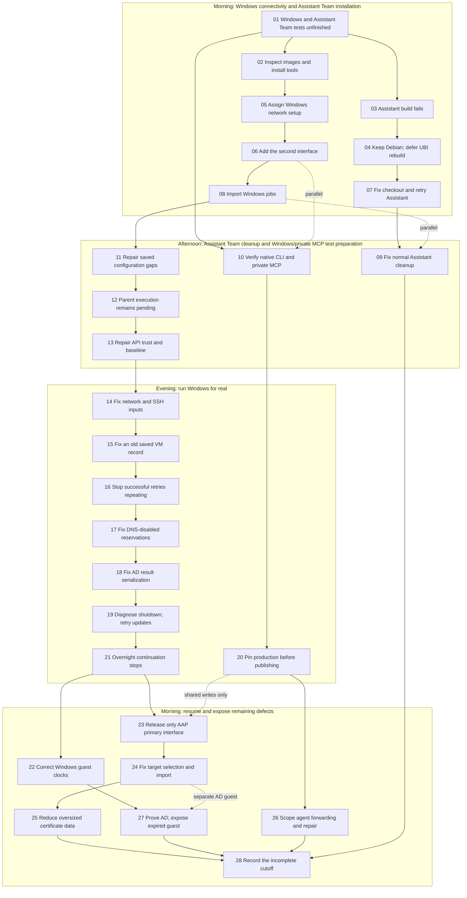

# Project Decision/Action Path Flowchart

**Pilot window:** 5 November 2026, 08:43:12 UTC → 6 November 2026, 08:43:12 UTC.

This is a retrospective of one day, not a current deployment status page. It
follows the main chat messages and existing decision histories. Expand a numbered
heading below the diagram for the decision, problem, response, outcome and timing.
Mermaid automatically sizes the diagram when it is rendered. GitHub Markdown
cannot expand a diagram node on click or redraw its layout, so the matching
native collapsible details remain below the diagram. For node-click toggling,
use the additional [HTML companion](project-decision-action-path-flowchart.html):
download it and open it locally; its diagram loads a pinned Mermaid runtime
from the internet.

The essential demo is: deploy a fresh AAP, import a use case, run its infrastructure
and application jobs, demonstrate the result, clean up its disposable resources,
and use the new AAP to install its successor. Importing CaC alone proves only the
configuration import. At the cutoff, several components worked but this whole
sequence was still incomplete.

## Where the day went

| Contributor | Evidence and meaning |
| --- | --- |
| Missing repeatability | The original environment already had a second network interface and working trust/network settings. Their absence on a fresh AAP exposed steps missing from automation. |
| Rework in newer automation | Ownership compatibility, retry termination, DNS-disabled networks, PowerShell serialization, primary-interface selection and oversized runtime data caused separate failures. Each required a focused fix and another real run. |
| Real installation time | One successful Assistant configuration took about **39 minutes**; a failed AD update run took about **28 minutes**; its successful retry took **56 minutes**. These are stated run durations, not time spent writing code. |
| Parent continuation failure | After AD completed at **00:19 UTC**, the next steps did not resume until the morning check at **07:34 UTC**: about **7 hours 15 minutes** of stalled continuation. The assistant explicitly acknowledged that no user decision was missing. |
| Pending execution and approval | A parent operation remained pending from **16:36:59 to 20:21:05 UTC**: **3 hours 44 minutes 6 seconds**. Records corroborate an approval-gated execution; the authorization-answer time is unavailable. This measures the pending interval, not the exact time a person spent reviewing it. A separate focused test waited roughly **14 minutes** the next morning before a writable temporary-path correction let it run in **0.4 seconds**. |
| Overbroad sequencing | Private MCP work was initially held until all Windows testing and cleanup. The assistant later acknowledged that only overlapping writes to shared AAP configuration needed serialization. |
| Coordination and reporting | Repeated status reports and restored summaries did not advance jobs. Some repeated an unverified result after the job had finished. These are grouped here rather than counted as new work. |

These intervals overlap with other workers' activity. **Do not add them together**
as a partition of the 24 hours. No reliable total for active implementation time
can be derived from the chat. A phase's first and last messages bound an observed
interval; they do not measure uninterrupted work.

## Overview

Solid arrows show the main dependency or sequence. Dotted arrows show work that
could proceed alongside another lane. Numbers match the expandable sections.

## Expandable decision and action record

Timing labels: **measured** means a recorded timestamp interval or run duration;
**reported** means an elapsed value stated in the main messages; **unknown** means
no dependable duration was available. Times below are UTC. On 5 November the date
is omitted; after midnight, entries explicitly say 6 November. Run references
such as **13-A** are neutral references within this document, not controller IDs.

<strong>01 — Windows and Assistant Team end-to-end tests remain unfinished</strong>

At 08:44, Assistant installation was already running, Windows preparation and
private CLI/MCP work remained unfinished, and successor deployment had not been
proved. A running job carried into this window is not counted as a fresh launch.
OpenShift was unavailable; the user later explicitly changed that test from
blocked to **deferred** at 15:50.

At 15:53 the user directed a smaller, functional demo: keep useful implementation,
proportionate target checks and real end-to-end verification; remove complexity
that does not help the demonstration. At 15:58 the user clarified that observed
failures must be fixed in automation rather than accepted as manual-reset work.
This changed priorities, not the prohibition on changing unintended resources.

**Timing:** carried-in activity; total duration unknown. **Sources:** main chat
08:44, 15:50–15:58; AutoDeploy decision history and README simplification
implementation `b62e89d`.

<strong>02 — An image-inspection detour adds work before the actual Windows test</strong>

The user approved the missing guest-image tooling for the test hypervisor at
08:48. Package run **02-A** failed by 08:59 because its saved source policy
predated the Assistant guest grant; the live resource itself was not changed by
that failure. The saved copies were aligned through the available API path.
Retry **02-B** succeeded by 09:22 and installation was verified.

Read-only Windows-image inspection then met an NTFS/distribution restriction.
The user questioned why that inspection was needed when the prepared images
already had WinRM. At 10:46 the user explicitly removed this extra prerequisite.
That did not claim the new guests were tested: actual runtime connections still
needed to pass. Earlier NTFS approval/installation was reported again in this
window and is not counted as a new installation here.

**Timing:** 08:48–10:46 observed discussion/attempt interval; individual package
runtimes unknown. **Sources:** main chat 08:48–09:46, 10:46; hypervisor configuration changes
`63cd3e5`, `766ba1f`.

<strong>03 — Assistant container build exposes a certificate/bootstrap mismatch</strong>

The carried-in Assistant installation **03-A** failed by 08:46 while building its
CLI container, after OS prerequisites had completed. The inherited Debian-based
container used HTTP package repositories while the new environment allowed only
HTTPS egress. Simply changing those repositories to HTTPS also required CA trust
inside the minimal image. Host curl/wget trust did not establish container trust.

A proposed bundled-CA bootstrap was prepared with focused checks, but it was a
choice awaiting the user's direction, not a completed deployment. Separately,
the Windows credential had acquired stricter certificate validation without the
necessary CA. The user retained the existing controlled lab policy at 10:50;
that decision is distinct from the Assistant package-download choice.

**Timing:** run started before the window; remaining duration unknown. The
08:46–11:45 discussion is not all active implementation. **Sources:** main chat
08:46, 09:09, 09:41, 10:50, 11:14–11:45; Windows `b0bf1af`, AutoDeploy `276ad84`.

<strong>04 — Keep the existing Debian image and HTTP downloads; defer UBI10</strong>

At 11:45 the user chose to keep the current Debian container and HTTP downloads
for this demo. A narrowly scoped Assistant HTTP allowance was implemented in
the existing recovery-isolation path; this was not a general removal of guest
isolation. Publication, saved policy and the actual grant were verified before
the next successful installation.

The UBI alternative was researched at the user's request. Both hypervisors and
the relevant guest exposed the required CPU instruction set according to the
12:01 report. At 12:21 the user selected a UBI10 Node.js image as the **deferred
rebuild target**. This was a future task, not a UBI runtime test or completed
migration. The temporary source-download choice and permanent rebuild plan were
recorded separately.

**Timing:** decision at 11:45; live grant reported verified by 14:55. Work overlapped
other lanes; active effort unknown. **Sources:** main chat 11:25–12:21,
14:53–14:55; AutoDeploy `85ee77d`, hypervisor configuration `fa4468a`.

<strong>05 — Decide that Windows infrastructure owns the extra AAP interface</strong>

By 11:08, testing exposed a missing prerequisite: the original AAP already had a
second interface on the Windows network, but cloning its OS image did not copy
that VM hardware. CaC imported into a fresh AAP therefore did not reproduce the
original machine's connectivity.

The user asked whether this belonged in the AAP OS setup or Windows deployment.
At 12:39–12:52 the user chose the existing AIOps-style pattern: importing CaC
creates jobs; the Windows infrastructure job prepares its complete environment,
including the optional AAP interface and persistent RHEL connection. It does not
silently launch infrastructure during the API-only CaC import.

**Timing:** first report 11:08 → agreed direction 12:52; discussion interval, not
measured coding time. **Sources:** main chat 11:08, 12:25–12:52; Windows network
ownership decision and implementation `1c06083`.

<strong>06 — Implement interface setup, ownership and normal cleanup</strong>

The Windows and shared lifecycle paths added the declared interface, persistent
NetworkManager configuration and saved ownership needed to remove only what the
demo created. Review caught configuration drift and the need to capture state
before hot-plugging. Existing cleanup paths were adapted rather than granting
unowned-resource deletion.

By 14:32 the reported checks covered the shared implementation and playbook
syntax. Public shared code was published by 14:42; Windows code followed. These
checks supported a runtime attempt; they did not prove the complete Windows
workflow. Later live failures show why that distinction mattered.

**Timing:** 12:53–14:43 observed implementation/publication interval; overlapping
work, active duration unknown. **Sources:** main chat 12:53–14:48; AutoDeploy
`eb806b7`, Windows `1c06083`.

<strong>07 — Fix a deleted checkout reference and complete Assistant installation</strong>

The Assistant retry first stopped at stale saved-policy preflight. A later
failure referenced a plugin in a temporary checkout that had already been
removed. The focused fix corrected that existing checkout dependency rather
than relaxing identity checks. The receiving policy was refreshed through
normal CaC, then the existing configuration job was retried.

Run **07-A** completed successfully by 15:30, after about **39 minutes**. It
passed the earlier package/bootstrap failures with the exact approved HTTP
grant. This established a working Assistant configuration on its disposable VM;
it did not prove the separate private AAP repair scenario.

**Timing:** successful run duration **reported ~39 minutes**; failed precursor
runtimes unknown. **Sources:** main chat 13:00–13:12, 14:53–14:55, 15:30;
Assistant/shared decision histories and subsequent lifecycle correction `41c77d2`.

<strong>08 — Install Windows definitions, then repair obsolete workflow nodes</strong>

The Windows CaC import installed the use case and populated its planned inventory
entries. At 15:15 the report counted 35 Job Templates, but found four obsolete
workflow nodes. The workflow was corrected to 29 nodes and validation was moved
ahead of mutations. Saved reset bindings and the intended host rows were checked.

Import run **08-A** subsequently succeeded by 16:58, taking about **3 minutes
57 seconds**. This proved the definitions were installed and linked; no Windows
VM had yet been created by that import. The worker then waited for the parent
to release the actual runtime test. Concurrent private bootstrap edits from
another use case were preserved.

**Timing:** 14:48–16:58 observed import/correction interval; **08-A measured
236.7 seconds**. **Sources:** visible worker outcome 16:58 and main chat
14:48–15:52; Windows `88fe3e7`.

<strong>09 — Normal Assistant retirement exposes two cleanup defects</strong>

After installation, normal retirement preview passed. Apply removed the VM and
its physical resources, but deleting the inventory entry failed. The cause was
specific: AAP refuses to remove a host from the inventory being used by that
same active job. Cleanup was changed to run from an existing separate execution
inventory while keeping its resource API scope unchanged.

A subsequent preview exposed a legacy null-to-empty-string comparison; the
existing focused fix was reused. CaC refresh **09-A** succeeded by 16:45.
Preview **09-B** and apply **09-C** then passed by 16:49, removing the remaining
entry through the normal automation. No manual deletion was substituted.

**Timing:** 15:30–16:49 observed lifecycle interval; individual retry runtimes
unknown. **Sources:** main chat 15:30–16:27; visible worker outcomes 16:37–16:49;
AutoDeploy `41c77d2`, Windows reset compatibility `a93b3ea`.

<strong>10 — Native CLI installation and two read-only MCP calls work</strong>

A separate native Claude installation run **10-A** launched at 11:11 and was
reported successful at 11:24. It verified the private Linux and monitoring MCP
connections without a model invocation. This deployment was distinct from the
Assistant container discussed earlier.

Later, one Vertex-backed model invocation made exactly two read-only MCP calls
and checked the selected identities. The reported result was successful:
**16.5 seconds, three turns, approximately $0.19**. Existing configuration was
preserved. This was useful connection proof, but no alert, EDA activation,
repair-job launch or service outage was exercised.

**Timing:** installation 11:11–11:24 observed message interval; exact runtime
unknown. Model test **reported 16.5 seconds**, confirmed in visible worker
messages at 16:14–16:19. **Sources:** main chat 11:11–11:24, 16:16;
visible worker outcome 16:19.

<strong>11 — Saved policies and missing bootstrap credentials interrupt backfill</strong>

Re-running ordinary AutoDeploy configuration was needed to publish selected
private MCP metadata and provision missing repository bootstrap credentials.
A receiving import **11-A** stopped at a protected CoP task. Readback showed
inventory/host updates had completed, but an unrelated new use-case template
could not be created because its required credentials were absent.

This was not proof that all preceding changes rolled back. The next action was
to complete normal base provisioning and refresh only the stale saved policy
fields. Concurrent reader/Vault bootstrap entries from another worker had to be
retained. Endpoint/token mapping stayed instance-specific; no new auth store or
SSH API fallback was introduced by this correction.

**Timing:** import launched 16:26, failure reported 16:29; exact job runtime
unknown. Morning completion appears in section 24. **Sources:** visible worker
messages 16:24–16:31; main chat 16:27, 20:32 and 6 November 07:38–07:41;
AutoDeploy `8237ce6`.

<strong>12 — A pending parent operation delays the next live test</strong>

The parent entered a pending approval-gated execution at 16:36:59. It returned at
20:21:05, when completed worker outcomes were delivered together. During this
interval the Assistant cleanup and Windows import finished in their own lanes,
but the next Windows runtime test was not released by the parent.

The records measure **3 hours 44 minutes 6 seconds pending**, not that much shell
execution or coding. They do not reveal the exact approval-answer timestamp, so
this cannot be attributed entirely to human review. It is distinct from the
later overnight continuation failure. The next main-chat action at 20:21
acknowledged the finished imports and proceeded to live Windows testing.

**Timing:** **measured pending interval**; allocation between approval handling,
execution availability and other waiting is unknown. **Sources:** parent
operation boundary timestamps, corroborating visible outcomes at 16:49/16:58
and main-chat continuation 20:21. No command/action-list interface is reproduced.

<strong>13 — Repair API certificate trust before capturing the Windows baseline</strong>

Initial Windows baseline run **13-A** failed at ownership collection before any
VM creation. A safer diagnostic retry **13-B** exposed the real certificate
validation error. The relevant existing credential lacked the new AAP's CA.
The CA was added without replacing unrelated credential values, followed by
normal CaC refresh **13-C**.

Baseline retry **13-D** succeeded by 20:55 and saved the immutable pre-demo state.
The clean deployment workflow **13-E** then started. This was an authentication
and repeatability defect, not evidence that the original environment had never
worked. The original environment's pre-existing trust was not reproduced.

**Timing:** 20:26–20:55 observed diagnostic/fix/retry interval; individual run
durations unknown. **Sources:** main chat 20:26–20:55; Windows safe error
reporting `3a59989` and certificate correction recorded in private decision history.

<strong>14 — Fix network precedence and multiline SSH credential handling</strong>

Workflow **13-E** (continued here) stopped at network/SSH checks. A generic network default was
overriding the AD deployment's selected network. The precedence fix was published
and the specific path retried. A second check unnecessarily demanded every
recorded SSH key algorithm; one correctly pinned key was sufficient.

Clean workflow **14-B** then exposed a different problem: the execution
environment received only the first line of a multiline known-hosts value.
Private-address pins were on later lines. Existing pinned names and addresses
were represented together without disabling host-key verification. Normal CaC
refresh **14-C** passed; clean workflow **14-D** started at 21:20.

**Timing:** 20:57–21:20 observed sequence, exact run durations unknown.
**Sources:** main chat 20:57–21:20; Windows `1f579b1`, `0108c05`.

<strong>15 — Remove one redundant legacy ownership field</strong>

The next source preflight failed with its useful reason hidden by protected
logging. A focused safe diagnostic showed that the legacy saved ownership record
contained one redundant field rejected by the newer schema. Its eight relevant
identity fields were still valid. Only the obsolete field was removed from the
encrypted record; identity matching was retained.

Workflow **15-A** passed the previous guards by 21:36 and proceeded to network
readback and ownership publication. The user asked why imported definitions did
not immediately work: the explicit answer was that successful CaC import had
not tested the complete runtime deployment on the new hypervisor.

**Timing:** 21:25–21:36 observed diagnostic/correction interval; exact runtime
unknown. **Sources:** main chat 21:25–21:36; Windows `7233188` and associated
private ownership-record correction.

<strong>16 — Stop a retry loop after successful network setup</strong>

At 21:41 the worker found queued retries continuing after the network transaction
had already succeeded. Only the affected attempts were stopped. The fix made a
successful transaction terminate that job's retry path, then verified that saved
ownership still matched the actual network before continuing.

Workflow **16-A** reused the verified completed setup. By 21:49 it had moved on
to disk cloning; it did not repeat or broaden the successful network changes.
This was a new retry-control defect in the automation, rather than a missing
prerequisite on the old environment.

**Timing:** 21:41–21:49 observed stop/fix/continuation interval; exact runtime
unknown. **Sources:** main chat 21:41–21:51; Windows `a0a569c`.

<strong>17 — Handle a DNS-disabled network and continue safe disk copies</strong>

Two guest creations succeeded. Three others stopped after copying disks because
the reservation helper tried to add DNS records to a libvirt network that
intentionally had DNS disabled. The correction skipped DNS work only for that
actual network setting while preserving DHCP reservation checks.

The failed attempts had left unbooted copies. Continuation was restricted to the
expected pristine copy, with no existing VM ownership or disk references and a
matching source. Normal creation retries **17-A**, **17-B** and **17-C** launched
at 22:16–22:17; all five guest creations were successful by 22:22. Successful
creations were preserved.

The user also requested cleanup of standalone Python helpers, custom plugins,
modules and embedded scripts. That larger readability/certified-collection
review was recorded in the existing task tracker and Git overview. The inventory
reported 83 non-test Python files across four related repositories, plus embedded
YAML blocks; their consolidation was not claimed complete during these repairs.

**Timing:** first failures around 21:50–22:00 → all creations verified 22:22;
exact per-guest runtimes unknown. **Sources:** main chat 21:51–22:22;
Windows `7e3cada`, AutoDeploy `3f5c7e2`, `632d2cb`.

<strong>18 — Diagnose AD validation instead of changing its network</strong>

The first AD configuration attempts stopped at validation. An inherited update
URL was investigated but contained no URLs, so it was not established as the
cause. Diagnostic retries **18-A** and **18-B** made the actual provenance error
visible.

PowerShell's default serialization depth had truncated nested address data:
validation received a string where it expected a list. The existing task's
output depth was corrected; no guest-network change or validation bypass was
needed. Retry **18-C** started by 22:37 and passed that previously failing check.
Job numbers mentioned in the chat identified receiving-controller runs, not VMs
or release versions.

**Timing:** 22:22–22:37 observed investigation/fix interval; individual failed
run durations unknown. **Sources:** main chat 22:22–22:49; Windows `6d3f45f`,
`799dc3d`.

<strong>19 — A licensing shutdown interrupts AD updates; guarded retry succeeds</strong>

AD update run **19-A** passed network validation and guest isolation release,
then waited for a VM that had powered off. It failed after about **28 minutes**.
One identity-checked start and normal diagnostic job **19-B** showed that the
Windows evaluation service had requested shutdown. After restart, that guest
reported a valid evaluation with 180 days remaining; the discrepancy was not yet
explained and no activation/rearm was performed.

A license readiness guard was added before updates. Retry **19-C** launched at
23:22 and completed on 6 November at **00:19**, after **56 minutes**. The later
verification reported six updates installed, none remaining and no pending
reboot. Other guests, source images and the immutable baseline were preserved.

**Timing:** **19-A reported ~28 minutes**; **19-C reported ~56 minutes**.
The latter started within this window and finished within it. **Sources:** main
chat 23:07–23:22 and 6 November 07:34–07:38; Windows `e22e5c7`, `9bcf202`.

<strong>20 — Protect the tested production runner before publishing the new one</strong>

Private AAP MCP support and a bounded repair runner were prepared, but publishing
main would also affect the existing production consumer. The user explicitly
approved pinning that project to its tested commit before publication for the
test AAP. The pin and successful project-sync run **20-A** were verified; other
project settings were preserved. New public/private code was then published.

Live MCP testing had been held behind all Windows testing and cleanup. When
questioned, the assistant acknowledged that this was overly conservative: MCP
itself does not depend on Windows. Only simultaneous writes to shared saved
AAP configuration needed to be serialized. Read-only checks could proceed.

**Timing:** approval 22:42 → pin verified 22:48; publication reported 22:48–22:49.
Broader hold duration unknown and overlaps Windows work. **Sources:** main chat
22:37–22:53; AIOps bounded-runner change `8422662` and published checkpoint
`0f16827`.

<strong>21 — Successful overnight work does not trigger the next stage</strong>

AD updates completed at 00:19 on 6 November. No subsequent runtime job followed.
At 07:34 the parent finally checked the result; no workers were active. It
acknowledged that Windows was waiting for its next instruction and MCP work was
waiting for review of prepared saved-data changes. **No user decision or
permission was missing.**

The parent also acknowledged stale reports: an unverified running status had
been repeated after completion. Both workers resumed around 07:35 with explicit
instructions to continue authorized stages, coordinating only shared writes.
Restored copies of earlier chat and repeated reports are not counted here as
fresh implementations, launches or fresh failures.

**Timing:** completion 00:19 → result checked 07:34: **about 7 hours 15 minutes**
of stalled continuation. This is not seven hours of job runtime. **Sources:**
main chat 6 November 07:33–07:46, including the explicit explanation of the hold.

<strong>22 — Diagnose another shutdown and align regular Windows guests to UTC</strong>

The regular newest Windows guest was powered off. After verifying its identity,
one diagnostic start and inspection run **22-A** confirmed another licensing
shutdown. Its clock was nine hours ahead: virtual hardware supplied the
hypervisor's local time while the guest used a different time zone.

All four regular guests had the mismatch. The existing preparation was corrected
to pair a UTC virtual clock with UTC guest settings. Persistent hardware-clock
changes were verified without altering guest identity, disks or interfaces.
The dedicated AD guest, core VMs and golden images were excluded. License state
would be reread after actual time correction; no activation, rearm or extra
network grant was included.

**Timing:** diagnostic start/inspection around 07:46–07:53; persistent correction
verified 08:00. Individual diagnostic runtime unknown. **Sources:** main chat
6 November 07:38–08:02 and visible worker outcomes 07:57–08:00;
Windows `0675643`, `e842b5c`.

<strong>23 — Keep final AAP release primary-only; remove an avoidable test wait</strong>

Normal base-configuration run **23-A** completed earlier configuration but failed
its final release preflight. The shared interface enumerator now included the
Windows-owned second interface; final AAP release intentionally grants only the
primary interface. The fix aligned identity comparison with that existing
boundary, preserving verification and secondary isolation.

A focused regression was first attempted with unwritable temporary paths. Its
approval-gated retry remained pending for about 14 minutes. The parent stopped
that wait; using writable temporary paths made the check pass in **0.4 seconds**.
The fix was published, and normal retry **23-B** succeeded before the imports.
Source-controller job numbering caused concern, so actual targets were checked:
only the test hypervisor and test AAP were managed; source-side saved AAP
inventory fields changed, not the production hypervisor's OS, VMs or firewall.

**Timing:** **23-A measured 2 minutes 48 seconds**; **23-B measured 2 minutes
52 seconds**. Test wait **reported ~14 minutes**, overlapping other work.
**Sources:** main chat 6 November 07:41–08:08; AutoDeploy `437fe9f`, documentation
release **0.46.3**.

<strong>24 — Fix target selection, finish bootstrap and verify the receiving surveys</strong>

Successful base configuration published selected private MCP metadata and the
missing bootstrap credentials. AutoDeploy import **24-A** then stopped before
changes because the physical VM name had been supplied where the inventory name
was required. The corrected input was used for **24-B**, which succeeded by
08:15.

A separate successor-readiness review found that three receiving stage templates
could not accept a new instance name. Their surveys were updated to require the
exact Stage 01 VM name, preserving other settings, credentials and labels.
Normal CaC import and independent readback verified the correction. The importer
selects an inventory entry, while later infrastructure stages select a physical
VM; documentation now distinguishes these inputs. This prepared successor
selection, but did not actually deploy a successor.

**Timing:** first import failure/correction 08:09–08:11; successful import
**measured about 2 minutes 5 seconds**; survey verification reported 08:16.
**Sources:** main chat 6 November 08:08–08:16 and visible worker outcome 08:16;
survey implementation `1c54154` in encrypted configuration history.

<strong>25 — A full CA bundle makes the AIOps import too large</strong>

AIOps import **25-A** failed while updating the existing repair runner. The actual
reason was HTTP 413: 147 root certificates had expanded encrypted runtime data
past the proxy's 1 MiB request limit. The response was to carry the installed
AAP issuer, not increase the limit or disable TLS verification.

One approximately 2 KiB issuer certificate verified both the selected API and
private MCP identities; ordinary provider trust stayed intact. The producer fix
was published as AutoDeploy **0.46.6**. Corrected encrypted stores/runtime were
published and verified by 08:41, reducing runtime data to about **18 KiB** while
preserving tokens, endpoints and other instances. Normal base republishing
**25-B** was running at the cutoff. Its later outcome is outside this audit.

**Timing:** **25-A measured about 1 minute 45 seconds**; diagnosis/correction
08:21–08:41 observed interval. **Sources:** main chat 6 November 08:15–08:33;
visible worker outcomes 08:31–08:42; AutoDeploy `bde1120`, documentation `7b186c6`.

<strong>26 — Complete the missing agent alert-to-repair wiring without a public MCP</strong>

Read-only review found that the website forwarding action worked, but the
inherited unfiltered agent action remained disabled. The existing event stream
already served the website and agent activations; no new stream or credential
was needed. A scoped action was added for only the selected demo agent trigger,
keeping inherited unfiltered forwarding disabled.

Acceptance was tightened to require at least one actual successful repair child,
not merely a model exit. The obsolete permission-bypass instructions were
removed. Focused checks and syntax/lint passed and the code was published.
The planned live test would stop only the selected agent once, observe alert →
EDA → bounded runner → existing repair job, then require a fresh monitoring
recovery. At cutoff, activation, fault injection and that full repair proof had
not run. MCP remained private.

**Timing:** review 07:57–08:03; scoped implementation/publication 08:05–08:18.
These are message intervals, active duration unknown. **Sources:** visible
worker review and outcomes 6 November 08:03–08:21; AIOps `c618d1f`, `17aaab1`.

<strong>27 — AD and LDAPS pass while the corrected clock exposes a real license failure</strong>

Independent AD deployment **27-A** ran alongside regular-guest work because it
changed a separate guest. Directory/DNS installation, forest creation and
subsequent LDAPS run **27-B** succeeded; certificate and LDAPS verification passed
by 08:33.

Windows basics **27-C** applied UTC correction to all four regular guests. The
newest guest still reported an expired evaluation after its clock was corrected;
the worker requested a delayed reread before considering activation access.
Thus the clock repair succeeded, but the complete regular-guest configuration
was not established as successful. A real license prerequisite remains distinct
from the earlier incorrect-clock defect. No activation or license alteration was
performed within this window.

**Timing:** **27-A measured about 7 minutes 2 seconds**; **27-B measured about
2 minutes 9 seconds**. **27-C measured about 7 minutes 52 seconds** and stopped
at its license guard. Overlapping jobs are not summed. **Sources:** main chat
6 November 08:21–08:33; visible worker outcomes 08:19–08:42;
Windows UTC change `e842b5c`.

<strong>28 — Freeze the evidence; do not call component progress end-to-end completion</strong>

At 08:43:12 the evidence supported successful Assistant install/normal retirement,
native CLI/private read-only MCP calls, all five Windows VM creations, AD
preparation/updates, directory deployment and LDAPS. AutoDeploy base retry and
receiving target surveys also passed.

Still unfinished were complete regular Windows configuration/patching, the
newest guest's license prerequisite, the corrected AIOps import/installer,
agent alert-to-repair demonstration, successor deployment and the later
conditional retirement/rebuild sequence. OpenShift testing was deferred, not a
missing permission. No later successful job is pulled backward into this window.

The user requested this retrospective at 08:36 and chose Markdown with separate
expandable sections by 08:42. That documentation decision did not itself finish
any deployment. The most useful next execution step was to verify the pending
normal publication, resolve the observed Windows prerequisite and continue the
remaining functional tests without another unnecessary parent hold.

**Timing:** exact audit cutoff, not a deployment completion timestamp.
**Sources:** main chat 6 November 08:33–08:43 and the final visible worker updates.

## Evidence, publication and limits

The narrative was checked against the local main conversation, clearly linked
visible worker outcomes and the related repositories' existing decision histories.
Underlying execution records were used only to corroborate timings and causes;
commands, process rows and raw action lists are deliberately not reproduced.
Repeated/restored history, quoted old results and periodic status messages were
not treated as new runs. Some delegated-message bodies were unavailable in clear
text; gaps are not filled with guessed activity or intent. This is a narrative
audit, not a claim to have reconstructed every underlying tool operation.

Public references use UTC times, generic resource roles and local run aliases.
Sensitive source records and the internal identifier mapping remain outside Git.
No AAP/API, hypervisor or monitoring query was made to produce this audit.

At the cutoff, the latest explicitly verified AutoDeploy publication was
**0.46.6 / `7b186c6`**. Windows **1.0.47 / `50063d4`** was a verified documentation-only publication
inside the window; its functional runtime remained **1.0.46 / `e608cf0`**. Assistant **1.11.9** was reported publication-verified; AIOps
publication was verified by commit, including `c618d1f` and its documentation
checkpoint. Formal tagged releases were not established by this audit.

The Markdown version uses standard Mermaid and native HTML details. In viewers
without Mermaid, its diagram remains readable as text; details depend on that
viewer's HTML support. The HTML companion embeds the same narrative and uses a
pinned Mermaid browser runtime plus a small allowlisted node-toggle handler.
Its content and detail headings remain usable if the runtime cannot load. It
requires no local server, backend or deployment component. The HTML toggle logic
and content parity were checked; real browser rendering was unavailable because
no browser executable was installed.
